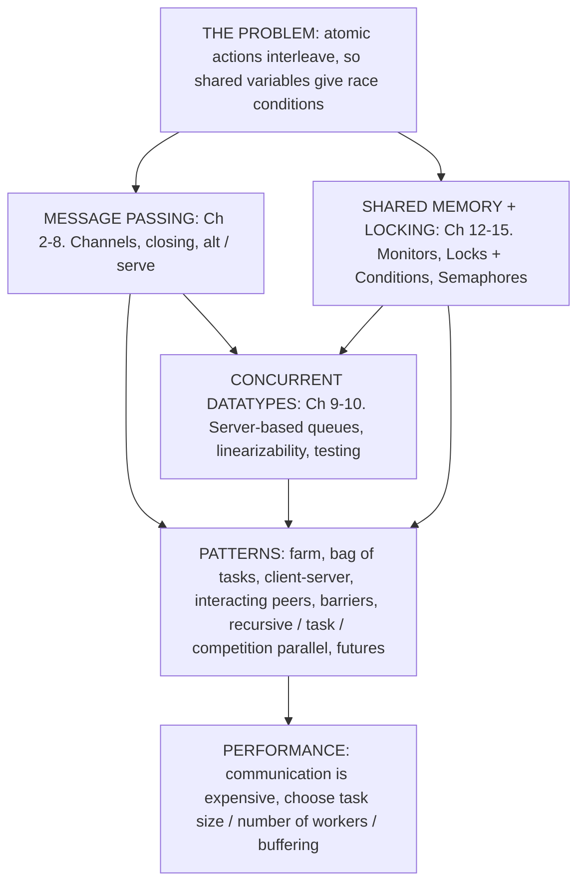

# Concurrent Programming — Course Summary

*Oxford CS Year 2 · Vincent Cheval (slides originally by Gavin Lowe, with thanks to Bernard Sufrin). Compiled from all 16 lecture chapters and the 4 problem sheets. All code is Scala 2.13 using **SCL** (Scala Concurrency Library, `import ox.scl._`).*

---

## Table of Contents

**Part 0 — The Big Picture**
- [0.1 The one problem the whole course solves](#01-the-one-problem-the-whole-course-solves)
- [0.2 Map of the course](#02-map-of-the-course)
- [0.3 How it all ties together: one problem, many implementations](#03-how-it-all-ties-together-one-problem-many-implementations)
- [0.4 Which tool when?](#04-which-tool-when)
- [0.5 The big takeaways](#05-the-big-takeaways-if-you-remember-nothing-else)
- [0.6 How to reason about a concurrent program (exam recipe)](#06-how-to-reason-about-a-concurrent-program-exam-recipe)

**Part I — Foundations**
1. [Introduction: Threads, Interleaving and Races](#1-introduction-threads-interleaving-and-races)
2. [SCL Basics](#2-scl-basics)

**Part II — Message Passing**

3. [Channels](#3-channels)
4. [Using Channels: Quicksort, Happens-Before, Disciplined Interaction](#4-using-channels-quicksort-happens-before-disciplined-interaction)
5. [Numerical Integration: Workers and a Controller](#5-numerical-integration-workers-and-a-controller)
6. [The Bag of Tasks Pattern](#6-the-bag-of-tasks-pattern)
7. [Alternation: `alt` and `serve`](#7-alternation-alt-and-serve)
8. [Clients and Servers](#8-clients-and-servers)
9. [Interacting Peers](#9-interacting-peers)

**Part III — Concurrent Datatypes & Synchronous Parallelism**

10. [Concurrent Datatypes and Linearizability](#10-concurrent-datatypes-and-linearizability)
11. [Partial Datatypes and Concurrent BFS](#11-partial-datatypes-and-concurrent-bfs)
12. [Synchronous Data Parallel Programming and Barriers](#12-synchronous-data-parallel-programming-and-barriers)

**Part IV — Shared-Memory Primitives**

13. [Monitors (`synchronized`, `wait`, `notify`)](#13-monitors-synchronized-wait-notify)
14. [Explicit Locks](#14-explicit-locks)
15. [Conditions and Targeted Signals](#15-conditions-and-targeted-signals)
16. [Semaphores](#16-semaphores)

**Part V — Patterns, Practice and Reference**

17. [Patterns of Concurrent Programming](#17-patterns-of-concurrent-programming)
18. [Problem Sheet Highlights (worked solutions)](#18-problem-sheet-highlights-worked-solutions)
19. [Cheat Sheets: SCL API, Glossary, Pitfalls, Concepts not to confuse](#19-cheat-sheets-scl-api-glossary-pitfalls)

---

# Part 0 — The Big Picture

## 0.1 The one problem the whole course solves

A **concurrent program** is several sequential threads running at once. Each thread is a sequence of **atomic actions**; running threads in parallel means their atomic actions get **interleaved** in an order you can't predict.

If two threads touch the same variable and at least one of them writes, different interleavings give different results. That's a **race condition**. The course is a toolkit for **disciplined interaction**: ways to coordinate threads so that *every* possible interleaving is correct.

> **The golden rule (from Ch. 3/4):** if two threads both access a variable (other than both just reading), there must be a **synchronisation** between them: after the first finishes with the variable and before the second starts using it.

Every tool in the course is a way to provide that synchronisation:

| Level | Tool | Synchronisation happens when… |
|---|---|---|
| High | **Concurrent datatype** (queue, set, barrier, …) | you call its operations; it hides the concurrency |
| Middle | **Channels** (`!`, `?`, `alt`, `serve`) | a send is matched with a receive |
| Low | **Monitors / Locks + Conditions** | a lock is released and then acquired; a signal is sent and received |
| Lowest | **Semaphores** | an `up` is matched by a `down` |

We also need ways to **reason** and **test**:
- **Reasoning:** invariants, the *happens-before* relation $`\preceq`$, counting messages and *rounds* (longest chain of messages).
- **Correctness for datatypes:** **linearizability**.
- **Testing:** compare against a sequential implementation; **logging** and checking traces; the **linearizability tester**.

## 0.2 Map of the course



| Ch. | Topic | Big idea in one line |
|---|---|---|
| 1 | Introduction | Interleaving + shared variables ⇒ races; we must avoid memory races. |
| 2 | Message passing | Threads share nothing and talk only via channels (CSP style). |
| 3 | Using channels | Recursive networks (quicksort); *happens-before*; channels also synchronise memory. |
| 4 | Numerical integration | **Farm**: controller splits the work equally across workers. Communication costs! |
| 5 | Bag of tasks | More, smaller tasks than workers ⇒ automatic **load balancing**; encapsulate concurrency in objects. |
| 6 | Alternation | `alt`/`serve` lets a thread wait on *several* channels; guards; fairness; dining philosophers/deadlock. |
| 7 | Clients & servers | A server thread owns the state; clients send requests and get replies. |
| 8 | Interacting peers | Centralised / symmetric / ring / tree topologies; count messages vs. rounds. |
| 9 | Concurrent datatypes | Total vs. partial ops; correctness = **linearizability**; how to test it. |
| 10 | Partial datatypes & BFS | Blocking ops; detecting termination; concurrent graph search. |
| 11 | Synchronous data parallel | Rounds separated by **barriers**; prefix sums in $`\Theta(\log n)`$ rounds; Jacobi iteration. |
| 12 | Monitors | `synchronized` for mutual exclusion; `wait`/`notify` instead of busy waiting. |
| 13 | Locks | Explicit `Lock`; fine-grained, striped locking, sharding. |
| 14 | Conditions | Several conditions per lock ⇒ **targeted** signals. |
| 15 | Semaphores | Stateful signals; mutex vs. signalling semaphores; **passing the baton**; counting semaphores. |
| 16 | Patterns | Recursive parallelism, competition, task parallel, futures, lock-free (CAS). |

## 0.3 How it all ties together: one problem, many implementations

The best way to see how the tools relate is that the course implements the **same abstractions over and over with different primitives**. Learn this table and you understand the course:

| Abstraction | Channels / server thread | JVM monitor (`synchronized`) | `Lock` + `Condition`s | Semaphores |
|---|---|---|---|---|
| Shared counter (mutual exclusion) | `BuffChan[Unit](1)` as a token (§4.6) | `synchronized{ x = x+1 }` (§13.2) | `lock.mutex{ x = x+1 }` (§14.1) | `mutex.down; x = x+1; mutex.up` (§16.2) |
| Total queue | `ServerTotalQueue` (§10.3) | — | — | — |
| Partial queue | `ServerPartialQueue` with a guard (§11.1) | `MonitorTerminatingPartialQueue` (§18 sheet 3) | `BoundedMonitorPartialQueue` (§15.4) | `SemaphorePartialQueue` (baton) / counting-semaphore queue (§16.6, §16.10) |
| Synchronous channel | SCL `SyncChan` | one-one `SyncChan` with `wait`/`notify` (§13.7) | `SharedSyncChan` with 3 conditions (§15.5) | `SyncChanSemaphores` with 3 semaphores (§16.8) |
| Barrier | `ServerBarrier` (§12.1), tree barrier (§18) | — | — | `Barrier` with passing the baton (§16.7) |
| One-place slot (producer/consumer) | — | `Slot`, `Slot2` (`notifyAll`) (§13.4) | `MonitorSlot` (targeted) (§15.2) | — |
| Bag of tasks / collector | distributor + collector threads (§6.3) | `synchronized getTask` (§18 sheet 3) | — | — |

**The progression in the course is from safe-and-easy to fast-and-fiddly:**
- Message passing is the easiest to reason about (no shared variables at all), works across networks, but servers can become **bottlenecks** and channel communication is expensive.
- Monitors/locks let threads share memory directly — faster, but you must get mutual exclusion and signalling exactly right.
- Semaphores are the lowest level; very flexible (*passing the baton*), very easy to get wrong.
- Lock-free programming (CAS) is beyond this course (→ *Concurrent Algorithms and Data Structures*).

## 0.4 Which tool when?

| Situation | Reach for |
|---|---|
| Pipeline / stream processing | Channels, closing channels to signal end of stream |
| Embarrassingly parallel numeric work | Farm or (better) **bag of tasks** |
| Work that generates more work (search, adaptive quadrature, quicksort) | **Bag of tasks with replacement** + termination detection |
| Shared resource with state (allocator, queue, set) | **Server** thread, or a **monitor** |
| Need to wait on any of several events | `alt` / `serve` (message passing) or a monitor with conditions |
| Threads computing in lock-step rounds | **Barrier** / **combining barrier** |
| Many threads on a big shared table | **Fine-grained / striped locking**, **sharding** |
| Need to wake a *particular kind* of waiting thread | `Lock` + **multiple conditions**, or semaphores with **passing the baton** |
| Need FIFO / selective wake-ups | One semaphore per waiting thread (**selective passing the baton**) |

## 0.5 The big takeaways (if you remember nothing else)

1. **Correct for every interleaving.** You can't test your way to correctness; you need an argument.
2. **No memory races.** Any two accesses to the same variable (not both reads) must be separated by a **synchronisation**. This also makes caching and compiler reordering harmless.
3. **Happens-before is your proof tool.** Chains of program order + communications (+ lock/semaphore handovers) show that one action precedes another.
4. **Encapsulate concurrency** in a few objects (servers, monitors, concurrent datatypes) so that reasoning is local. Their correctness criterion is **linearizability**.
5. **Check-then-act is a race** (TOCTTOU). Combine check and act into one atomic operation (total ops return `Option`; partial ops block).
6. **Waiting:** never busy-wait; always `while(!cond) wait()` / `await(test)`; remember who could be woken by each signal.
7. **Signals:** a condition `signal` with no waiter is **lost**; a semaphore `up` is **remembered**; an extra binary `up` is a **lost signal**.
8. **Deadlock = cycle of waiting.** Break it by ordering resources, limiting entry, asymmetry, or back-off. Blocking operations need **termination detection**.
9. **Liveness and fairness matter too:** starvation (readers/writers), unfair `alt`s, competing blocked clients.
10. **Communication is expensive.** Balance granularity (bag of tasks), count **messages and rounds**, and remember that more threads isn't automatically faster.

## 0.6 How to reason about a concurrent program (exam recipe)

1. **List the shared state** and, for each variable, *which threads may read/write it, and in which phases*.
2. **State invariants** (e.g. "`pending` non-empty ⇒ no resource free"; "`writers ≤ 1 ∧ (readers = 0 ∨ writers = 0)`"); check each operation preserves them, under mutual exclusion.
3. **Show the synchronisation** between conflicting accesses with happens-before chains ($`\prec`$ / $`\preceq`$).
4. **Safety:** argue nothing bad happens in *any* interleaving. Look for check-then-act gaps and lost or misdirected signals.
5. **Deadlock freedom:** show no **cycle** of threads waiting for each other (and that no thread waits for a signal that can no longer be sent).
6. **Liveness / fairness:** can someone wait forever while others progress (starvation)? Is the `alt` fair?
7. **Termination:** do all threads (including servers) eventually stop? Are channels closed / servers shut down?
8. **Cost:** count total messages and the longest chain (rounds); consider contention and bottlenecks.
9. **Testing plan:** compare with a sequential version; log with conservative intervals; use the linearizability tester for datatypes.

---

# Part I — Foundations

## 1. Introduction: Threads, Interleaving and Races

> [!NOTE]
> **📖 Key definitions**
> - **Thread:** a single sequential flow of control. Threads in the same process **share memory**.
> - **Process:** one or more threads with their own **protected address space**; processes communicate via the OS (expensive).
> - **Atomic action:** an action that happens **indivisibly**; no other thread can observe it half-done. *Example:* one load or one store of an `Int`. *Non-example:* `x = x+1`, which is three actions (load, add, store).
> - **Interleaving:** one possible execution: a single sequence merging every thread's atomic actions while keeping each thread's own order.
> - **Independent actions:** $`a`$ and $`b`$ are independent if doing $`a;b`$ or $`b;a`$ always gives the same result. *Independent:* two reads of `x`; writes to different variables. *Not independent:* a read and a write of `x`; two writes of `x`.
> - **Race condition:** two non-independent actions can happen in either order and **at least one order gives a wrong result**.
> - **Memory (data) race:** two threads access the same location, **at least one writes**, and there is **no synchronisation** between the accesses. This course forbids all memory races.
> - **Synchronisation:** an event that forces an order between actions of different threads: a channel communication, a lock release followed by acquire, a signal received by a waiter, a semaphore `up` consumed by `down`, a barrier.
> - **Safety property:** "nothing bad ever happens" (e.g. never two writers in the database). A violation is visible in a *finite* prefix of the execution.
> - **Liveness property:** "something good eventually happens" (e.g. every request is answered). Violated only by *infinite* behaviour (deadlock, starvation, livelock).

### 1.1 Processes vs. threads
- A **thread** is a single sequentially executing program. Several threads can share one **address space** and communicate through **shared memory**: low communication overhead, cheap context switches.
- A **process** is one or more threads sharing an address space. Different processes have separate, protected address spaces and communicate via operating-system calls: high overheads, expensive context switches.
- In this course we use **threads in one address space**. Programs that use *only* message passing could have their threads replaced by separate processes.

### 1.2 Why concurrency?
1. **Speed** — use many processors. Problems in the class **NC** ("Nick's Class") can be solved in polylogarithmic time on a parallel machine with polynomially many processors (e.g. matrix multiplication, determinant, maximal matching, polynomial GCD).
   - **Data parallel:** every thread does the same thing to its own part of the data.
   - **Task parallel:** different threads do different things.
   - ⚠️ Concurrency may *not* speed things up: communication and coordination costs can outweigh the gain.
2. **Multi-task systems** — one thread per independent task is far simpler than one monolithic loop (e.g. 1000 light controllers ⇒ 1000 threads; operating systems, GUIs, real-time controllers, games, simulations).
3. **Distributed computing** — the web, file servers, databases: necessarily concurrent, often client–server.

### 1.3 Architectures (background)
- **Uni-processor, multi-threaded:** the OS schedules threads; a thread runs until it blocks (e.g. I/O) or its time slice ends.
- **Thread states:** `Runnable --schedule--> Running --deschedule--> Runnable`; `Running --block--> Blocked --unblock--> Runnable`; `Running --done--> Finished`.
- **Shared-memory multiprocessors:** CPUs share memory over an interconnect; each CPU has its own **cache**, so caches may be **inconsistent**. The language's **memory model** says what consistency is guaranteed.
- **Multi-core:** several cores on a chip, private L1, shared L2/L3. Little speed-up unless the software is written to exploit it.
- **GPUs (GPGPU):** many cores, great at parallel floating point.
- **Distributed memory:** each CPU has private memory; communication by **message passing**.

### 1.4 The race: what goes wrong with undisciplined sharing

```scala
import ox.scl._
object Race{
  var x = 0
  def p = thread{ for(i <- 0 until 1000) x = x+1 }   // increment 1000 times
  def q = thread{ for(i <- 0 until 1000) x = x-1 }   // decrement 1000 times
  def system = p || q
  def main(args: Array[String]) = { run(system); println(x) }
}
```

This does **not** always print 0. It can print any value from $`-1000`$ to $`+1000`$. Why: `x = x+1` is not atomic. It's really `LD x; INC; ST x` (load, increment, store). Interleaving gives **lost updates**:

```text
p:  LD x (sees 0)        INC (local 1)                 ST x  -> x = 1
q:          LD x (sees 0)            DEC (local -1)          ST x -> x = -1
```

Both updates happened but only the last store survives.

### 1.5 The abstract model
- Some actions are **atomic** (e.g. one machine instruction).
- A sequential program executes a sequence of atomic actions; a concurrent program **interleaves** the atomic actions of its threads.
- Two actions are **independent** if swapping their order never changes the overall effect (e.g. actions on different variables, or two *reads* of the same variable). Interleaving independent actions is harmless.
- **Non-independent** actions (two writes of the same variable, or a read and a write) are dangerous.
- Threads run at unpredictable rates, so **your program must be correct for every possible interleaving**.

> **Sheet 1 Q1:** if $`P`$ does $`m`$ atomic actions and $`Q`$ does $`n`$, the number of interleavings is the number of ways to choose which of the $`m+n`$ slots belong to $`P`$:
> ```math
> \binom{m+n}{m} = \frac{(m+n)!}{m!\,n!}
> ```
> This grows explosively, which is why testing alone can never be exhaustive.

### 1.6 Even worse: caches and compiler reordering
- **Caching:** Java does not guarantee caches are kept coherent. Two threads can each work on their own cached copy of the same variable.
- **Compiler optimisations:** the compiler may reorder instructions if this is unobservable *sequentially*. For example

```scala
answer = <some value>
done = true
```
may be reordered to `done = true; answer = ...`, so another thread doing
```scala
while(!done){ }      // busy wait. DON'T DO THIS!
myAnswer = answer
```
can read a stale `answer`. (It might even loop forever if the read of `done` is hoisted out of the loop.)

**Good news:** if you avoid memory races by synchronising properly (channels, monitors, locks, semaphores), the **Java Memory Model** guarantees all these problems disappear.

### 1.7 Key definitions
- **Race condition:** two non-independent actions can occur in either order, and at least one order gives a wrong result.
- **Memory race:** two threads concurrently perform non-independent actions on the same memory location. **This course avoids all memory races**: formally, any two non-independent memory actions must be separated by a synchronisation.
- **Safety / correctness:** nothing bad happens; the results are correct (typically an invariant holds after every action).
- **Liveness / progress:** something good eventually happens; the system does something useful.
- **Latency:** requests are served quickly. **Throughput:** many requests are handled.

> [!TIP]
> **✅ Key takeaways**
> 1. A concurrent program must be correct for **every** interleaving. There are $`\binom{m+n}{m}`$ of them, so testing only ever samples a few.
> 2. Races come from **non-independent actions with no synchronisation between them**. The cure is always synchronisation, never luck or timing.
> 3. Without synchronisation, a thread may see another thread's writes **late, never, or in a different order** (caches + compiler reordering). The Java Memory Model only promises sensible behaviour for **race-free** programs.
> 4. Concurrency is used for **speed**, for **structuring multi-task systems**, and because **distributed systems** are inherently concurrent. Speed is not guaranteed: coordination costs.
> 5. Correctness has two halves: **safety** (nothing bad) and **liveness** (something good happens). Also consider **latency** and **throughput**.

> [!WARNING]
> **⚠️ Common misconceptions & errors**
> - ❌ "`x = x+1` is a single step." ✅ It's load, add, store; two threads can interleave and **lose an update**.
> - ❌ "My test passed 1000 times, so there's no race." ✅ Bad interleavings can be extremely rare. You need an *argument* (synchronisation, invariants).
> - ❌ "Once thread A writes `x`, thread B immediately sees it." ✅ Not without synchronisation: B may read a stale cached value forever.
> - ❌ "Statements run in the order I wrote them, as seen by other threads." ✅ The compiler/CPU may reorder independent statements (`answer = v; done = true` can become `done = true; answer = v`).
> - ❌ "Spinning on a flag (`while(!done){}`) is a valid way to wait." ✅ It's wrong under the JMM (the JIT can hoist the read, so it loops forever) **and** wastes CPU. Use proper blocking.
> - ❌ "Reads are always safe." ✅ Read + read is safe; a read **concurrent with a write** is a race.
> - ❌ "More threads = faster." ✅ Communication and coordination can dominate.

---

## 2. SCL Basics

> [!NOTE]
> **📖 Key definitions**
> - **`ThreadGroup`:** a *description* of zero or more threads. Nothing runs until you `run` or `fork` it.
> - **`run(p)`:** execute `p` and **block the caller until every thread in `p` has terminated**.
> - **`fork(p)`:** start `p` in the background and **return immediately** (used to start server threads).
> - **`p || q`:** parallel composition; it terminates when **both** have terminated.

SCL is Gavin Lowe's library, based on Bernard Sufrin's CSO (Communicating Scala Objects).

| Construct | Meaning |
|---|---|
| `thread{ code }` | A `ThreadGroup` that, when run, executes `code` |
| `thread(name){ code }` | Same, with a name (appears in thread dumps) |
| `p \|\| q` | Parallel composition of `ThreadGroup`s; terminates when **both** terminate |
| `\|\| (for(i <- 0 until n) yield t(i))` | Parallel composition of a collection |
| `run(p)` or `p.run` | Run `p` and **wait** for it to finish |
| `fork(p)` or `p.fork` | Start `p` running in **parallel** with the current thread and return immediately |

```bash
# compile and run (Scala 2.13), with the ox folder on the classpath
scalac -classpath .:path/to/ox Race.scala
scala  -classpath .:path/to/ox Race
```

> [!WARNING]
> **⚠️ Common misconceptions & errors**
> - ❌ "Writing `def p = thread{...}` starts a thread." ✅ It only builds a description; `run`/`fork` starts it (and each `run` of a `def` creates **fresh** threads).
> - ❌ "`run(server)` is how to start a server." ✅ A server loops forever, so `run` would never return. Use `fork`.
> - ❌ "`p || q` finishes when either finishes." ✅ It waits for **both**. A single thread blocked forever means `run` hangs.

---

# Part II — Message Passing

## 3. Channels

> [!NOTE]
> **📖 Key definitions**
> - **Channel:** a FIFO link carrying values from an output port to an input port. Values arrive **in the order sent**.
> - **Synchronous channel (`SyncChan`):** a send and its receive happen **at the same moment** (a *rendezvous*); whichever arrives first **blocks** until the other arrives. Capacity 0.
> - **Buffered channel (`BuffChan(k)`):** a send completes immediately if fewer than $`k`$ messages are waiting, and **blocks only when the buffer is full**; a receive blocks only when it's empty.
> - **InPort `??[A]` / OutPort `!![A]`:** the receiving / sending end, named from the **thread's** point of view.
> - **`out.endOfStream`:** the *sender* says "no more data". A sync channel closes; a buffered one closes once drained.
> - **`in.close`:** close the channel completely (often a *receiver* saying "I won't accept more").
> - **`Stopped`:** the exception family (`Closed`, `AltAbort`) meaning "this communication can never happen". `repeat`, `attempt` and `serve` catch it and end cleanly.
> - **CSP (Communicating Sequential Processes):** a style where sequential components share **nothing** and interact **only** by message passing.

### 3.1 The idea
Components (threads) **communicate only through channels**, the **CSP** (Communicating Sequential Processes) paradigm. Since no variables are shared, there are no memory races, and reasoning is local. Message passing is also *necessary* for distributed systems.

A channel is a **directional wire**: values sent at the **output port** (`chan!v`) come out of the **input port** (`chan?()`) **in the same order**.

### 3.2 Channels in SCL
- `Chan[A]` has two subtypes:
  - `SyncChan[A]`: **synchronous.** Whichever of `!`/`?` arrives first waits for the other; then both proceed together.
  - `BuffChan[A](size)`: **buffered / asynchronous.** A send succeeds immediately while fewer than `size` messages are buffered; the next send blocks until something is received. FIFO: the $`i`$-th receive returns the $`i`$-th message sent.
- `val c = new SyncChan[A]`; `c!v` sends; `c?()` receives and returns the value.
- Port types: `InPort[A]` (abbrev. `??[A]`) has `?()`; `OutPort[A]` (abbrev. `!![A]`) has `!`. A `Chan[A]` is both. "In"/"out" are from the **thread's** point of view.
- Polymorphic buffered channels need a `ClassTag`: `def f[A: scala.reflect.ClassTag] = new BuffChan[A](10)` (the buffer is an `Array[A]`).

A synchronous channel communication is like a distributed assignment:
```scala
{ val chan = new SyncChan[A]; run(thread{ chan!v } || thread{ x = chan?() }) }   // same effect as x = v
```

### 3.3 Simple components

```scala
def copy[A](in: ??[A], out: !![A]) = thread{ while(true) out!(in?()) }

def console[A](in: ??[A]) = thread{ while(true) println(in?()) }

def nats(out: !![Int]) = thread{ var n = 0; while(true){ out!n; n += 1 } }

/** Copy alternate values from in to out. */
def alts[A](in: ??[A], out: !![A]) = thread{ while(true){ out!(in?()); in?() } }
```
Typing parameters as `??`/`!!` documents what the thread does with each channel and gives type safety.

**Example: multiples of four.**
```scala
val x1, x2, x4 = new SyncChan[Int]
def system = nats(x1) || alts(x1, x2) || alts(x2, x4) || console(x4)
```
`nats` sends 0,1,2,3,…; the first `alts` passes 0,2,4,…; the second passes 0,4,8,…; `console` prints the multiples of 4. Making the channels `BuffChan[Int](10)` can smooth out speed differences; a **bounded** buffer stops a fast sender eating unbounded memory.

### 3.4 `tee` and generic components
```scala
// Version 1: outputs in a fixed order
def tee[A](in: ??[A], out1: !![A], out2: !![A]) = thread{
  while(true){ val v = in?(); out1!v; out2!v }
}
```
If the environment reads `out2` before `out1` (e.g. `println(out2?() + out1?())`), this **deadlocks**. **Generic components should make as few assumptions about their environment as possible**, so output concurrently:
```scala
def tee[A](in: ??[A], out1: !![A], out2: !![A]) = thread{
  while(true){ val v = in?(); run(thread{out1!v} || thread{out2!v}) }
}
```
(Creating two threads per value is moderately expensive. §7.4 gives a cheaper version using `alt`.)

### 3.5 Closing channels
To signal the end of a finite stream, **close the channel**:
- `in.close` closes an `InPort` (a receiver can say "I'll accept no more").
- `out.endOfStream` closes an `OutPort` for sending. On a **sync** channel this fully closes it; on a **buffered** channel receivers can keep receiving until the buffer is empty, then it's fully closed.
- Sending/receiving on a closed channel throws `Closed`, a subclass of **`Stopped`**.
- Closing an already-closed channel has no effect. `c.isClosed` tests it; `c.reopen` reopens it (pre: it is closed and nobody is using it).

**Propagate closure downstream:** catch the exception and close your other channels.
```scala
def alts[A](in: ??[A], out: !![A]) = thread{
  try{ while(true){ out!(in?()); in?() } }
  catch{ case _: Closed => in.close; out.endOfStream }
}
```

### 3.6 `repeat` and `attempt`
- `repeat{ cmd }` is like `while(true){ cmd }` but **terminates cleanly** if `cmd` throws a `Stopped` exception.
- `repeat(guard){ cmd }` is like `while(guard){ cmd }`, same rule.
- `attempt{ p }{ q }` acts like `p`, but if `p` throws `Stopped` it runs `q` instead.

```scala
def alts[A](in: ??[A], out: !![A]) = thread{
  repeat{ out!(in?()); in?() }
  in.close; out.endOfStream
}
```

> [!TIP]
> **✅ Key takeaways**
> 1. Pure message passing ⇒ **no shared variables ⇒ no memory races**, and each component can be reasoned about on its own.
> 2. **Synchronous** channels tie the states of sender and receiver together (easy reasoning). **Buffered** channels decouple their speeds (performance) but lose that guarantee.
> 3. Model end-of-data by **closing channels**. A component that sees a closed channel should **close its other channels** so termination ripples through the whole network.
> 4. Generic components should assume **as little as possible** about the order in which their environment communicates (`tee` that outputs in either order).

> [!WARNING]
> **⚠️ Common misconceptions & errors**
> - ❌ "A send on a buffered channel never blocks." ✅ It blocks when the buffer is **full**.
> - ❌ "After `c!v` returns, someone has received `v`." ✅ True only for **synchronous** channels.
> - ❌ "`endOfStream` on a buffered channel throws away buffered messages." ✅ Receivers can still drain the buffer.
> - ❌ "`repeat` catches any exception." ✅ Only `Stopped` (e.g. `Closed`). Other exceptions propagate.
> - ❌ Forgetting to close downstream channels. ✅ The downstream thread then waits forever and `run` **never returns**.
> - ❌ A `tee` that always outputs `out1` then `out2`. ✅ It deadlocks if the environment reads `out2` first.

---

## 4. Using Channels: Quicksort, Happens-Before, Disciplined Interaction

> [!NOTE]
> **📖 Key definitions**
> - **Happens-before $`a \preceq a'`$:** in a given execution, $`a'`$ occurs after or at the same time as $`a`$. Generated by: (1) program order within a thread ($`\prec`$); (2) a send happens before its receive; (3) on a **synchronous** channel, the send and receive happen together ($`\equiv`$).
> - **Strictly before $`a \prec a'`$:** $`a \preceq a'`$ and not simultaneous.
> - **Totally ordered chain:** $`m_1 \prec m_2 \prec \dots \prec m_k`$. Its length measures *sequential time*.
> - **Data-less channel:** `Chan[Unit]`, used purely to synchronise.
> - **Rule of disciplined interaction:** if two threads access a variable (not both only reading), there must be a synchronisation **after the first's last access and before the second's first access**.

### 4.1 Concurrent Quicksort (recursive network)
**Goal:** read a stream of `Int`s (end signalled by closing), output it sorted, then close.

```text
                 toLower --> [qSort] --> fromLower
   in --> [controller]                              --> out
                 toHigher --> [qSort] --> fromHigher
```

```scala
def qSort(in: ??[Int], out: !![Int]): ThreadGroup = thread("QSort"){
  attempt{
    val pivot = in?()
    val toHigher, toLower, fromHigher, fromLower = new SyncChan[Int]
    def controller = thread("Controller"){
      // Distribute: smaller values go low, others go high
      repeat{ val n = in?(); if(n < pivot) toLower!n else toHigher!n }
      toHigher.endOfStream; toLower.endOfStream
      // Collect: lows, then pivot, then highs
      repeat{ out!(fromLower?()) }; out!pivot; repeat{ out!(fromHigher?()) }
      out.endOfStream
    }
    run(controller || qSort(toHigher, fromHigher) || qSort(toLower, fromLower))
  }{ out.endOfStream }   // empty input stream: just close the output
}
```

**Testing pattern** (used throughout the course): random inputs, run, compare with a trusted sequential answer, repeat many times.
```scala
def doTest = {
  val xs = Array.fill(N)(scala.util.Random.nextInt(Max)); val ys = new Array[Int](N)
  val in, out = new SyncChan[Int]
  def sender   = thread{ for(x <- xs) in!x; in.endOfStream }
  def receiver = thread{ var i = 0; repeat{ ys(i) = out?(); i += 1 } }
  run(sender || qSort(in, out) || receiver)
  assert(xs.sorted.sameElements(ys))
}
```

**Practical 1, sorting networks:** built from **comparators** (input $`x_0, x_1`$, output $`\min(x_0,x_1)`$ on `out0` and $`\max(x_0,x_1)`$ on `out1`). A 4-input network uses 5 comparators: the first four route the smallest/largest to the top/bottom; the fifth sorts the middle two.

### 4.2 The happens-before relation
For actions in one execution (memory reads/writes, sends, receives), write $`a \preceq a'`$ ("$`a`$ happens before $`a'`$") if $`a'`$ occurs after, or at the same time as, $`a`$.

```math
a \equiv a' \iff a \preceq a' \,\wedge\, a' \preceq a \qquad\qquad a \prec a' \iff a \preceq a' \,\wedge\, a \not\equiv a'
```

$`\preceq`$ is a **preorder** (reflexive, transitive; *not* antisymmetric) such that:
1. **Program order:** if $`a`$ precedes $`a'`$ in the same thread, then $`a \prec a'`$.
2. **Send before receive:** if $`a`$ is a send and $`a'`$ its matching receive, then $`a \preceq a'`$ (sync or buffered).
3. **Synchronous = simultaneous:** on a synchronous channel the send and receive satisfy $`a \equiv a'`$.

Pairs unrelated by $`\preceq`$ can happen in either order, so you must check that either order is OK (no race).

### 4.3 Data-less channels: pure synchronisation
Use `Chan[Unit]` (the only value is `()`) to synchronise without passing data:
```scala
val c = new SyncChan[Unit]
run(thread{ print("Hello "); c!() } || thread{ c?(); println("world") })
```
```math
\texttt{print("Hello")} \prec \texttt{c!()} \equiv \texttt{c?()} \prec \texttt{println("world")}
```
With a **sync** channel you could swap `!` and `?` between the threads and it still works (the two ends happen together). With a **buffered** channel you could not: the send wouldn't wait.

### 4.4 Channels synchronise memory too
When two threads synchronise on a channel, **all writes before the synchronisation are visible after it**, and the compiler may not reorder across it.
```scala
val c = new SyncChan[Unit]; var x = -1
def p = thread{ x = 42; c!() }
def q = thread{ c?(); /* guaranteed to see x == 42 */ }
```

### 4.5 Rule for disciplined interaction
Threads *may* share variables, as long as: **if two threads access a variable (not both only reading), there is a (direct or indirect) synchronisation after the first finishes and before the second starts.** State clearly which threads may read/write each variable in each state.

### 4.6 Fixing the race with a buffered channel as a token
```scala
var x = 0
val c = new BuffChan[Unit](1)                       // holds at most one "token"
def p = thread{ for(i <- 0 until 1000){ c?(); x = x+1; c!() } }
def q = thread{ for(i <- 0 until 1000){ c?(); x = x-1; c!() } }
def main(args: Array[String]) = { run(p || q || thread{ c!() }); println(x) }  // put in initial token
```
Only the thread holding the token touches `x`, so it always prints 0, while still allowing every interleaving of *whole* updates.

**Q: would a `SyncChan` work?** Mutual exclusion still holds (a `c!()` hands the token directly to a waiting `c?()`), but at the very end the last thread's final `c!()` has **no receiver**, so it blocks forever and `run` never returns. The buffer lets the final token sit in the channel.

### 4.7 Objects and message passing: beware references
Sending an object sends a **reference**. Both threads now share it, so a race is possible.
```scala
def p(in: ??[String], mid: !![Person]) = thread{
  val pers = new Person()
  while(true){ val n = in?(); pers.name = n; mid!pers }   // BUG: same object every time
}
def q(mid: ??[Person]) = thread{ while(true){ val pers = mid?(); println(pers.name) } }
```
**What's wrong:** `p` mutates `pers.name` for the next message while `q` may still be reading the previous one (a memory race), so `q` can print the wrong name. **Fix:** create a `new Person` per message, or send a copy.

**Objects vs. threads:** both are modules. Objects usually have one active at a time and communicate by procedure calls (passing data *and control*). Threads are all active at once and communicate by messages (passing *data*).

> [!TIP]
> **✅ Key takeaways**
> 1. To prove that a read sees a write (or that something happens in order), build a **happens-before chain**: write $`\prec`$ send $`\preceq`$ receive $`\prec`$ read.
> 2. If two actions are **not related** by $`\preceq`$, they can happen in **either order**, so check that both orders are fine.
> 3. A channel communication also synchronises **memory**: writes before it are visible after it (JMM).
> 4. Sharing variables is OK **if** the accesses happen in phases separated by synchronisation, and you state who may access what, when.
> 5. Sending an object sends a **reference**, so that's sharing too.

> [!WARNING]
> **⚠️ Common misconceptions & errors**
> - ❌ "$`\preceq`$ is a partial order." ✅ It's a **preorder**: a sync send and receive satisfy $`a \preceq a'`$ and $`a' \preceq a`$ with $`a \neq a'`$.
> - ❌ "On a buffered channel the receive also happens before the send." ✅ Only send $`\preceq`$ receive.
> - ❌ "Two threads can share a variable as long as they don't touch it at exactly the same instant." ✅ They need a **synchronisation** between the accesses, otherwise caches/reordering break it.
> - ❌ "`mid!pers` copies the object." ✅ It sends a reference; mutating `pers` afterwards races with the receiver. Send a fresh or copied object.
> - ❌ "A `SyncChan` works as a mutual-exclusion token just like `BuffChan(1)`." ✅ The last thread's final `c!()` has no receiver and **blocks forever**.

---

## 5. Numerical Integration: Workers and a Controller

> [!NOTE]
> **📖 Key definitions**
> - **Data parallelism:** every worker runs the **same code** on a **different part** of the data.
> - **Farm (controller + workers):** a controller (*farmer*) splits the work, sends one piece to each worker, and combines the results.
> - **Trapezium rule:** $`\int_a^b f \approx \big(\tfrac{f(a)+f(b)}{2} + \sum_{i=1}^{n-1} f(a+i\delta)\big)\delta`$ with $`\delta = (b-a)/n`$.
> - **Speed-up / efficiency** *(standard terms, useful for analysis):* $`S(p) = T_1/T_p`$, $`E(p) = S(p)/p`$.

### 5.1 The trapezium rule
Split $`[a,b]`$ into $`n`$ intervals of width $`\delta = (b-a)/n`$:
```math
\int_a^b f(x)\,dx \;\approx\; \left( \frac{f(a)+f(b)}{2} + \sum_{i=1}^{n-1} f(a + i\delta) \right)\delta
```
(each interval contributes $`\tfrac{f(a+i\delta)+f(a+(i+1)\delta)}{2}\,\delta`$; interior points are counted twice, hence the shape above).

```scala
/** Pre: n*delta = right-left (up to rounding!). */
def integral(left: Double, right: Double, n: Int, delta: Double): Double = {
  require(n > 0)
  require(Math.abs(n*delta - (right-left)) < 0.000000001)  // == would fail due to rounding
  var sum: Double = (f(right)+f(left))/2.0
  for(i <- 1 until n) sum += f(left+i*delta)
  sum*delta
}
```

### 5.2 The farm (controller + workers): data parallelism
- Split $`[a,b]`$ into `nWorkers` equal ranges, one per worker.
- The controller sends each worker its task on a **shared** channel `toWorkers`; workers send results on a **shared** channel `toController`; the controller sums them.
- Channels can have **many senders and many receivers**.

```scala
private type Task = (Double, Double, Int, Double)     // (left, right, taskSize, delta)
private def mkChan[A: scala.reflect.ClassTag]: Chan[A] =
  if(buffering > 0) new BuffChan[A](buffering) else new SyncChan[A]
private val toWorkers = mkChan[Task]
private val toController = mkChan[Double]

private def worker = thread("worker"){
  val (left, right, taskSize, delta) = toWorkers?()
  toController!integral(left, right, taskSize, delta)
}

private var result = 0.0
private def controller = thread("controller"){
  val delta = (b-a)/n; val taskSize = n/nWorkers; val taskRange = (b-a)/nWorkers
  var left = a
  for(i <- 0 until nWorkers){ val right = left+taskRange; toWorkers!(left, right, taskSize, delta); left = right }
  result = 0.0
  for(i <- 0 until nWorkers) result += toController?()
}
private def system = (|| (for(i <- 0 until nWorkers) yield worker)) || controller
def apply(): Double = { run(system); result }
```

### 5.3 Testing floating point
The sequential version always gave `9.000449999999995` for $`\int_0^3 x^2\,dx`$ with 100 intervals; the concurrent one varied (`…999`, `…997`). **Why:** the controller adds sub-results **in whatever order they arrive**, and floating-point addition is **not associative**. So test for *approximate* equality:
```scala
assert(seqResult != 0.0 && Math.abs((seqResult-concResult)/seqResult) < 1E-7 ||
       Math.abs(seqResult-concResult) < 1E-10)
```
with random polynomials, random $`a,b,n`$, nWorkers, repeated millions of times.

### 5.4 Tuning: how many workers? how much buffering?
- Per-worker computation is $`O(1/\text{nWorkers})`$, but communication grows as $`O(\text{nWorkers})`$.
- Run time first falls like $`1/\text{nWorkers}`$, then rises like $`\text{nWorkers}`$ when communication dominates.
- For small $`n`$, the best number of workers is **less** than the number of hardware threads (profiling: workers spent < 25% of time computing, the rest waiting). For large $`n`$, slightly **more** workers than hardware threads helps the scheduler load-balance.
- Buffering helps when there are too many workers; with a sensible number it barely matters here (curiously, buffer size 1 was slower).

> **A rough mental model (not from the slides):** with total work $`W`$, $`p`$ workers and per-message cost $`c`$, $`T(p) \approx W/p + c\,p`$, minimised around $`p^{*} \approx \sqrt{W/c}`$. Bigger problems justify more workers.

**Experimental design:** timings are random; control noise and do statistics (means, 95% confidence intervals).

**Lesson:** *communication is expensive; the channel can be a bottleneck.*

> [!TIP]
> **✅ Key takeaways**
> 1. Per-worker **computation shrinks** like $`1/p`$ but **communication grows** like $`p`$, so there's an optimal number of workers that depends on problem size.
> 2. **Communication is expensive**: a shared channel can become the bottleneck.
> 3. Test a concurrent program **against a sequential one**, with random inputs, many times. For floating point, compare **approximately**.
> 4. Performance results are noisy: control the environment and use statistics (means + confidence intervals).

> [!WARNING]
> **⚠️ Common misconceptions & errors**
> - ❌ "The concurrent and sequential answers must be bit-identical." ✅ The controller adds results in **arrival order**, and floating-point `+` is **not associative**.
> - ❌ "`require(n*delta == right-left)`" ✅ This fails because of rounding; use a tolerance.
> - ❌ "Best number of workers = number of cores." ✅ For small problems it's fewer; for big ones slightly more can help load balancing.
> - ❌ "Buffering always helps." ✅ Here it barely mattered with a sensible worker count (buffer size 1 was even slower).

---

## 6. The Bag of Tasks Pattern

> [!NOTE]
> **📖 Key definitions**
> - **Load balancing:** spreading work so that **no worker sits idle** while others are still busy.
> - **Bag of tasks:** a pool of many small tasks (many more than workers). Each worker repeatedly **takes a task when it's free**, so faster workers automatically do more.
> - **Bag of tasks with replacement:** workers may **add new tasks** to the bag (e.g. split an interval in two).
> - **Task granularity:** how much work one task contains.
> - **Encapsulation (concurrent object):** hiding a concurrency design decision inside one object whose methods are safe to call concurrently, so reasoning is **local**.

### 6.1 Why not equal shares?
Equal shares only work if every worker has its own equally fast, equally loaded processor and you know what "equal" means. Otherwise use **more, smaller tasks than workers**: a worker gets a new task whenever it finishes, so faster workers do more. That's **load balancing for free**.

### 6.2 Architecture
```text
           distributor ──task──▶ worker 1 … worker n ──result──▶ collector
```
Split the controller into a **distributor** and a **collector** (independent jobs, and one controller could be a bottleneck). The distributor **closes** `toWorkers` when tasks run out, which makes workers' `repeat` terminate.

```scala
private def worker = thread("worker"){
  repeat{
    val (left, right, taskSize, delta) = toWorkers?()
    toController!integral(left, right, taskSize, delta)
  }
}
private def distributor = thread("distributor"){
  val delta = (b-a)/n; val taskSize = n/nTasks; val taskRange = (b-a)/nTasks
  var left = a
  for(i <- 0 until nTasks){ val right = left+taskRange; toWorkers!(left, right, taskSize, delta); left = right }
  toWorkers.endOfStream
}
private var result = 0.0
private def collector = thread("collector"){
  result = 0.0; for(i <- 0 until nTasks) result += toController?()
}
private def system = (|| (for(i <- 0 until nWorkers) yield worker)) || distributor || collector
```

### 6.3 Tuning results
- More tasks per worker ⇒ better load balancing… until a threshold where communication dominates (≈ when a task takes ~2 ms). With too many tiny tasks, workers spent < 1% of their time computing!
- Best was around 50 workers on a 64-hardware-thread machine, and the result was **30–35% faster** than the farm.

### 6.4 Encapsulation
Concurrency decisions were tangled with the computation. Better: put each design decision inside **one concurrent object** whose methods may be called concurrently. Then reasoning is **local** to one object, and swapping the implementation (e.g. to monitors, see Sheet 3 Q6) changes one place.

```scala
private class BagOfTasks(buffering: Int){
  private val toWorkers = if(buffering > 0) new BuffChan[Task](buffering) else new SyncChan[Task]
  /** Get a task. @throws Stopped if there are no more tasks. */
  def getTask: Task = toWorkers?()
  private def server = thread{ /* send nTasks tasks, then */ toWorkers.endOfStream }
  fork(server)                          // start the server; constructor returns immediately
}
private class Collector(buffering: Int){
  private val toController = if(buffering > 0) new BuffChan[Double](buffering) else new SyncChan[Double]
  private val resultChan = new SyncChan[Double]
  def add(x: Double) = toController!x
  def get: Double = resultChan?()
  private def server = thread{
    var result = 0.0
    for(i <- 0 until nTasks) result += toController?()
    resultChan!result                   // hand over the result only when COMPLETE
  }
  fork(server)
}
private def worker(bag: BagOfTasks, collector: Collector) = thread{
  repeat{ val (l, r, size, delta) = bag.getTask; collector.add(integral(l, r, size, delta)) }
}
def apply(): Double = {
  val bag = new BagOfTasks(buffering); val collector = new Collector(buffering)
  run(|| (for(i <- 0 until nWorkers) yield worker(bag, collector)))
  collector.get
}
```

⚠️ **Incorrect design:** if the collector stored `result` in a field and `get` just returned it, `run(workers)` could finish while the server is **still adding the last sub-result**, so `apply` could return a value missing it (and that's a memory race too). Sending the result on `resultChan` forces `get` to wait.

### 6.5 Bag of tasks with replacement
Workers may put **new tasks back into the bag**, e.g. **adaptive quadrature**: estimate $`\int_a^{mid}`$, $`\int_{mid}^b`$ and $`\int_a^b`$ with single trapezia; if the first two sum to within $`\varepsilon`$ of the third, accept; otherwise return the two halves to the bag. Concurrent BFS (§11) and bag-of-tasks quicksort (§17) are also of this form. **Termination is the hard part:** stop when the bag is empty *and* no worker is busy (could still add tasks). See the full solution in §18.

> [!TIP]
> **✅ Key takeaways**
> 1. **Granularity trade-off:** tasks too big ⇒ poor load balancing; tasks too small ⇒ communication dominates (in the experiments, ~2 ms per task was the threshold).
> 2. Split a controller that does two independent jobs into **two threads** (distributor + collector): it's simpler and avoids a bottleneck.
> 3. **Encapsulate** the bag and the collector as objects; the worker code doesn't care how they're implemented.
> 4. With replacement, **termination** needs: bag empty **and** no worker busy (a busy worker might still add tasks).

> [!WARNING]
> **⚠️ Common misconceptions & errors**
> - ❌ "An equal split is always best." ✅ Only if processors are equally fast and equally loaded, and you know what "equal" means.
> - ❌ "When `run(workers)` returns, the collector has finished." ✅ The collector is a separate forked thread that may still be adding the **last** result. Get the result through a channel (`resultChan`), not a field.
> - ❌ "With replacement: bag empty ⇒ done." ✅ A worker still processing a task may put more tasks in.
> - ❌ "The smaller the tasks, the better the balance, so make them tiny." ✅ Workers then spend most of their time communicating (< 1% computing in one experiment).

---

## 7. Alternation: `alt` and `serve`

> [!NOTE]
> **📖 Key definitions**
> - **`alt`:** wait until **one of several** ports is ready, communicate on it, and run that branch.
> - **Guard:** boolean condition on a branch; it's evaluated **once** per `alt` (once per iteration of `serve`) and must have **no side effects**.
> - **Feasible branch:** guard true **and** port open. **Ready branch:** feasible **and** the other side is ready to communicate now.
> - **`AltAbort`:** thrown when **no** branch is feasible.
> - **`serve`:** a repeated `alt` that is **fair**: it resumes checking after the last branch chosen.
> - **Fairness:** if an option is **continually possible**, it **eventually** happens. This is *not* the same as equal shares.
> - **Deadlock:** a set of threads **each blocked waiting for another thread in the set**, so none can ever proceed (typically a **cycle of waiting**, as in dining philosophers).
> - **Starvation:** some thread waits forever although the rest of the system keeps making progress.
> - **Livelock** *(standard term):* threads keep acting (e.g. pick up a fork, time out, put it down, retry) but make no progress. A risk with the timeout solution if everyone retries in lock-step.

### 7.1 Why
So far a thread can only wait on **one** channel. `alt` waits until **any one** of several ports is ready.

```scala
alt( inport1 =?=> { f1 }
   | ...
   | inportn =?=> { fn } )      // waits for a ready port, receives v, runs fi(v)
```

**Example: tagger** (merge two streams, tagging the source):
```scala
def tagger[T](l: ??[T], r: ??[T], out: !![(Int, T)]) = thread{
  repeat{
    alt( l =?=> { x => out!(0, x) }
       | r =?=> { x => out!(1, x) } )
  }
  l.close; r.close; out.endOfStream
}
```

### 7.2 Guards, feasibility, readiness
```scala
alt( guard1 && inport1 =?=> { f1 } | ... | guardn && inportn =?=> { fn } )
```
- Each guard is evaluated **once** and must have **no side effects**.
- A branch is **feasible** if its guard is true and its port is open. It is **ready** if it's feasible and the port can communicate now.
- `alt` waits for a ready branch (choosing among several if needed). If **no branch is feasible** (or all become infeasible because channels close), it throws **`AltAbort`** (a `Stopped`).
- `inport =?=> …` is shorthand for `true && inport =?=> …`.

### 7.3 `serve` and fairness
```scala
serve( g1 && p1 =?=> { f1 } | ... | gn && pn =?=> { fn } )
```
is like `repeat{ alt(...) }` (terminates when every branch has a false guard or a closed port, or a body throws `Stopped`). Both re-evaluate guards and port expressions every iteration. The difference:
- `repeat{ alt(...) }` creates a **new** `alt` each time and tests branches **in order**, so if branch 1 is always ready, other branches **starve**.
- `serve` reuses **one** alt and starts testing from the branch **after** the last one chosen (round-robin), so it is **fair**: a branch that is continually ready is eventually chosen.

**Fairness** means "if something is continually possible, it eventually happens". It does **not** mean equal shares (99%/1% can be fair). Fairness can cost throughput, so ask whether you need it.

```scala
def tagger[T](l: ??[T], r: ??[T], out: !![(Int, T)]) = thread{
  serve( l =?=> { x => out!(0, x) } | r =?=> { x => out!(1, x) } )   // fair to l and r
  l.close; r.close; out.endOfStream
}
```

### 7.4 Output branches and continuations
```scala
guard && outport =!=> { expression }                  // when ready, evaluate expression and send it
guard && outport =!=> { expression } ==> { command }  // ...then run command (continuation)
```

**`tee` again** (either order, no extra threads):
```scala
def tee[T](in: ??[T], out1: !![T], out2: !![T]) = thread{
  repeat{
    val v = in?()
    alt( out1 =!=> { v } ==> { out2!v }
       | out2 =!=> { v } ==> { out1!v } )
  }
}
```

**Two-place buffer** (mixing input and output branches):
```scala
def buff2Alt[T](in: ??[T], out: !![T]) = {
  var x: T = null.asInstanceOf[T]   // contents (valid iff !empty)
  var empty = true
  serve( !empty && out =!=> { empty = true; x }
       | empty  && in  =?=> { v => x = v; empty = false }
       | !empty && in  =?=> { v => out!x; x = v } )        // full: emit old, keep new
}
```
(A recursive version: `buff2` receives `x` then calls `buff2full(in,out,x)`, which `alt`s between outputting `x` and inputting `y`.)

### 7.5 Restrictions and caveats
- A port may **not** be feasible in two `alt`s/`serve`s simultaneously (but may be used by an `alt` and a plain `!`/`?`).
- **Both ends** of one channel may not be simultaneously feasible in `alt`s. (SCL detects violations.)
- Generalised alts: `serve( | (for(i <- 0 until ins.length) yield ins(i) =?=> { x => out!(i, x) }) )`.
- `alt`s are **heavyweight**. If you can force communications into a fixed order, do that instead.

### 7.6 Dining Philosophers and deadlock
Five philosophers, five forks. Philosopher $`i`$ needs forks $`i`$ and $`(i-1) \bmod 5`$. Each picks up the **left** fork, then the **right**.

```scala
type Command = Boolean; val Pick = true; val Drop = false

def phil(me: Int, left: !![Command], right: !![Command]) = thread("Phil"+me){
  repeat{
    think
    left!Pick; right!Pick     // pick up left, then right
    eat
    left!Drop; right!Drop
  }
}
def fork(me: Int, left: ??[Command], right: ??[Command]) = thread("Fork"+me){
  serve( left  =?=> { x => assert(x == Pick); val y = left?();  assert(y == Drop) }
       | right =?=> { x => assert(x == Pick); val y = right?(); assert(y == Drop) } )
}
```

**Deadlock:** if all five pick up their left fork at once, every philosopher waits for a right fork that is held by a neighbour. It's a **cycle of waiting**, so nobody progresses. It may happen instantly or only after a long time, which is why it's dangerous. (Ctrl-\ gives a thread dump; named threads help.)

**Practical 2: three ways to break the cycle:**
1. **One right-handed philosopher:** picks up right first, so the circular wait can't form.
2. **Butler:** at most $`N-1`$ philosophers may sit at once; by pigeonhole, some seated philosopher can get both forks.
3. **Timeouts:** if a fork isn't obtained in time, put down what you hold and retry later.

**Shared channels vs. alts:** a fork could instead have single `pick`/`drop` channels shared by both neighbours: `repeat{ pick?(); drop?() }`. (Separate `pick`/`drop` channels are needed.)

### 7.7 Logging
`println` debugging is clumsy. Use SCL's `Log`:
```scala
val log = new Log[String](N)          // N = number of threads
log.add(me, me+" picks up left fork") // performed by thread `me`
log.get                               // Array of events, merged by timestamp
log.toFile("/tmp/logFile")
log.writeToFileOnShutdown("philsLog.txt")   // useful if the program deadlocks and you Ctrl-C
```
Each thread logs into a **thread-local** log with timestamps (no races, fast); `get` merges by timestamp. This assumes clocks are loosely synchronised across cores (OK on Linux; on Windows use `SharedLog`).

> [!TIP]
> **✅ Key takeaways**
> 1. `alt`/`serve` give **choice**: a thread can react to whichever event happens first. Guards make branches conditional on local state.
> 2. Prefer **`serve`** for long-running loops: it's fair; `repeat{ alt(...) }` can starve later branches.
> 3. Output branches (`=!=>`) plus continuations (`==>`) let you send in either order without spawning threads.
> 4. Deadlock = **circular waiting**. Break the cycle: **asymmetry** (one right-handed philosopher), **limit entry** (butler allows $`N-1`$), or **back off** (timeouts).
> 5. Use **logging** (thread-local, timestamped) rather than `println`, and log to a file on shutdown to debug deadlocks.

> [!WARNING]
> **⚠️ Common misconceptions & errors**
> - ❌ "If no branch is ready, `alt` throws." ✅ It **waits**. It throws `AltAbort` only if **no branch is feasible**.
> - ❌ "Guards are re-checked continuously while the `alt` waits." ✅ Each guard is evaluated **once** per `alt`. Guards should depend only on the thread's own local state.
> - ❌ "`repeat{ alt(...) }` is fair." ✅ It always tests branches in order, so the first can starve the rest. Use `serve`.
> - ❌ "Fair means equal shares." ✅ 99%/1% can be fair; fairness only promises *eventually*.
> - ❌ Using the same port in two `alt`s at once, or both ends of a channel in `alt`s. ✅ Forbidden (detected at run time).
> - ❌ "If it deadlocks, my tests will catch it immediately." ✅ Dining philosophers can run a long time before deadlocking.
> - ❌ "`alt` is cheap, so use it everywhere." ✅ It's heavyweight. If a fixed order works, use it.

---

## 8. Clients and Servers

> [!NOTE]
> **📖 Key definitions**
> - **Server:** a thread that **owns some state privately** and repeatedly services **requests** from clients.
> - **Client:** a thread that sends a request and (usually) waits for a **reply**.
> - **Reply channel:** where the server sends the answer. It can be **one per client** (fixed number of clients) or **one per request** (sent inside the request; any number of clients).
> - **False positive (testing):** the test reports an error that didn't happen. **False negative:** the test misses an error that did happen.

### 8.1 The pattern
A **server** is a thread that repeatedly handles **requests** from **clients**. It owns its state privately, so **no races**. It's used for concurrent datatypes, in operating systems, and everywhere in networked systems.

### 8.2 Resource allocation server
```scala
trait RAServer{
  type ClientId = Int; type Resource = Int
  def requestResource(me: ClientId): Option[Resource]   // None = nothing free
  def returnResource(me: ClientId, r: Resource): Unit
}
```

**Version 1: known number of clients, one reply channel each.**
```scala
class RAServer1(clients: Int, numResources: Int) extends RAServer{
  private val acquireRequestChan = new BuffChan[ClientId](clients)
  private val acquireReplyChan   = Array.fill(clients)(new BuffChan[Option[Resource]](1))
  private val returnChan         = new BuffChan[Resource](clients)
  private val shutdownChan       = new SyncChan[Unit]

  def requestResource(me: ClientId) = { acquireRequestChan!me; acquireReplyChan(me)?() }
  def returnResource(me: ClientId, r: Resource) = returnChan!r
  def shutdown = shutdownChan!()

  private def server = thread{
    val free = Array.fill(numResources)(true)     // only the server touches this: no races
    serve(
      acquireRequestChan =?=> { c =>
        var r = 0; while(r < numResources && !free(r)) r += 1
        if(r == numResources) acquireReplyChan(c)!None
        else{ free(r) = false; acquireReplyChan(c)!Some(r) }
      }
      | returnChan =?=> { r => free(r) = true }
      | shutdownChan =?=> { _ =>
          acquireRequestChan.close; returnChan.close; shutdownChan.close
          acquireReplyChan.foreach(_.close) }
    )
  }
  server.fork
}
```
Declaring `free` **inside** the server makes its scope (and ownership) obvious.

**Version 2: arbitrarily many clients.** Each request carries a **fresh reply channel**:
```scala
private type ReplyChan = Chan[Option[Resource]]
private val acquireRequestChan = new BuffChan[ReplyChan](BuffSize)
def requestResource(me: ClientId) = {
  val replyChan = new BuffChan[Option[Resource]](1)
  acquireRequestChan!replyChan; replyChan?()
}
// server: acquireRequestChan =?=> { replyChan => ... replyChan!Some(r) ... }
```

**Version 3: queue requests that can't be met** (instead of replying `None`):
```scala
val pending = new scala.collection.mutable.Queue[ReplyChan]
// Invariant: if pending is non-empty then every free(r) is false
serve(
  acquireRequestChan =?=> { replyChan =>
    var r = 0; while(r < numResources && !free(r)) r += 1
    if(r == numResources) pending.enqueue(replyChan)                 // client must wait
    else{ assert(pending.isEmpty); free(r) = false; replyChan!Some(r) }
  }
  | returnChan =?=> { r => if(pending.nonEmpty) pending.dequeue()!Some(r) else free(r) = true }
  | ...
)
```
This can **deadlock** if all resources are held and all clients request more.

**Version 4: block unsatisfiable requests with a guard** (simpler):
```scala
var numFree = numResources
serve(
  numFree > 0 && acquireRequestChan =?=> { replyChan =>
    var r = 0; while(r < numResources && !free(r)) r += 1
    free(r) = false; numFree -= 1; replyChan!Some(r)
  }
  | returnChan =?=> { r => free(r) = true; numFree += 1 }
  | ...
)
```
Clients block on the channel itself. When a resource returns they **compete**, so it's probably **less fair** than the explicit queue.

### 8.3 Testing with logs
**Property:** no two clients hold the same resource simultaneously.
```scala
trait LogEvent
case class GotResource(c: ClientId, r: Resource) extends LogEvent
case class ReturnedResource(c: ClientId, r: Resource) extends LogEvent

def checkLog(events: Array[LogEvent]): Boolean = {
  val held = Array.fill(numResources)(false); var error = false; var i = 0
  while(i < events.size && !error){
    events(i) match{
      case GotResource(c, r) => if(held(r)) error = true else held(r) = true
      case ReturnedResource(c, r) => held(r) = false
    }
    i += 1
  }
  !error
}
```
**Log acquires *after* acquiring and returns *before* returning.** Then the logged holding period is a **subset** of the real one. This avoids **false positives** (reporting a bug that isn't there, e.g. client A returns `r`, B gets `r` and logs it before A has logged its return). It risks **false negatives**, but enough testing still finds real bugs.

### 8.4 Variations
- **Asynchrony:** split "make request" from "obtain response" so the client can do useful work in between (buffered reply channels let the server reply early).
- **One channel, many request types** (natural for networks):
```scala
private trait Request
private case class Acquire(replyChan: ReplyChan) extends Request
private case class Return(r: Resource) extends Request
private case object Shutdown extends Request
requestChan?() match{ case Acquire(rc) => ...; case Return(r) => ...; case Shutdown => ... }
```

> [!TIP]
> **✅ Key takeaways**
> 1. A server serialises access to its state: **only the server touches it ⇒ no races**. Declare the state **inside** the server thread.
> 2. Three policies when a request can't be met: **reply `None`** (client decides), **queue the request** (explicit FIFO, fairer), or **block it with a guard** (simplest; clients compete, so less fair).
> 3. Provide **`shutdown`** so the server thread terminates.
> 4. When testing with logs, make the logged interval a **subset** of the real one: log "got" **after** acquiring and "returning" **before** returning. That avoids false positives.
> 5. Splitting request from response gives **asynchrony**: the client can work while waiting.

> [!WARNING]
> **⚠️ Common misconceptions & errors**
> - ❌ "One shared reply channel for all clients is fine." ✅ Replies could go to the **wrong client**. Use per-client or per-request reply channels.
> - ❌ "Log the return after actually returning." ✅ Another client may log acquiring the resource first, giving a **false positive**.
> - ❌ "Queueing pending requests can't deadlock." ✅ If all resources are held and every holder requests more, everyone waits forever.
> - ❌ "The server stops by itself when clients finish." ✅ It loops forever unless shut down.

---

## 9. Interacting Peers

> [!NOTE]
> **📖 Key definitions**
> - **Interacting peers:** many threads running **the same code**, exchanging messages to solve a problem together.
> - **Total messages:** the overall communication cost.
> - **Rounds:** the length of the **longest totally ordered chain** of messages. This measures **time** (messages in parallel don't add up).
> - **Contention:** several threads trying to use the same channel or thread at once, so some must wait.
> - **Topologies:** centralised (star), symmetric (complete graph), ring, binary tree (heap layout: children of $`i`$ are $`2i+1`$, $`2i+2`$).

### 9.1 The setting
Many threads run the **same code** and exchange messages. **Running example:** each node $`i`$ holds $`x_i`$, and at the end every node must hold $`\sum_i x_i`$.
```scala
trait Sum{ def apply(me: Int, x: Int): Int }   // submit x, get back the overall sum
```
**Measuring cost:**
- **Total messages:** not the same as time, since messages can be concurrent.
- **Rounds** = length of the longest **totally ordered chain** $`m_1 \prec m_2 \prec \dots \prec m_k`$ of messages. This is the real "sequential time".

### 9.2 Centralised
```scala
class Centralised(n: Int) extends Sum{
  private val toController   = new BuffChan[Int](n-1 max 1)
  private val fromController = new BuffChan[Int](n-1 max 1)
  def apply(me: Int, x: Int): Int =
    if(me == 0){
      var sum = x
      for(i <- 1 until n) sum += toController?()      // gather
      for(i <- 1 until n) fromController!sum          // scatter
      sum
    } else { toController!x; fromController?() }
}
```
**Invariant (controller, first stage):** $`\text{sum} = x_0 + \sum\{x_i \mid 1 \le i < n,\ x_i \text{ received}\}`$.
**Cost:** $`2(n-1)`$ messages, all through node 0, so they form one chain: $`2(n-1)`$ rounds.

### 9.3 Symmetric (fully connected)
```scala
class Symmetric(n: Int) extends Sum{
  private val toNode = Array.fill(n)(new SyncChan[Int])    // indexed by receiver
  def apply(me: Int, x: Int): Int = {
    def sender = thread{ for(i <- 1 until n) toNode((me+i)%n)!x }   // staggered order!
    var sum = x
    def receiver = thread{ for(i <- 1 until n) sum += toNode(me)?() }
    run(sender || receiver)       // send and receive in parallel, else deadlock
    sum
  }
}
```
**Invariant (node $`i`$):** $`\text{sum} = x_i + \sum\{x_j \mid x_j \text{ received by } i\}`$.
**Contention:** if every sender goes `0,1,2,…`, everyone queues for node 0 and node $`n-1`$ waits; the chain has length $`2n-3`$. Starting at `me+1` (staggered) gives a longest chain of $`n-1`$.
**Cost:** $`n(n-1)`$ messages in $`n-1`$ rounds.

**Computing the best time (method):**
1. Label each thread's actions, e.g. $`a!\#k.i`$ = thread $`i`$'s $`k`$-th send on $`a`$.
2. Add program order: $`act.i \prec act'.i`$ if $`act`$ comes first in thread $`i`$.
3. For each matched send/receive: sync channel ⇒ both $`\preceq`$ directions (simultaneous); buffered ⇒ send $`\preceq`$ receive only.
4. Time of an interleaving = longest chain; **best time = min over interleavings**.

### 9.4 Ring, version 1: one token goes round twice
Node $`i`$ receives from $`i-1`$ and sends to $`(i+1) \bmod n`$.
```scala
class Ring(n: Int) extends Sum{
  require(n >= 2)
  private val chan = Array.fill(n)(new SyncChan[Int])  // chan(i): from node i-1 to node i
  def apply(me: Int, x: Int): Int = {
    val in = chan(me); val out = chan((me+1)%n)
    if(me == 0){ out!x; val sum = in?(); out!sum; sum }          // initiator
    else{
      val sum1 = in?(); out!(sum1+x)                             // pass on partial sum
      val sum = in?(); if(me != n-1) out!sum; sum                // pass on final sum
    }
  }
}
```
**Invariant:** the first-stage value sent from node $`i`$ to $`i+1`$ is $`\sum_{0 \le j \le i} x_j`$, so node 0 gets the full sum back.
**Cost:** $`2n-1`$ messages, all sequential. Nodes are idle most of the time; good if nodes have other work to do between messages.

### 9.5 Ring, version 2: all values go round simultaneously
```scala
class RingSym(n: Int) extends Sum{
  private val chan = Array.fill(n)(new BuffChan[Int](1))   // MUST be buffered
  def apply(me: Int, x: Int): Int = {
    val in = chan(me); val out = chan((me+1)%n)
    var sum = x; out!x
    for(k <- 1 until n){ val w = in?(); sum += w; out!w }
    val w = in?(); assert(x == w)            // my own value comes back
    sum
  }
}
```
**Invariant (after iteration $`k`$ at node $`i`$):** $`\text{sum} = \sum_{0 \le j \le k} x_{(i-j) \bmod n}`$.
**Why buffered?** Every node starts with `out!x`. With sync channels all would block sending and nobody would receive: deadlock. Buffer size 1 suffices (more smooths speed differences).
**Cost:** $`n^2`$ messages, $`n`$ rounds. Every node is busy, so one slow node slows everyone.

### 9.6 Tree (binary heap layout)
Node 0 is the root; node $`i`$'s children are $`2i+1`$ and $`2i+2`$ (if $`< n`$). Sums go **up**, the total comes **down**.
```scala
class Tree(n: Int) extends Sum{
  private val up, down = Array.fill(n)(new SyncChan[Int])   // indexed by the CHILD
  def apply(me: Int, x: Int) = {
    val child1 = 2*me+1; val child2 = 2*me+2
    var sum = x
    if(child1 < n) sum += up(child1)?()
    if(child2 < n) sum += up(child2)?()
    // sum = total of my subtree
    if(me != 0){ up(me)!sum; sum = down(me)?() }
    if(child1 < n) down(child1)!sum
    if(child2 < n) down(child2)!sum
    sum
  }
}
```
**Correctness claim** (by induction on subtree size): node $`i > 0`$ sends its parent $`\sum\{x_j \mid j \in \mathrm{desc}(i)\}`$ where
```math
\mathrm{desc}(i) = \{i\} \,\cup\, \big(\text{if } 2i+1<n \text{ then } \mathrm{desc}(2i+1) \text{ else } \emptyset\big) \,\cup\, \big(\text{if } 2i+2<n \text{ then } \mathrm{desc}(2i+2) \text{ else } \emptyset\big)
```
**Cost:** $`2(n-1)`$ messages in about $`4\lfloor \log n \rfloor`$ rounds.

### 9.7 Comparison

| Algorithm | Messages | Rounds |
|---|---|---|
| Centralised | $`2(n-1)`$ | $`2(n-1)`$ |
| Symmetric | $`n(n-1)`$ | $`n-1`$ |
| Ring (1) | $`2n-1`$ | $`2n-1`$ |
| Ring (2) | $`n^2`$ | $`n`$ |
| Tree | $`2(n-1)`$ | $`\sim 4\lfloor \log n \rfloor`$ |

The tree gets the best of both: few messages **and** few rounds.

**Testing:** each thread picks a random `x`, writes it to `xs(me)`, gets the sum into `results(me)` (indexed by thread ⇒ no races), then `assert(results.forall(_ == xs.sum))`.

> [!TIP]
> **✅ Key takeaways**
> 1. Always judge a protocol by **both** messages and rounds (table in §9.7). The **tree** gets few messages ($`2(n-1)`$) **and** few rounds ($`O(\log n)`$).
> 2. Prove correctness with an **invariant** about what each node's partial value represents (e.g. "the ring token from node $`i`$ is $`\sum_{j \le i} x_j`$").
> 3. **Contention** can secretly make things sequential; **stagger** the send order (`(me+i) % n`).
> 4. If **every** node starts by sending, synchronous channels **deadlock**. Use buffers or send and receive in parallel.

> [!WARNING]
> **⚠️ Common misconceptions & errors**
> - ❌ "Fewer messages ⇒ faster." ✅ The centralised protocol has few messages but they're all sequential ($`2(n-1)`$ rounds).
> - ❌ "The symmetric protocol automatically takes $`n-1`$ rounds." ✅ Only once contention is removed; with everyone sending to node 0 first, the chain is $`2n-3`$.
> - ❌ "Ring protocol 2 works with `SyncChan`." ✅ Everyone does `out!x` first, so they all block: **deadlock**. Buffer size 1 is needed.
> - ❌ "The tree protocol's up/down channels are indexed by parent." ✅ They're indexed by the **child** (`up(i)` links node `i` and its parent).

---

# Part III — Concurrent Datatypes & Synchronous Parallelism

## 10. Concurrent Datatypes and Linearizability

> [!NOTE]
> **📖 Key definitions**
> - **Concurrent datatype:** a datatype (queue, set, …) that many threads can use at once, whose operations **appear to happen one at a time**.
> - **Total operation:** always returns; signals "precondition false" with a special value (`None`, `null`, exception). *E.g.* `dequeue(): Option[T]`.
> - **Partial operation:** **blocks** until its precondition holds. *E.g.* `dequeue(): T` waits until the queue is non-empty.
> - **History:** the record of every operation's **call** and **return** (with results) in one execution.
> - **Linearization point:** the instant, **between an operation's call and its return**, at which it appears to take effect.
> - **Linearizable:** every history can be explained by choosing linearization points so that the operations, run **sequentially in that order**, give exactly the observed results under the **sequential specification**.
> - **Sequential specification:** an immutable, deterministic model of the datatype, given as `seqOp: S => (A, S)`.
> - **TOCTTOU** (time-of-check to time-of-use): acting on a check whose result may be **out of date** by the time you act.

### 10.1 Why datatypes?
A **concurrent datatype** (queue, stack, set, map, …) can be safely used by many threads at once; operations appear to happen **one at a time, without interference**. Users barely think about concurrency; the implementer reasons **locally** about one object. **Datatype-based concurrent programming** puts all the concurrency into a few reusable datatypes.

### 10.2 Preconditions: total vs. partial
The sequential idiom `if(!q.isEmpty) q.dequeue()` **breaks** concurrently: another thread can dequeue between the test and the call (a *time-of-check to time-of-use* race). Two fixes:
- **Total** operation: always returns, using a special value for "precondition false": `Option` (`None`), sometimes `null`, or an exception.
- **Partial** operation: **blocks** until the precondition becomes true.

```scala
trait TotalQueue[T]{
  def enqueue(x: T): Unit
  def dequeue(): Option[T]       // None if empty
  def shutdown: Unit
}
// usage:
queue.dequeue() match{ case Some(x) => ...; case None => ... }
```

### 10.3 Server-based total queue
```scala
class ServerTotalQueue[T] extends TotalQueue[T]{
  private val enqueueChan = new SyncChan[T]
  private val dequeueChan = new SyncChan[Option[T]]
  def enqueue(x: T) = enqueueChan!x
  def dequeue(): Option[T] = dequeueChan?()
  private def server = thread{
    val queue = new scala.collection.mutable.Queue[T]
    serve( enqueueChan =?=> { x => queue.enqueue(x) }
         | dequeueChan =!=> { if(queue.nonEmpty) Some(queue.dequeue()) else None } )
  }
  server.fork
  def shutdown = { enqueueChan.close; dequeueChan.close }  // lets the server terminate (and be GC'd)
}
```
The server handles operations one at a time, so there's no interference.

### 10.4 Linearizability: what "correct" means
A concurrent datatype is **linearizable** if:
1. each operation appears to take effect **atomically** at some instant, its **linearization point**,
2. that point lies **between the operation's call and its return**, and
3. the results are exactly those the **sequential** datatype would give if the operations ran in the order of their linearization points.

Examples (time flows right):
```text
t0: |--enqueue(4)--|
t1:      |--enqueue(5)--|  |--dequeue(): Some(4)--|
```
Valid: linearize `enq(4), enq(5), deq→4`. Since the enqueues overlap, `deq→Some(5)` would also be valid (`enq(5), enq(4), deq→5`).

```text
t0:                  |--enqueue(4)--|
t1: |--enqueue(5)--|                   |--dequeue()--|
```
Here `enqueue(5)` finished before `enqueue(4)` started, so the dequeue **must** return `Some(5)`.

```text
t0: |--enqueue(4)--| |--enqueue(5)--|
t1:                    |--dequeue(): Some(4)--|
t2:                    |----dequeue(): None----|
```
**Not linearizable:** the queue is non-empty throughout `t2`'s call (4 is there until `t1` takes it, by which time 5 has been enqueued), so `None` is impossible.

### 10.5 Why the server must use synchronous channels
With **buffered** channels:
- `t1` calls `enqueue(5)` and returns while 5 is still sitting in `enqueueChan`; then `t2` dequeues and gets `None`. ✗
- Or the server pre-sends `None` into `dequeueChan`; then `t1` enqueues 5 (stored); then `t2` receives the stale `None`. ✗

With **synchronous** channels, each operation takes effect at its channel communication, which lies between call and return. That's the linearization point. **Always use synchronous channels for server-based datatypes.**

### 10.6 Testing for linearizability (Lowe's framework, built into SCL)
1. Run several workers doing random operations, **logging** each call and return.
2. Search for a linearization that the sequential spec accepts; if none, report an error.
3. Repeat many times.

You need an **immutable, deterministic sequential specification** `S`. Each concurrent operation `op: (T1..Tn) => A` gets a semantic function `seqOp: (T1..Tn) => S => (A, S)` (return value + new state; results compared with `==`).

```scala
object QueueTest{
  type C = TotalQueue[Int]
  type S = scala.collection.immutable.Queue[Int]

  def seqEnqueue(x: Int)(q: S): (Unit, S) = ((), q.enqueue(x))
  def seqDequeue(q: S): (Option[Int], S) =
    if(q.isEmpty) (None, q) else { val (r, q1) = q.dequeue; (Some(r), q1) }

  def worker(me: Int, log: LinearizabilityLog[S, C]) = {
    val random = new scala.util.Random
    for(i <- 0 until 200)
      if(random.nextFloat <= 0.3){
        val x = random.nextInt(20)
        log({ q: C => q.enqueue(x) }, "enqueue("+x+")", seqEnqueue(x))
      }
      else log({ q: C => q.dequeue() }, "dequeue()", seqDequeue)
  }

  def main(args: Array[String]) = for(i <- 0 until 1000){
    val concQueue = new ServerTotalQueue[Int]
    val seqQueue = scala.collection.immutable.Queue[Int]()
    val tester = LinearizabilityTester[S, C](seqQueue, concQueue, 4, { (n, log) => worker(n, log) })
    assert(tester() > 0)       // positive result = linearizable
    concQueue.shutdown
  }
}
```
- The **string** names the operation (used in error output and internally, so different operations need different strings).
- **Control the search space:** the tester explores all sequential states reachable by reordering concurrent operations; for a queue that's exponential in its length. So keep queues short (here dequeues are more frequent than enqueues).
- `tsLog = false` uses a non-timestamp log (for OSes without good timestamps).

> [!TIP]
> **✅ Key takeaways**
> 1. Thread-safe pieces don't compose: `if(!q.isEmpty) q.dequeue()` is a **TOCTTOU race**. Make check-and-act **one** operation (a total `dequeue` returning `Option`, or a partial one that blocks).
> 2. **Linearizability** is *the* correctness criterion for concurrent datatypes. Operations may overlap in time, but each must appear atomic at some point inside its call–return interval.
> 3. If op A **returns before** op B is **called**, A must be linearized before B. Only **overlapping** ops may be reordered.
> 4. Server-based datatypes must use **synchronous** channels; the communication **is** the linearization point.
> 5. **Test** with the linearizability tester: random ops, immutable spec, results compared by `==`, and keep the state space small.

> [!WARNING]
> **⚠️ Common misconceptions & errors**
> - ❌ "Linearizable means operations never overlap." ✅ They can overlap; they just *appear* to take effect instantaneously.
> - ❌ "The linearization point is the call (or the return)." ✅ It can be **anywhere** between them.
> - ❌ "If ops overlap at all, any order is allowed." ✅ Only orders consistent with real-time order of **non-overlapping** ops, **and** valid for the spec.
> - ❌ "Buffered channels are fine inside a server-based queue." ✅ A value can sit in a buffer after `enqueue` returns, so a later `dequeue` wrongly gets `None`: **not linearizable**.
> - ❌ "The tester proved my datatype correct." ✅ It only shows that the **histories it observed** were linearizable.
> - ❌ Using a mutable spec, or comparing `Array`s with `==`. ✅ The spec must be immutable; convert arrays to `List`s (array `==` is reference equality).

---

## 11. Partial Datatypes and Concurrent BFS

> [!NOTE]
> **📖 Key definitions**
> - **Partial queue:** `dequeue` **blocks** while the queue is empty.
> - **Termination detection:** recognising that **no further progress is possible** (e.g. queue empty **and** every worker waiting to dequeue), then shutting down cleanly.
> - **Coordinator:** a thread that receives the first solution and then shuts the system down.
> - **Approximate BFS:** nodes are expanded *roughly* in breadth-first order, but a slow thread can let deeper nodes run first.

### 11.1 Partial queue: block when empty
```scala
trait PartialQueue[T]{
  def enqueue(x: T): Unit
  def dequeue(): T           // blocks until non-empty
  def shutdown: Unit
}
class ServerPartialQueue[T] extends PartialQueue[T]{
  private val enqueueChan = new SyncChan[T]; private val dequeueChan = new SyncChan[T]
  def enqueue(x: T) = enqueueChan!x
  def dequeue(): T = dequeueChan?()
  private def server = thread{
    val queue = new scala.collection.mutable.Queue[T]
    serve( enqueueChan =?=> { x => queue.enqueue(x) }
         | queue.nonEmpty && dequeueChan =!=> queue.dequeue() )     // guard does the blocking
  }
  server.fork
  def shutdown = { enqueueChan.close; dequeueChan.close }
}
```
⚠️ If the queue is empty and **every** thread is dequeuing, the system **deadlocks**.

**Testing with preconditions:** make the sequential op `require` its precondition; an operation can't be linearized in a state where the spec throws `IllegalArgumentException`:
```scala
def seqDequeue(q: S): (Int, S) = { require(q.nonEmpty); q.dequeue }
```
(Avoid test deadlock: e.g. half the threads only enqueue, half only dequeue.)

### 11.2 A terminating partial queue
Detect "queue empty **and** all workers waiting" and then shut down, so every `dequeue` throws `Stopped`. To count waiters, the server can't just block the channel: each dequeuer sends a **reply channel**, which the server stores.
```scala
class TerminatingPartialQueue[A](numWorkers: Int){
  private type ReplyChan = Chan[A]
  private val enqueueChan = new SyncChan[A]
  private val dequeueChan = new SyncChan[ReplyChan]
  private val shutdownChan = new SyncChan[Unit]

  def enqueue(x: A) = enqueueChan!x
  /** @throws Stopped if the queue has been shut down. */
  def dequeue(): A = { val reply = new SyncChan[A]; dequeueChan!reply; reply?() }
  def shutdown = attempt{ shutdownChan!(()) }{ }    // server may already have closed it

  private def server = thread("server"){
    val queue = new scala.collection.mutable.Queue[A]
    val waiters = new scala.collection.mutable.Queue[ReplyChan]
    // Invariant: queue.isEmpty || waiters.isEmpty
    def close = {
      for(c <- waiters) c.close                          // waiting dequeues throw Stopped
      enqueueChan.close; dequeueChan.close; shutdownChan.close
    }
    serve(
      enqueueChan =?=> { x =>
        if(waiters.nonEmpty){ assert(queue.isEmpty); waiters.dequeue()!x }   // hand straight over
        else queue.enqueue(x)
      }
      | dequeueChan =?=> { reply =>
          if(queue.nonEmpty) reply!(queue.dequeue())
          else{ waiters.enqueue(reply); if(waiters.length == numWorkers) close }
        }
      | shutdownChan =?=> { _ => close }
    )
  }
  server.fork
}
```

### 11.3 Graph search
```scala
trait Graph[N]{ def succs(n: N): List[N] }
abstract class GraphSearch[N](g: Graph[N]){
  def apply(start: N, isTarget: N => Boolean): Option[List[N]]
}
```
(Example: Lewis Carroll's word ladders, *grass → … → green*, nodes = words, edges = differ in one letter.)

**Sequential BFS:** a queue of `(node, pathToIt)` plus a `seen` set.
```scala
val queue = new scala.collection.mutable.Queue[(N, List[N])]; queue += ((start, List(start)))
val seen = scala.collection.mutable.Set[N](start)
while(queue.nonEmpty){
  val (n, path) = queue.dequeue()
  for(n1 <- g.succs(n)){
    if(isTarget(n1)) return Some(path :+ n1)
    else if(seen.add(n1)) queue.enqueue((n1, path :+ n1))   // add returns true if new
  }
}
None
```

### 11.4 Concurrent BFS
Workers run the same loop on a shared `TerminatingPartialQueue` and a shared **`ConcSet`** (§13.3). `g.succs` must be thread-safe (usually it only reads).

**Termination is the subtle part:**
- **Path found:** return exactly one path and stop everyone. A **coordinator** receives the first path, then shuts down the queue (so all workers' `dequeue` throws `Stopped`) and closes `pathFound` (so other finders stop).
- **No path:** eventually the queue is empty with all workers waiting, so it closes itself; a worker closes `pathFound`, which stops the coordinator.

```scala
val pathFound = new SyncChan[List[N]]
def worker = thread("worker"){
  repeat{
    val (n, path) = queue.dequeue()
    for(n1 <- g.succs(n)){
      if(isTarget(n1)) pathFound!(path :+ n1)
      else if(seen.add(n1)) queue.enqueue((n1, path :+ n1))
    }
  }
  pathFound.close
}
var result: Option[List[N]] = None          // written only by the coordinator
def coordinator = thread("coordinator"){
  attempt{ result = Some(pathFound?()) }{ }
  queue.shutdown; pathFound.close
}
run((|| (for(_ <- 0 until numWorkers) yield worker)) || coordinator)
result
```

**Only approximately breadth-first:** a delayed thread may let deeper nodes be expanded before shallower ones, so the path may not be shortest. For true BFS, synchronise globally at the end of each ply. This is **bag of tasks with replacement**: each queued node = "expand me", which may add tasks.

> [!TIP]
> **✅ Key takeaways**
> 1. Blocking operations introduce **deadlock risk**: if all threads wait to dequeue from an empty queue, nobody will ever enqueue.
> 2. To detect "all waiting", the server must **count waiters**, so dequeuers send **reply channels** that the server stores (a guard alone would hide them).
> 3. A concurrent search must terminate **both ways**: solution found (coordinator shuts the queue) **and** no solution (queue detects everyone waiting).
> 4. Concurrent graph search = **bag of tasks with replacement**; `seen.add` must be a single atomic "add and tell me if it was new".

> [!WARNING]
> **⚠️ Common misconceptions & errors**
> - ❌ "A partial queue can't deadlock." ✅ It deadlocks when empty and every thread is dequeuing.
> - ❌ "The concurrent BFS returns a shortest path." ✅ It's only approximately breadth-first. For true BFS, synchronise at the end of each ply.
> - ❌ "`if(!seen.contains(n)) { seen.add(n); queue.enqueue(n) }`" ✅ TOCTTOU: two workers can both enqueue `n`. Use `if(seen.add(n))`.
> - ❌ "Once one worker finds a path, the others stop on their own." ✅ They must be **told**: shut down the queue (and close `pathFound`).

---

## 12. Synchronous Data Parallel Programming and Barriers

> [!NOTE]
> **📖 Key definitions**
> - **Synchronous data parallel:** threads work in **rounds**, each on its own part of the data, with a global synchronisation between rounds.
> - **Barrier:** `sync(me)` returns only when **all $`p`$ threads** have called it (for that round).
> - **Combining barrier:** a barrier where each thread contributes $`x_i`$ and all receive $`f(x_0, \dots, x_{p-1})`$ for associative $`f`$. *E.g.* `AndBarrier` ⇒ "is everyone done?".
> - **Recursive doubling:** in round $`r`$, combine with the partner at distance $`2^r`$, so $`n`$ values are combined in $`\lceil \log_2 n \rceil`$ rounds (prefix sums).
> - **Strictly diagonally dominant:** $`|a_{ii}| > \sum_{j \neq i} |a_{ij}|`$ for every row. This guarantees Jacobi converges.

### 12.1 Rounds and barriers
Threads proceed in **rounds**; at the end of each round there's a **barrier synchronisation**: no thread passes until all have arrived. So each thread sees the others' previous-round updates. Data is shared by messages (when each value goes to few threads) or via shared variables. Applications: image processing, PDEs (weather, fluids), matrices, cellular automata.

```scala
val barrier = new Barrier(p)     // threads 0..p-1
barrier.sync(me)                 // returns only when all p threads have called sync
```
A simple server-based barrier:
```scala
class ServerBarrier(p: Int){
  private val arrive, leave = new SyncChan[Unit]
  def sync(me: Int) = { arrive!(); leave?() }
  private def server = thread{
    while(true){ for(i <- 0 until p) arrive?(); for(i <- 0 until p) leave!() }
  }
  server.fork
}
```
SCL's real `Barrier` takes $`O(\log p)`$ per sync (and $`O(p)`$ to create). A tree-based one is in §18.

**Combining barrier:** each thread contributes $`x_i`$ and all get back $`f(x_0, f(x_1, \dots f(x_{p-2}, x_{p-1})\dots))`$ for associative $`f`$ (order irrelevant if commutative too).
```scala
val combBarrier = new CombiningBarrier[Boolean](p, _ && _)
val allDone = combBarrier.sync(me, myDone)        // true iff everyone passed true
val andBarrier = new AndBarrier(p)                // built-in shorthand for the above
```

### 12.2 Prefix sums in $`\Theta(\log n)`$ rounds
**Goal:** $`\forall k \in \{0,\dots,n-1\}:\ \text{sum}(k) = \sum a[0..k]`$, using $`n`$ threads.

**Idea (recursive doubling):** thread `me` keeps $`s`$. With $`\text{gap} = 2^r`$ after round $`r`$:
```math
s = \sum a(\text{me}-\text{gap} \,..\, \text{me}] \qquad (\text{taking } a(i)=0 \text{ for } i<0)
```
Each round, `me` receives $`s`$ from `me-gap`, which is $`\sum a(\text{me}-2\,\text{gap}\,..\,\text{me}-\text{gap}]`$, so adding it gives $`\sum a(\text{me}-2\,\text{gap}\,..\,\text{me}]`$; then gap doubles. Stop when $`\text{gap} \ge n`$.

```text
round:   start        gap=1         gap=2          gap=4
T5:      a[5]         a[4..5]       a[2..5]        a[0..5]
T3:      a[3]         a[2..3]       a[0..3]        a[0..3]
```

```scala
class PrefixSums(n: Int, a: Array[Int]){
  private val barrier = new Barrier(n)
  private val toSummers = Array.fill(n)(new BuffChan[Int](1))   // indexed by receiver
  private val sum = new Array[Int](n)

  private def summer(me: Int) = thread("summer"+me){
    // Invariant: gap = 2^r and s = sum a(me-gap..me]; Variant: n - gap
    var gap = 1; var s = a(me)
    while(gap < n){
      if(me+gap < n) toSummers(me+gap)!s       // send my value up the line
      if(gap <= me){ val inc = toSummers(me)?(); s = s + inc }
      gap += gap
      barrier.sync(me)
    }
    sum(me) = s
  }
  def apply(): Array[Int] = { run(|| (for(i <- 0 until n) yield summer(i))); sum }
}
```
**Why the barrier is essential:** without it a fast thread `me-2·gap` could already be in round $`r+1`$ and its message could reach `me` before the slow `me-gap`'s round-$`r`$ message, giving the wrong value.

**Complexity:** $`\Theta(\log n)`$ rounds × $`\Theta(\log n)`$ per barrier $`= \Theta((\log n)^2)`$.

### 12.3 Jacobi iteration (solving $`Ax = b`$)
Write $`A = D + R`$ with $`D`$ the diagonal and $`R`$ the rest. Then
```math
Ax = b \iff Dx + Rx = b \iff x = D^{-1}(b - Rx) \qquad (a_{ii} \neq 0)
```
Iterate from any $`x^{(0)}`$ (e.g. all 0):
```math
x^{(k+1)} = D^{-1}\big(b - R\,x^{(k)}\big), \qquad\text{i.e.}\qquad x_i^{(k+1)} = \frac{1}{a_{ii}}\Big(b_i - \sum_{j \neq i} a_{ij}\, x_j^{(k)}\Big)
```
**Converges if $`A`$ is strictly diagonally dominant:** $`|a_{ii}| > \sum_{j \neq i} |a_{ij}|`$ for all $`i`$. Stop when every $`|x_i^{(k+1)} - x_i^{(k)}| < \varepsilon`$.

```scala
protected def update(a: Array[Array[Double]], b: Array[Double], x: Array[Double], i: Int, n: Int): Double = {
  var sum = 0.0
  for(j <- 0 until n; if j != i) sum += a(i)(j)*x(j)
  (b(i)-sum) / a(i)(i)
}
```
All $`x_i`$ must be updated **simultaneously** from the old vector, so use **two arrays** `oldX`, `newX` and swap them each iteration.

**Shared-memory concurrent version:** $`p`$ workers, each owning a strip of `height = n/p` rows. In each round, everyone **reads all of `oldX`** and **writes only its own strip of `newX`**. A combining barrier both separates rounds and decides termination.
```scala
class ConcJacobi(p: Int) extends Jacobi{
  private val combBarrier = new AndBarrier(p)
  def solve(a: Array[Array[Double]], b: Array[Double]): Array[Double] = {
    val n = a.length; require(n%p == 0); val height = n/p
    val x0, x1 = new Array[Double](n); var result: Array[Double] = null
    def worker(me: Int) = thread{
      val start = me*height; val end = (me+1)*height
      var oldX = x0; var newX = x1; var done = false
      while(!done){
        var myDone = true
        for(i <- start until end){
          newX(i) = update(a, b, oldX, i, n)
          myDone &&= Math.abs(oldX(i)-newX(i)) < Epsilon
        }
        done = combBarrier.sync(me, myDone)              // barrier + global AND
        if(!done){ val t = oldX; oldX = newX; newX = t } // everyone swaps identically
      }
      if(me == 0) result = newX
    }
    run(|| (for(i <- 0 until p) yield worker(i)))
    result
  }
}
```
Because of the barrier, all workers agree on which array is "old" in each round, so there are no races. For small $`n`$ the sequential version wins (synchronisation overhead); for large $`n`$ the concurrent one wins.

**Alternative:** one shared array and two sub-rounds per round (read everything into locals, *barrier*, write your strip, *barrier*).

**Message-passing version:** each worker keeps its own copy of `x`. Each round it computes its segment and sends `(me, newSegment, myDone)` to all others on buffered channels, copies in what it receives, then `barrier.sync(me)`. The barrier is needed so a fast worker's round-$`k+1`$ message can't overtake a slow worker's round-$`k`$ one. Optimisation: store `x` as `xs: Array[Array[Double]]` of shape $`p \times \text{height}`$ (abstraction `x = xs.flatten`) so each received block is inserted with one assignment. That gives $`O(\text{height} + p)`$ per round instead of $`O(n)`$, about 45% faster.

### 12.4 Grids and neighbours
For cellular automata, PDEs, image smoothing: give each thread a horizontal **strip**. Each round it sends its top row up and its bottom row down.
⚠️ **Arrays are references:** `up!myA(start)` shares the row with the receiver, which is a race! Either send a **copy** (`up!(myA(start).clone)`) or replace the row afterwards (`myA(start) = new Array[Int](N)`).

> [!TIP]
> **✅ Key takeaways**
> 1. The barrier separates **reading** the old state from **writing** the new state. Classic structure: **two arrays**, read `old`, write your slice of `new`, barrier, swap.
> 2. Termination must be a **global** decision. Use a **combining barrier** so every thread gets the same answer and leaves the loop in the same round.
> 3. Without a barrier, a fast thread's **next-round** message can overtake a slow thread's **current-round** one.
> 4. Count cost as **rounds × cost per round**: prefix sums take $`\Theta(\log n)`$ rounds × $`\Theta(\log n)`$ per barrier $`= \Theta(\log^2 n)`$.
> 5. Arrays are references: sending a row **shares** it, so send a **copy**.

> [!WARNING]
> **⚠️ Common misconceptions & errors**
> - ❌ "Each thread can stop when **its own** part has converged." ✅ The others will wait at the barrier forever. All must agree (combining barrier).
> - ❌ "Updating `x` in place is the same as Jacobi." ✅ Jacobi needs all updates computed from the **old** vector; in-place updates are a different algorithm and race with readers.
> - ❌ "Prefix sums takes $`\Theta(\log n)`$ time." ✅ $`\Theta(\log n)`$ **rounds**, but each barrier costs $`\Theta(\log n)`$.
> - ❌ "Message passing needs no barrier because each value goes to the right receiver." ✅ The channel to a receiver is shared by rounds, so messages from different rounds can mix.
> - ❌ "Small problems benefit from parallel Jacobi too." ✅ For small $`n`$, barrier overhead makes the sequential version faster.

---

# Part IV — Shared-Memory Primitives

## 13. Monitors (`synchronized`, `wait`, `notify`)

> [!NOTE]
> **📖 Key definitions**
> - **Critical region:** code that accesses shared state and so must not run in two threads at once.
> - **Mutual exclusion:** at most one thread is inside the critical region at any time.
> - **Monitor:** an object bundling **private data + operations + mutual exclusion** (+ a way to wait for conditions).
> - **`synchronized`:** run a block while holding the object's lock. Only one thread at a time across **all** `synchronized` blocks **on the same object**.
> - **Re-entrant:** a thread already holding the lock can enter another block on the same lock.
> - **`wait()`:** atomically **release the lock and suspend** until notified, then **re-acquire** the lock before continuing.
> - **`notify()` / `notifyAll()`:** wake **one** / **all** threads waiting on this monitor.
> - **Spurious wake-up:** returning from `wait()` with **no** notify (allowed on the JVM).
> - **Signal-and-continue:** after `notify` the **notifier keeps the lock**; the woken thread competes for it later (Java/Scala). *Signal-and-wait:* the lock passes straight to the woken thread.
> - **Busy waiting:** looping on a condition instead of blocking.
> - **Starvation (readers/writers):** a writer waits forever because readers keep overlapping.

### 13.1 Mutual exclusion
**Mutual exclusion:** at most one thread at a time executes a **critical region**. A **monitor** = data + operations + synchronisation guaranteeing mutual exclusion. A thread must hold the monitor's **lock** to run inside it.

### 13.2 `synchronized`
`o.synchronized{ e }` behaves like `e`, but at most one thread can be inside *any* `synchronized` block **on `o`** at a time (`o` must be an `AnyRef`). `synchronized{ e }` means `this.synchronized{ e }`.
```scala
object Counter{
  private var x = 0
  def inc  = synchronized{ x = x+1 }
  def dec  = synchronized{ x = x-1 }
  def getX = synchronized{ x }
}

/** A concurrent set (used in concurrent BFS). */
class ConcSet[A]{
  private val set = scala.collection.mutable.Set[A]()
  def add(x: A): Boolean = synchronized{ set.add(x) }   // true if x was new
}
```
**Re-entrant:** a thread holding the lock may enter another `synchronized` block on the same object (e.g. `f` calls `g`, both synchronized).

### 13.3 Busy waiting: DON'T
```scala
class Slot[T]{  // BROKEN
  private var value = null.asInstanceOf[T]; private var filled = false
  def put(v: T) = { while(filled){ }; value = v; filled = true }
  def get: T = { while(!filled){ }; val result = value; filled = false; result }
}
```
It deadlocks after a few iterations: the JIT may turn `while(filled){}` into `if(filled) while(true){}`, the compiler may reorder the two writes, and caches may give stale values. And even if it worked, spinning wastes CPU and memory-bus bandwidth and doesn't scale. **Suspend and get notified instead.**

### 13.4 `wait`, `notify`, `notifyAll`
- `wait()`: **suspend and release the lock** until another thread in the same monitor calls `notify()`; then the thread must **re-acquire the lock** (competing with others) before continuing.
- `notify()`: wake **one** waiting thread (if any). `notifyAll()`: wake **all** of them.
- Must be called **inside** a `synchronized` block on the same object (`o.synchronized{ … o.wait() … o.notify() … }`).
- `wait(t)`: like `wait()` but wakes after `t` ms anyway (timeouts).
- ⚠️ **Spurious wake-ups:** a JVM thread may wake without any `notify`.

**The correct waiting idiom, always:**
```scala
while(!cond) wait()
```
Recheck because (1) wake-ups can be spurious, and (2) another thread may have run in between and falsified `cond`.

```scala
class Slot[T]{   // one producer, one consumer
  private var value = null.asInstanceOf[T]; private var filled = false
  def put(v: T) = synchronized{
    while(filled) wait()
    value = v; filled = true
    notify()
  }
  def get: T = synchronized{
    while(!filled) wait()
    val result = value; filled = false
    notify()
    result
  }
}
```

**Multiple producers and consumers break `notify`:**
1. Two consumers wait. 2. Producer 1 fills, wakes consumer 1. 3. Producer 2 must wait. 4. Consumer 1 empties and its `notify` wakes **consumer 2** (wrong kind!). 5. Consumer 2 sees empty and waits again.

Now producer 2 and consumer 2 both wait although they could have exchanged data, so a signal is **lost**. Fix: **`notifyAll()`** (correct but expensive: everyone wakes, grabs the lock, rechecks, and most wait again). §15 fixes it properly with targeted signals.
```scala
class Slot2[T]{
  private var value = null.asInstanceOf[T]; private var filled = false
  def put(v: T) = synchronized{ while(filled) wait(); value = v; filled = true; notifyAll() }
  def get: T = synchronized{ while(!filled) wait(); filled = false; notifyAll(); value }
}
```

### 13.5 Signal-and-continue vs signal-and-wait
Scala/Java use **signal-and-continue**: the notifier **keeps the lock** and carries on; the woken thread waits for the lock. That's why `get` above may `notifyAll()` *before* returning `value`. In **signal-and-wait** systems the signaller hands over the lock immediately.

### 13.6 Java Memory Model for monitors
- **Leaving** a `synchronized` block (or calling `wait`) **publishes** the thread's writes.
- **Entering** one (or returning from `wait`) **subscribes** to everything published on that monitor.

So if your shared variables are only touched inside `synchronized` blocks, you can ignore caching and reordering.

**Thread states (extended):** Running → Waiting (on `wait`) → (notify / spurious wake-up) → Blocked on lock → (obtain lock) → Runnable; plus I/O-blocked.

### 13.7 A one-one synchronous channel from a monitor
```scala
class SyncChan[A]{
  private var value = null.asInstanceOf[A]
  private var full = false                // is value ready to be received?
  def send(x: A) = synchronized{
    assert(!full)                         // previous round complete
    value = x; full = true
    notify()                              // wake receiver at (2)
    while(full) wait()                    // (1) wait for receiver: this makes it synchronous
  }
  def receive: A = synchronized{
    while(!full) wait()                   // (2) wait for sender
    full = false
    notify()                              // wake sender at (1)
    value
  }
}
```
**Testing:** log before/after each call; check that no call returns before both the matching send and receive have been called, and that values match.

### 13.8 Readers and writers
Many **readers** may access the database together; a **writer** needs exclusive access.
```scala
trait ReadersWritersLock{ def readerEnter: Unit; def readerLeave: Unit; def writerEnter: Unit; def writerLeave: Unit }
// usage: rw.readerEnter; <read>; rw.readerLeave
```
**Simple version.** Invariant: `writers <= 1 && (readers == 0 || writers == 0)`.
```scala
class ReadersWritersMonitor extends ReadersWritersLock{
  private var readers = 0; private var writers = 0
  def readerEnter = synchronized{ while(writers > 0) wait(); readers += 1 }
  def readerLeave = synchronized{ readers -= 1; notifyAll() }
  def writerEnter = synchronized{ while(writers > 0 || readers > 0) wait(); writers = 1 }
  def writerLeave = synchronized{ writers = 0; notifyAll() }
}
```
**Starvation:** if readers keep overlapping so there's always ≥ 1 reader inside, writers **never** get in.

**Fair version:** a writer **registers interest first**; then no *new* reader may enter, so the current readers drain away.
```scala
class FairReadWriteLock extends ReadersWritersLock{
  private var readers = 0     // readers in the CS
  private var writers = 0     // writers in the CS *or trying*
  def readerEnter = synchronized{ while(writers > 0) wait(); readers += 1 }
  def readerLeave = synchronized{ readers -= 1; if(readers == 0) notifyAll() }
  def writerEnter = synchronized{
    while(writers > 0) wait()   // wait for any writer ahead of me
    writers = 1                 // register: blocks new readers
    while(readers > 0) wait()   // wait for current readers to leave
  }
  def writerLeave = synchronized{ writers = 0; notifyAll() }
}
```
(Avoids starvation provided the JVM monitor is fair.) **Testing:** log `Enter` *after* entering and `Leave` *before* leaving (subset of true period ⇒ no false positives); then scan the log checking the invariant.

> [!TIP]
> **✅ Key takeaways**
> 1. Protect **every** access to shared state (reads too) with the **same** lock.
> 2. The only correct way to wait: **`while(!cond) wait()`**, because of spurious wake-ups **and** because another thread may falsify `cond` before you get the lock.
> 3. `notify` wakes an **arbitrary** waiter. With **different kinds** of waiters (producers vs consumers) it can wake the wrong kind and lose a signal, so use `notifyAll` (or targeted conditions, §15).
> 4. Monitors give memory guarantees: unlock **publishes**, lock **subscribes**. Correctly synchronised code needs no further JMM thinking.
> 5. Fairness is a design decision: the simple readers/writers lock **starves writers**; registering writer interest fixes it.

> [!WARNING]
> **⚠️ Common misconceptions & errors**
> - ❌ "`wait()` keeps the lock." ✅ It **releases** it, and must re-acquire it before returning.
> - ❌ "The notified thread runs immediately after `notify()`." ✅ The notifier continues (signal-and-continue); the woken thread must win the lock later, by which time `cond` may be false again.
> - ❌ "`if(!cond) wait()` is enough." ✅ Use `while`.
> - ❌ "`notify()` wakes a thread that can make progress." ✅ It may wake one of the wrong kind; that signal is then wasted.
> - ❌ Calling `wait`/`notify` outside `synchronized` (or on a different object). ✅ Throws `IllegalMonitorStateException`.
> - ❌ "Only writes need `synchronized`." ✅ Unsynchronised reads may see stale values (that's why `getX` is synchronized).
> - ❌ "`synchronized` blocks on different objects exclude each other." ✅ Only blocks on the **same** object do.
> - ❌ "`notifyAll` is a free fix." ✅ Every waiter wakes, grabs the lock, rechecks, and most go back to sleep.

---

## 14. Explicit Locks

> [!NOTE]
> **📖 Key definitions**
> - **Lock:** an object with `acquire` (wait until free, then take) and `release`. `lock.mutex{ … }` = acquire; run; release in `finally`.
> - **Contention:** threads waiting for the same lock. High contention ⇒ the lock is a **bottleneck**.
> - **Coarse-grained locking:** one lock for the whole structure.
> - **Fine-grained locking:** one lock per element.
> - **Striped locking:** $`k`$ locks; lock $`j`$ guards every element $`i`$ with $`i \bmod k = j`$.
> - **Sharding:** split the data into $`n`$ independent sub-structures (shards), each with its own lock; element $`x`$ lives in shard `hash(x) mod n`.

### 14.1 SCL `Lock`
```scala
val lock = new Lock
lock.acquire      // wait until no other thread holds it, then take it
lock.release

/** Execute comp under mutual exclusion. */
def mutex[A](comp: => A): A = { acquire; try{ comp } finally{ release } }
```
`finally` guarantees release even if `comp` throws, and after the result is computed.
```scala
object Counter{
  private var x = 0; private val lock = new Lock
  def inc  = lock.mutex{ x = x+1 }
  def dec  = lock.mutex{ x = x-1 }
  def getX = lock.mutex{ x }
}
```
- **Re-entrant:** acquiring a lock you already hold works; you must release it as many times.
- **Memory model:** release **publishes**, acquire **subscribes** (like `synchronized`).
- Unlike `synchronized` blocks (which must nest), lock holding periods can **overlap arbitrarily**: `lock1.acquire; …; lock2.acquire; …; lock1.release; …; lock2.release`.

### 14.2 Reducing contention

**Coarse-grained (one lock): a bottleneck.**
```scala
class ArrayWrapper[T](a: Array[T]){
  private val lock = new Lock
  def get(i: Int): T = lock.mutex{ a(i) }
  def set(i: Int, x: T) = lock.mutex{ a(i) = x }
}
```

**Fine-grained (one lock per entry):** threads can use different entries in parallel, but `a.size` lock objects cost memory.
```scala
private val locks = Array.fill(a.size)(new Lock)
def get(i: Int): T = locks(i).mutex{ a(i) }
```

**Striped locking:** `numLocks < a.size` locks; `locks(j)` guards every `i` with `i % numLocks == j`. If `numLocks` is somewhat bigger than the number of threads, waits are rare.
```scala
def get(i: Int): T = locks(i%numLocks).mutex{ a(i) }
```

**Sharding:** split a set into $`n`$ independent **shards** (the object = their union); put $`x`$ in shard `x.hashCode mod n`, each with its own lock.
```scala
class ShardedSet[A](n: Int){
  private val theSets = Array.fill(n)(scala.collection.mutable.Set[A]())  // theSets(i) holds x with indexFor(x)==i
  private val locks = Array.fill(n)(new Lock)                             // locks(i) protects theSets(i)
  private def indexFor(x: A) = (x.hashCode & 0x7FFFFFFF) % n             // mask: % is odd on negatives!
  def add(x: A): Boolean = { val i = indexFor(x); locks(i).mutex{ theSets(i).add(x) } }
}
```

> [!TIP]
> **✅ Key takeaways**
> 1. Explicit locks = `synchronized` with more control: holding periods can **overlap** (non-nested), and you can attach **conditions** (§15).
> 2. Always release in **`finally`** (use `mutex`), otherwise an exception leaves the lock held forever.
> 3. To scale, **reduce contention**: fine-grained, striped or sharded locking, so operations on different parts proceed in parallel.

> [!WARNING]
> **⚠️ Common misconceptions & errors**
> - ❌ "`acquire; …; release` without `try/finally` is fine." ✅ An exception in between never releases the lock.
> - ❌ "Fine-grained locking is always best." ✅ It costs memory, and operations touching **several** elements must take several locks (needs a fixed order to avoid deadlock).
> - ❌ "`x.hashCode % n` is a valid shard index." ✅ It can be **negative**. Use `(x.hashCode & 0x7FFFFFFF) % n`.
> - ❌ "A re-entrant lock is released by a single `release`." ✅ You must release as many times as you acquired.

---

## 15. Conditions and Targeted Signals

> [!NOTE]
> **📖 Key definitions**
> - **Condition (variable):** a named wait-queue attached to a lock. `await()` releases the lock and waits for a `signal()` on **that** condition.
> - **Targeted signal:** waking a thread of a **specific kind** (e.g. only a waiting consumer) by giving each kind its own condition.
> - **`await(test)`:** `while(!test) await()`.
> - **Barging:** after a signal, a *different* thread grabs the lock first and invalidates the condition before the woken thread runs.
> - **Quiescent state:** a moment when no thread is running or runnable (all are blocked). Good for stating invariants about who is waiting where.

### 15.1 The problem with `notifyAll`
In `Slot2`, a `put` should wake a **getter**, and a `get` should wake a **putter**. With one wait-set per monitor you can't target them, so you're stuck with `notifyAll` and lots of wasted wake-ups.

### 15.2 SCL `Condition`
A lock can have **any number of conditions**:
```scala
private val lock = new Lock
private val empty    = lock.newCondition   // signalled when the slot becomes empty
private val nonEmpty = lock.newCondition   // signalled when the slot becomes full
```
| Operation | Meaning |
|---|---|
| `c.await()` | release the lock, wait for a signal on `c`, then re-acquire the lock |
| `c.await(test)` | `while(!test) await()` |
| `c.signal()` | wake one thread waiting on `c` |
| `c.signalAll()` | wake all threads waiting on `c` |

All must be called **while holding the lock**. Name conditions well and comment their roles!

```scala
class MonitorSlot[T]{
  private var value = null.asInstanceOf[T]; private var filled = false
  private val lock = new Lock
  private val empty, nonEmpty = lock.newCondition
  def put(v: T) = lock.mutex{
    empty.await(!filled)                    // (1) wait for slot to be emptied
    value = v; filled = true
    nonEmpty.signal()                       // wake a get at (2)
  }
  def get: T = lock.mutex{
    nonEmpty.await(filled)                  // (2) wait for slot to be filled
    filled = false
    empty.signal()                          // wake a put at (1)
    value
  }
}
```

**Spurious wake-ups:** SCL conditions **don't** have them (`java.util.concurrent.locks.Condition` and C++ condition variables **do**). But you may still need to **recheck**: another thread may grab the lock between the signal and the woken thread re-acquiring it (e.g. a second `get` takes the value first). `await(test)` handles this.

**JVM vs SCL monitors:** SCL conditions are more expensive. Use them only when you need targeting.

### 15.3 Semaphores vs conditions (preview)
A `signal` with **nobody waiting is lost**. That's why conditions are usually paired with a **boolean state variable** (e.g. `filled`, `barberDone`). Semaphores (§16) remember signals.

### 15.4 Bounded partial queue
```scala
class BoundedMonitorPartialQueue[T](bound: Int) extends PartialQueue[T]{
  private val queue = new scala.collection.mutable.Queue[T]
  private val lock = new Lock
  private val notFull  = lock.newCondition
  private val notEmpty = lock.newCondition
  def enqueue(x: T) = lock.mutex{
    notFull.await(queue.length < bound)     // (1)
    queue.enqueue(x); notEmpty.signal()      // wake a dequeue at (2)
  }
  def dequeue(): T = lock.mutex{
    notEmpty.await(queue.nonEmpty)           // (2)
    val result = queue.dequeue(); notFull.signal()   // wake an enqueue at (1)
    result
  }
}
```

### 15.5 Many-to-many synchronous channel (three signals)
1. Sender → receiver: "value deposited" (`slotFull`).
2. Receiver → sender: "you may continue" (`continue`), which makes it **synchronous**.
3. Receiver → *next* sender: "slot emptied" (`slotEmptied`).

```scala
class SharedSyncChan[A]{
  private var value = null.asInstanceOf[A]; private var full = false
  private val lock = new Lock
  private val slotFull, continue, slotEmptied = lock.newCondition
  def send(x: A) = lock.mutex{
    slotEmptied.await(!full)   // (1) wait for previous value to be taken: RECHECK (another sender may win)
    value = x; full = true
    slotFull.signal()          // wake receiver at (2)
    continue.await()           // (3) no recheck needed: no other sender can be waiting here
  }
  def receive: A = lock.mutex{
    slotFull.await(full)       // (2) RECHECK (another receiver may win)
    continue.signal()          // wake current sender at (3)
    full = false
    slotEmptied.signal()       // wake next sender at (1)
    value
  }
}
```
**Testing trick:** send distinct values so matching send/receive pairs are identifiable, then check each pair's calls overlap. This is sound because the implementation is **data independent** in `A` (values are only stored and returned, never compared), so any bug would also show up with distinct values.

### 15.6 The sleeping barber
One barber, several waiting chairs. Four monitor methods, each pair exchanging a signal in each direction:

| Barber | Customer |
|---|---|
| `getNextCustomer`: announce available, wait for chair to be occupied | `getHaircut`: wait for barber, sit in chair |
| `finishedCut`: announce done, wait for customer to leave | `waitForHaircut`: wait for barber to finish, leave |

```scala
object Barber{
  private var barberAvailable = false; private var barberDone = false
  private val lock = new Lock
  private val barberAvailableC, chairOccupiedC, barberDoneC, customerLeftC = lock.newCondition

  def getNextCustomer = lock.mutex{
    barberAvailable = true                 // flag: customer may not be waiting yet
    barberAvailableC.signal()              // wake a customer at (1)
    chairOccupiedC.await()                 // (2) only the barber waits here, and he's waiting first
  }
  def getHaircut = lock.mutex{
    barberAvailableC.await(barberAvailable)  // (1) recheck: another customer may have taken the slot
    barberAvailable = false                  // clear for next round
    chairOccupiedC.signal()                  // wake barber at (2)
  }
  def finishedCut = lock.mutex{
    barberDone = true; barberDoneC.signal()  // wake customer at (3); flag in case not yet waiting
    customerLeftC.await()                    // (4)
  }
  def waitForHaircut = lock.mutex{
    if(!barberDone) barberDoneC.await()      // (3) only the current customer can wait here
    barberDone = false
    customerLeftC.signal()                   // wake barber at (4)
  }
}
```
**General advice for synchronisation puzzles:**
- Use **state variables** that record which threads are in which wait, at least in **quiescent** states (when nobody is running/runnable). For example `barberAvailable` ⇔ barber is waiting in `getNextCustomer`; the customer who claims it clears it before signalling.
- Track **how many** threads wait where, or how many operations have completed.
- Use a **flag** whenever a signal might arrive before the other party waits.
- **Debug:** lots of assertions; log signals sent/received.

> [!TIP]
> **✅ Key takeaways**
> 1. **One condition per reason for waiting** (`notFull`, `notEmpty`, …) gives targeted wake-ups instead of `notifyAll`.
> 2. A `signal()` with nobody waiting is **lost**. If the signal can happen before the wait, record it in a **boolean/counter state variable** and wait on `await(flag)`.
> 3. Even without spurious wake-ups (SCL), **recheck** the condition: barging can falsify it.
> 4. For synchronisation puzzles (sleeping barber): write down the **sequence of signals**, give each its own condition, add flags where a signal may come early, and state **invariants in quiescent states**.

> [!WARNING]
> **⚠️ Common misconceptions & errors**
> - ❌ "A `signal` is remembered until someone waits." ✅ It's **lost** (unlike a semaphore `up`).
> - ❌ "SCL has no spurious wake-ups, so I never need to recheck." ✅ Barging can still invalidate the condition (two consumers, one item).
> - ❌ "Conditions are separate locks." ✅ All conditions of a lock share **that one lock**; you must hold it to `await`/`signal`.
> - ❌ "`java.util.concurrent` conditions behave like SCL's." ✅ Java and C++ conditions **can** wake spuriously.

---

## 16. Semaphores

> [!NOTE]
> **📖 Key definitions**
> - **Semaphore:** a synchronisation object with **state**. `down` (P/wait/acquire) waits until it's available and takes it; `up` (V/signal/release) makes it available.
> - **Binary semaphore:** state is up or down.
> - **Mutex semaphore:** binary, **initially up**; `down`…`up` brackets a critical region.
> - **Signalling semaphore:** binary, **initially down**; `up` sends a signal, `down` waits for it. The signal is **remembered**.
> - **Counting semaphore:** state = number of **permits** $`\ge 0`$; `down` waits for a permit and takes one; `up` adds one.
> - **Lost signal:** an `up` on an already-up binary semaphore. The signal vanishes (SCL-style semaphores throw).
> - **Passing the baton:** the thread leaving a critical region **chooses who goes next** and lifts *that* thread's semaphore **without releasing the mutex**; the woken thread inherits mutual exclusion.

### 16.1 Definition
Like a railway signal: **`down`** (P / wait / acquire) waits until the flag is up, then lowers it and proceeds. **`up`** (V / signal / release) raises the flag so another thread can proceed.

```scala
/** A binary semaphore. */
class Semaphore(private var isUp: Boolean){
  def down = synchronized{ while(!isUp) wait(); isUp = false }
  def up   = synchronized{ require(!isUp); isUp = true; notify() }
}
class MutexSemaphore      extends Semaphore(true)    // initially UP
class SignallingSemaphore extends Semaphore(false)   // initially DOWN
```
`up` on an already-up semaphore is almost always a bug (a **lost signal**), so this version throws. Others make it a no-op. OS kernels provide semaphores, and languages build monitors on top of them.

### 16.2 Two uses

**Mutual exclusion (initially up):** `down` on entry, `up` on exit.
```scala
object Counter{
  private var x = 0; private val mutex = new MutexSemaphore
  def inc  = { mutex.down; x = x+1; mutex.up }
  def getX = { mutex.down; val result = x; mutex.up; result }
}
```

**Signalling (initially down):** `up` sends a signal, `down` waits for one.
```scala
private val signal = new SignallingSemaphore
def signaller = thread{ ...; signal.up; ... }
def waiter    = thread{ ...; signal.down; ... }   // can't pass until signalled
```
The signal goes to only **one** thread and is **remembered** if nobody is waiting yet.

### 16.3 Deadlock by lock ordering
```scala
def p = thread{ sem1.down; ...; sem2.down; ...; sem2.up; ...; sem1.up }
def q = thread{ sem2.down; ...; sem1.down; ...; sem1.up; ...; sem2.up }
```
`p` holds `sem1` and wants `sem2`; `q` holds `sem2` and wants `sem1`, so they **deadlock**. **Fix:** always acquire resources in one global order.

### 16.4 Semaphores vs conditions
Both signal. A **semaphore has state**, so an `up` before anyone waits is **not lost**. A condition `signal` with nobody waiting **is lost** (so pair conditions with a boolean variable).

### 16.5 Two-thread synchronisation pitfall
```scala
def p1 = thread{ for(i <- 1 to 2){ ...; signal1.up; signal2.down; ... } }
def p2 = thread{ for(i <- 1 to 2){ ...; signal2.up; signal1.down; ... } }
```
Possible: `signal1.up₁, signal2.up₁, signal2.down₁, signal1.up₂`. `p1` signals again before `p2` consumed the first, so `up` on an up semaphore throws (or, as a no-op, the signal is lost and `p2` blocks forever).
**Fix:** reverse the order in one thread:
```scala
def p1 = thread{ for(...){ ...; signal1.up; signal2.down; ... } }
def p2 = thread{ for(...){ ...; signal1.down; signal2.up; ... } }
```
```math
\texttt{signal1.up}_1 \prec \texttt{signal1.down}_1 \prec \texttt{signal2.up}_1 \prec \texttt{signal2.down}_1 \prec \texttt{signal1.up}_2 \prec \cdots
```
Since $`\texttt{s.down}_n \prec \texttt{s.up}_{n+1}`$ for each semaphore, no `up` hits an up semaphore.

### 16.6 Passing the baton: partial queue
If a dequeue finds the queue empty it waits on `dequeueWait`. An enqueue either **passes the baton** to a waiting dequeue (leaving `mutex` **down**, so the dequeuer inherits mutual exclusion) or releases `mutex`.
```scala
class SemaphorePartialQueue[T] extends PartialQueue[T]{
  private val queue = new scala.collection.mutable.Queue[T]
  private var waitingDequeues = 0
  private val mutex = new MutexSemaphore
  private val dequeueWait = new SignallingSemaphore
  // Invariant: if waitingDequeues > 0 and mutex is up, then queue is empty
  def enqueue(x: T) = {
    mutex.down
    queue.enqueue(x)
    if(waitingDequeues > 0) dequeueWait.up   // pass the baton to a dequeue at (1)
    else mutex.up
  }
  def dequeue(): T = {
    mutex.down
    if(queue.isEmpty){
      waitingDequeues += 1; mutex.up         // MUST release before waiting, or deadlock
      dequeueWait.down                       // (1) wake up holding the "mutex rights"
      assert(queue.length == 1); waitingDequeues -= 1
    }
    val result = queue.dequeue(); mutex.up; result
  }
}
```
**Passing the baton:** the current thread decides **who runs next** and lifts *that* thread's semaphore. Mutual exclusion is handed over directly, so nobody can sneak in between.

### 16.7 Barrier with semaphores
```scala
class Barrier(n: Int){
  private var waiting = 0                          // # threads waiting
  private val waitSem = new SignallingSemaphore
  private val mutex = new MutexSemaphore
  def sync = {
    mutex.down
    if(waiting == n-1) waitSem.up                  // last arrival: start the wake-up chain
    else{
      waiting += 1; mutex.up; waitSem.down         // wait to be woken
      waiting -= 1
      if(waiting > 0) waitSem.up                   // pass baton to next waiter
      else mutex.up                                // last one out: allow next round in
    }
  }
}
```
The first $`n-1`$ block; the $`n`$-th starts a chain of wake-ups; `mutex` stays down until the last waiter leaves, so **rounds can't interfere**.

### 16.8 Synchronous channel with semaphores
```text
Sender_n             Receiver_n            Sender_{n+1}
 slotEmptied.down
 value = x
 slotFull.up   ───▶  slotFull.down
                     result = value
 continue.down ◀───  continue.up
 slotEmptied.up ─────────────────────────▶ slotEmptied.down
```
```scala
class SyncChanSemaphores[A] extends SyncChanT[A]{
  private var value = null.asInstanceOf[A]
  private val slotFull    = new SignallingSemaphore   // to receiver: value deposited
  private val continue    = new SignallingSemaphore   // to current sender: you may go
  private val slotEmptied = new MutexSemaphore        // to next sender: slot free (initially UP)
  def send(x: A) = {
    slotEmptied.down; value = x
    slotFull.up                  // baton to receiver
    continue.down                // wait for receiver
    slotEmptied.up               // baton to next sender
  }
  def receive: A = { slotFull.down; val result = value; continue.up; result }
}
```
Together the three semaphores give mutual exclusion: when a thread is active all are down; when idle, exactly one is up (initially `slotEmptied`). No `full` flag is needed. The chain
```math
\texttt{slotEmptied.down}_1 \prec \texttt{slotFull.up}_1 \prec \texttt{slotFull.down}_1 \prec \texttt{continue.up}_1 \prec \texttt{continue.down}_1 \prec \texttt{slotEmptied.up}_1 \prec \texttt{slotEmptied.down}_2 \prec \cdots
```
shows $`\texttt{s.down}_n \prec \texttt{s.up}_{n+1}`$, so **no signal is lost**.

⚠️ **Wrong version:** if the *receiver* does `slotEmptied.up` (after `continue.up`) and a sender is suspended just before `continue.down`, the next sender and receiver can run, and the second `continue.up` hits an up semaphore (a lost signal).

### 16.9 First-come-first-served mutual exclusion (selective passing the baton)
Each waiting thread creates **its own semaphore**, queues it, and waits on it. `leave` wakes the head of the queue.
```scala
class MutexQueue{
  private val queue = new scala.collection.mutable.Queue[Semaphore]
  private var busy = false
  private val mutex = new MutexSemaphore
  // Invariant: if mutex is up and busy == false then queue is empty
  def enter = {
    mutex.down
    if(busy){ val sem = new SignallingSemaphore; queue.enqueue(sem); mutex.up; sem.down }  // wait my turn
    else assert(queue.isEmpty)
    busy = true; mutex.up
  }
  def leave = {
    mutex.down; busy = false
    if(queue.nonEmpty) queue.dequeue().up    // baton (incl. mutex rights) to the next in line
    else mutex.up
  }
}
```
Store extra info with each semaphore when you need to *choose* who to wake (choose someone who can make progress).

### 16.10 Counting semaphores
State = number of **permits** $`\ge 0`$. `down` waits until $`> 0`$ and then decrements; `up` increments and wakes one.
```scala
class CountingSemaphore(private var permits: Int = 0){
  def down = synchronized{ while(permits == 0) wait(); permits -= 1 }
  def up   = synchronized{ permits += 1; notify() }
}
class CountingSemaphorePartialQueue[T] extends PartialQueue[T]{
  private val queue = new scala.collection.mutable.Queue[T]
  private val mutex = new MutexSemaphore
  private val size = new CountingSemaphore(0)       // state == queue.length
  def enqueue(v: T) = { mutex.down; queue.enqueue(v); size.up; mutex.up }
  def dequeue(): T = {
    size.down                                        // FIRST wait for an item...
    mutex.down; val result = queue.dequeue(); mutex.up   // ...THEN take the mutex
    result
  }
}
```
⚠️ **Order matters:** if `dequeue` took `mutex` first on an empty queue, it would block `enqueue` forever: deadlock.

> [!TIP]
> **✅ Key takeaways**
> 1. A semaphore **remembers** an `up`, so a signal sent before anyone waits isn't lost. That's the key difference from conditions.
> 2. Mutex (start up) vs signalling (start down): the **initial value** encodes the role.
> 3. **Passing the baton** gives precise control over who runs next (FIFO, readers vs writers, …). Waiting threads must **release the mutex before** waiting.
> 4. Prove no lost signals by showing $`\texttt{s.down}_n \prec \texttt{s.up}_{n+1}`$ for each semaphore (happens-before chains).
> 5. **Order of `down`s matters**: wait on the condition semaphore (e.g. counting `size`) **before** taking the mutex; take multiple locks in a **global order**.

> [!WARNING]
> **⚠️ Common misconceptions & errors**
> - ❌ "A semaphore is just a lock." ✅ It has **no owner**: any thread can `up` it, which is what makes signalling and baton passing possible.
> - ❌ "An extra `up` is harmless." ✅ On a binary semaphore it's a **lost signal** (or an exception).
> - ❌ "When passing the baton I should also release the mutex." ✅ No! The woken thread **inherits** it. Releasing as well breaks mutual exclusion.
> - ❌ "It's fine to wait on a signalling semaphore while holding the mutex." ✅ Deadlock: the signaller can't get in.
> - ❌ "`mutex.down; size.down` is the same as `size.down; mutex.down`." ✅ The first deadlocks on an empty queue.
> - ❌ "`signal1.up; signal2.down` in **both** threads synchronises them repeatedly." ✅ It works once, but in a loop one thread can `up` twice. Reverse the order in one thread.
> - ❌ "Two threads locking `sem1` then `sem2` and `sem2` then `sem1` is fine." ✅ Classic deadlock. Fix a global lock order.

---

# Part V — Patterns, Practice and Reference

## 17. Patterns of Concurrent Programming

> [!NOTE]
> **📖 Key definitions**
> - **Recursive parallelism:** replace independent recursive calls on **disjoint data** with parallel threads.
> - **Competition parallel:** run **different algorithms** for the same problem in parallel and take the first answer.
> - **Task parallel:** **different** threads perform **different operations**, typically as a **pipeline** (not the same "task" as in bag-of-tasks!).
> - **Future:** a value computed in parallel; reading it **blocks until it's ready**.
> - **Lock-free programming:** no locks; correctness relies on atomic hardware instructions such as **compare-and-set (CAS)**: "if the value is `expected`, set it to `new` and return true; else return false", atomically.

Patterns seen so far: concurrent datatypes; bag of tasks (± replacement); synchronous computation; interacting peers (central, fully connected, ring, tree); clients and servers. More:

### 17.1 Recursive parallelism
Replace independent recursive calls (on **disjoint** data) by parallel threads.
```scala
/** Thread to sort a[l..r). partition permutes a[l..r) and returns k with a[l..k) <= a(k) < a[k+1..r). */
private def qsort(l: Int, r: Int): ThreadGroup = thread{
  if(l+1 < r){ val m = partition(l, r); run(qsort(l, m) || qsort(m+1, r)) }
}
def apply() = run(qsort(0, a.length))
```
Full recursion creates far more threads than processors (spawn + context-switch overhead). **Limit it:** go sequential below a size threshold.
```scala
val parLimit = a.length / 20
private def qsortLimit(l: Int, r: Int): ThreadGroup = thread{
  if(l+1 < r){
    val m = partition(l, r)
    if(r-l >= parLimit) run(qsortLimit(l, m) || qsortLimit(m+1, r))
    else{ run(qsortLimit(l, m)); run(qsortLimit(m+1, r)) }
  }
}
```
**Quicksort via bag of tasks with replacement:** a fixed set of workers; tasks are `(l, r)`; small tasks are sorted sequentially, big ones partitioned and the two halves returned to the bag. The bag is a bottleneck, so: don't return empty/singleton tasks; return one half and keep working on the other; use a better concurrent structure.

### 17.2 Competition parallel
Run **different algorithms** on the same problem in parallel; take whichever finishes first. Great for **SAT** (NP-complete; every solver has bad cases, but different solvers have different bad cases).

### 17.3 Task parallel
Different threads do **different operations** on the data, usually as a **pipeline**: compiler stages (lex → parse → typecheck → codegen → optimise), Unix pipes `ls -R | grep elephant | more`, search engines (index lookups, ads, logging, HTML).

### 17.4 Futures
A value computed in parallel, used later; reading it blocks until ready.
```scala
class Future[A](exp: => A){
  private var result = null.asInstanceOf[A]
  private var done = false
  private def server = thread{ synchronized{ result = exp; done = true; notifyAll() } }
  server.fork
  def apply(): A = synchronized{ while(!done) wait(); result }
}
// val x = new Future(lengthyComputation); ...; val y = f(x())
```

### 17.5 Lock-free programming (beyond this course)
Locks and servers are **bottlenecks** that limit scaling. Lock-free code allows races but uses hardware atomics, chiefly **compare-and-set**:
```scala
def compareAndSet(expected: Int, newValue: Int): Boolean = atomically{
  if(current == expected){ current = newValue; true } else false
}
```
Plain reads/writes aren't enough: e.g. a **wait-free queue is impossible** with standard registers. → *Concurrent Algorithms and Data Structures*.

> [!TIP]
> **✅ Key takeaways**
> 1. Recursive parallelism is natural for divide-and-conquer but must be **limited** (go sequential below a threshold) to avoid thread explosion.
> 2. Bag-of-tasks with replacement is the scalable alternative: a **fixed** number of workers.
> 3. Competition parallelism shines when algorithms have **different bad cases** (SAT).
> 4. Every lock and every server is a potential **bottleneck**; lock-free techniques (CAS) are the next step (→ *Concurrent Algorithms and Data Structures*).

> [!WARNING]
> **⚠️ Common misconceptions & errors**
> - ❌ "Spawn a thread for every recursive call." ✅ Thousands of threads cost more than they gain. Use a threshold.
> - ❌ "Futures remove the need to think about races." ✅ The computation must still not race with the main thread on shared data.
> - ❌ "Lock-free means no synchronisation." ✅ It relies on atomic CAS; ordinary reads/writes alone can't even implement a wait-free queue.

---

## 18. Problem Sheet Highlights (worked solutions)

> Solutions marked **(model)** follow the official model answers; the rest are my own worked solutions in the course style. Check them against your tutor's answers.

### Sheet 1

**Q1, interleavings (model):** $`\binom{m+n}{m} = \frac{(m+n)!}{m!\,n!}`$.

**Q2, bank account TOCTTOU (model).** `if(account.canDebit(v)) account.debit(v)`: two threads both see balance 100 ≥ 100, both debit, and the balance becomes −100. That's a **time-of-check to time-of-use** race; `canDebit` (thread A) and `debit` (thread B) aren't independent. **Fix:** make check-and-act a single atomic operation:
```scala
def tryDebit(value: Int): Boolean = atomically{
  if(balance >= value){ balance -= value; true } else false
}
```

**Q3, merge two ascending streams** (hold ≤ 1 value from each):
```scala
def merge(left: ??[Int], right: ??[Int], out: !![Int]) = thread{
  var l = left?(); var r = right?()
  while(true){
    if(l <= r){ out!l; l = left?() } else { out!r; r = right?() }
  }
}
```

**Q4, pipeline sort with n components.** Each keeps the largest seen so far and passes the rest on; on end-of-stream it emits its kept value last.
```scala
class MyPipeSort(n: Int) extends PipeSort(n){
  private val chans = Array.fill(n+1)(new SyncChan[Int])
  val left: OutPort[Int] = chans(0)
  val right: InPort[Int] = chans(n)
  private def comp(in: ??[Int], out: !![Int]) = thread{
    attempt{
      var max = in?()
      repeat{ val x = in?(); if(x > max){ out!max; max = x } else out!x }
      out!max                         // input closed: release the largest last
    }{ }
    out.endOfStream
  }
  def apply(): ThreadGroup = || (for(i <- 0 until n) yield comp(chans(i), chans(i+1)))
}
```
After passing $`k`$ components, the last $`k`$ values of the stream are the $`k`$ largest, in order; so $`n`$ components sort $`n`$ values. More than $`n`$ inputs won't be fully sorted. Messages: $`n`$ values on each of $`n+1`$ channels gives $`n(n+1)`$. Longest chain: the $`n`$ inputs to component 1 followed by each component's final output form a chain of about $`2n`$, so time is $`\Theta(n)`$.

**Q5, matrix multiplication with bag of tasks:** a task = a **block of rows** of $`c`$ (a single entry is far too small, since communication would dominate). Workers read `a`, `b` (read-only, so no races) and write disjoint rows of `c`.

**Q6, count common elements (model).** Split `a` into segments, one per worker. Each worker builds a hash set of `b` and counts its segment's hits (avoids $`O(n^2)`$), then sends the count to a controller that sums.
```scala
class CountDups(a: Array[Int], b: Array[Int], numWorkers: Int){
  private val toController = new BuffChan[Int](1)
  private def worker(me: Int) = thread{
    val aStart = me*a.length/numWorkers; val aEnd = (me+1)*a.length/numWorkers
    val bHash = new scala.collection.mutable.HashSet[Int]; bHash ++= b
    var count = 0
    for(i <- aStart until aEnd; if bHash.contains(a(i))) count += 1
    toController!count
  }
  private var result = 0   // only the controller writes it while running
  private def controller = thread{ for(i <- 0 until numWorkers) result += toController?() }
  def apply(): Int = { result = 0; run(|| (for(i <- 0 until numWorkers) yield worker(i)) || controller); result }
}
```
Sharing one `bHash` is fine **only if** it's fully built before workers start and `contains` does no writes. Concurrent `add`s are not thread-safe.

### Sheet 2

**Q1, multiplexer (model):**
```scala
def multiplex[T](in0: ??[T], in1: ??[T], out0: !![T], out1: !![T]): ThreadGroup = {
  val mid = new SyncChan[(Int, T)]
  def tagger = thread{
    serve( in0 =?=> { x => mid!(0, x) } | in1 =?=> { x => mid!(1, x) } )
    in0.close; in1.close; mid.endOfStream
  }
  def detagger = thread{
    repeat{ val (i, x) = mid?(); if(i == 0) out0!x else out1!x }
    out0.endOfStream; out1.endOfStream; mid.close
  }
  tagger || detagger
}
```
Terminates when both inputs close or an output with a pending message is closed. **Liveness:** if one receiver refuses its data, the shared `mid` blocks the *other* virtual channel too. **Fairness:** `serve` alternates when both inputs are ready.

**Q2, change machine (model):**
```scala
def ChangeMachine(inPound: ??[Unit], out5p: !![Unit], out10p: !![Unit], out20p: !![Unit]) = thread{
  var credit = 0   // pence
  serve( credit == 0  && inPound =?=> { _ => credit += 100 }
       | credit >= 5  && out5p  =!=> { credit -= 5;  () }
       | credit >= 10 && out10p =!=> { credit -= 10; () }
       | credit >= 20 && out20p =!=> { credit -= 20; () } )
}
```

**Q3, unbounded buffer:**
```scala
def buff[T](in: ??[T], out: !![T]) = thread{
  val queue = new scala.collection.mutable.Queue[T]
  serve( in =?=> { x => queue.enqueue(x) }                       // always willing to input
       | queue.nonEmpty && out =!=> { queue.dequeue() } )         // output when holding data
  in.close; out.endOfStream
}
```
The `serve` ends only when `in` is closed **and** the queue has drained (both branches infeasible).

**Q4, adaptive quadrature with bag of tasks + replacement.** The controller tracks how many workers are **busy**: the computation is over exactly when the bag is empty **and** nobody is busy.
```scala
class Adaptive(f: Double => Double, a: Double, b: Double, Epsilon: Double, nWorkers: Int){
  require(a <= b)
  private type Task = (Double, Double)
  private val toWorkers = new SyncChan[Task]
  private val toController = new SyncChan[Either[Double, (Task, Task)]]  // area, or two subtasks
  private var result = 0.0                                                // written by controller only

  private def worker = thread{
    repeat{
      val (l, r) = toWorkers?()
      val mid = (l+r)/2; val fl = f(l); val fr = f(r); val fm = f(mid)
      val lArea = (fl+fm)*(mid-l)/2; val rArea = (fm+fr)*(r-mid)/2; val area = (fl+fr)*(r-l)/2
      if(Math.abs(lArea+rArea-area) < Epsilon) toController!Left(area)
      else toController!Right(((l, mid), (mid, r)))
    }
  }
  private def controller = thread{
    val bag = new scala.collection.mutable.Stack[Task]; bag.push((a, b))
    var busy = 0                                   // # workers holding a task
    serve( bag.nonEmpty && toWorkers =!=> { busy += 1; bag.pop() }
         | busy > 0 && toController =?=> {
             case Left(area)    => busy -= 1; result += area
             case Right((t1, t2)) => busy -= 1; bag.push(t1); bag.push(t2)
           } )
    // serve exits when bag is empty AND busy == 0 (all guards false)
    toWorkers.endOfStream                          // workers' repeat loops end
  }
  def apply(): Double = { run(controller || (|| (for(_ <- 0 until nWorkers) yield worker))); result }
}
```
Efficiency ideas: a worker keeps one half and returns only the other; solve small intervals sequentially; buffer the channels; use a stack (depth-first) to keep the bag small.

**Q5, men/women pairing server** (each sends its name with a fresh reply channel):
```scala
class MenWomenServer{
  private type ReplyChan = Chan[String]
  private val manChan, womanChan = new SyncChan[(String, ReplyChan)]
  def manSync(me: String): String   = { val c = new BuffChan[String](1); manChan!(me, c); c?() }
  def womanSync(me: String): String = { val c = new BuffChan[String](1); womanChan!(me, c); c?() }
  private def server = thread{
    repeat{ val (m, mc) = manChan?(); val (w, wc) = womanChan?(); mc!w; wc!m }
  }
  server.fork
  def shutdown = { manChan.close; womanChan.close }
}
```
Logging-based correctness, as first-order formulas over call/return events: every returned pair is **symmetric** (if man $`m`$ gets $`w`$ then woman $`w`$ gets $`m`$), each thread is in **at most one** pair per call, and the two calls of a pair **overlap in time**. Weakness: these only check the trace you happened to see (and only safety, not liveness).

**Q6, ring fold** $`f(\dots f(f(x_0,x_1),x_2)\dots,x_{n-1})`$. Stage 1: an accumulator travels $`0 \to 1 \to \dots \to n-1`$. Stage 2: node $`n-1`$ sends the answer round.
```scala
class RingFold[T](xs: Array[T], f: (T,T) => T, outs: Array[SyncChan[T]]){
  private val n = xs.length; require(n >= 2 && outs.length == n)
  private val chans = Array.fill(n)(new SyncChan[T])   // chans(i): from node i-1 to node i
  private def node(i: Int) = thread{
    val in = chans(i); val out = chans((i+1)%n)
    val result =
      if(i == 0){ out!xs(0); in?() }                   // stage-1 value sent = foldl f [x0]
      else{
        val v = f(in?(), xs(i))                         // received foldl f [x0..x_{i-1}]; v = foldl f [x0..x_i]
        if(i == n-1) v else { out!v; in?() }            // node n-1 holds the final answer
      }
    if(i != n-2) out!result                             // stage 2: pass answer on (n-2 is the last to need it)
    outs(i)!result
  }
  def apply(): ThreadGroup = || (for(i <- 0 until n) yield node(i))
}
```
**Property of $`f`$:** if $`f`$ is **associative** you can combine in any bracketing, e.g. a **tree** in $`O(\log n)`$ rounds; if it's also **commutative**, the symmetric ring (all values circulate, §9.5) or all-to-all works in any arrival order.

**Q7, distributed termination detection.**
- **(a) Why the naive token fails:** the token passes node $`k`$ (passive, value stays `true`). Later an *active* node $`j`$ that the token hasn't reached yet sends $`k`$ a message (reactivating $`k`$) and then goes passive before the token arrives. The token returns `true` although $`k`$ is active.
- **(b) Fix (Dijkstra-style colouring):** each node records whether it has **sent a message since it last forwarded the token** ("dirty"). A dirty node sets the token to `false` (and becomes clean); an active node also sets `false`. Node 0 starts new rounds until a token returns `true` *and* node 0 stayed passive and clean throughout. **Safety:** we terminate only if every node is passive and no message is in transit (sync channels ⇒ none in transit). **Liveness:** once all nodes are passive and stay so, the next full round leaves every node clean, so within two rounds a `true` token returns.
- **(c) Messages follow the ring:** a node behind the token can only be reactivated by a message coming from further behind, ultimately via the wrap-around through node 0. So it suffices that node 0 **discards** the round if it has been active since it sent the token.

### Sheet 3

**Q1, server-based total stack (model):** like `ServerTotalQueue` with a `mutable.Stack`: `pushC =?=> { x => stack.push(x) } | popC =!=> { if(stack.isEmpty) None else Some(stack.pop()) }`; test with an immutable stack spec (`seqPop` returns `(None, s)` when empty).

**Q2, barrier in $`\Theta(\log n)`$:** reuse the **tree** pattern from §9.6 with data-less channels: gather up, then release down.
```scala
class TreeBarrier(n: Int){
  private val up, down = Array.fill(n)(new SyncChan[Unit])   // indexed by child
  def sync(me: Int) = {
    val c1 = 2*me+1; val c2 = 2*me+2
    if(c1 < n) up(c1)?(); if(c2 < n) up(c2)?()      // my whole subtree has arrived
    if(me != 0){ up(me)!(); down(me)?() }            // tell parent; wait for release
    if(c1 < n) down(c1)!(); if(c2 < n) down(c2)!()   // release children
  }
}
```
No thread returns until the root has heard from everyone, and the depth is $`\lfloor \log_2 n \rfloor`$, so it takes $`\Theta(\log n)`$.

**Q3, prefix sums with shared variables:** a shared array `s`. In each round, thread `me` **reads** `s(me-gap)` into a local, **barrier**, then **writes** `s(me) += local`, **barrier**. That's two barriers per round so that no read overlaps a write (or use two arrays and swap, like Jacobi).

**Q4(a), grid max with neighbour-only communication** ($`n \times n`$ torus, send up/right). Do $`n-1`$ rounds along rows, then $`n-1`$ along columns. Each round: send the current max, receive the neighbour's, take the max. Send and receive must be **concurrent** (all nodes send at once on sync channels):
```scala
def worker(i: Int, j: Int, x: Int, readUp: ??[Int], writeUp: !![Int],
           readRight: ??[Int], writeRight: !![Int]) = thread{
  var m = x
  for(_ <- 1 until n){ var y = 0; run(thread{ writeRight!m } || thread{ y = readRight?() }); m = m max y }
  // now m = max of my row (after k rounds it covers k+1 consecutive entries)
  for(_ <- 1 until n){ var y = 0; run(thread{ writeUp!m } || thread{ y = readUp?() }); m = m max y }
  results(i)(j) = m       // each thread writes its own cell: no race
}
```
That's $`2(n-1)`$ rounds. No barrier is needed: each channel is point-to-point FIFO, so the $`k`$-th message on it belongs to round $`k`$.

**Q4(b), $`O(\log n)`$ rounds with all-to-all channels:** **recursive doubling**. In round $`r`$ send to $`(i, j+2^r)`$ and receive from $`(i, j-2^r)`$ (mod $`n`$); after $`\lceil \log_2 n \rceil`$ rounds you have the row max (overlaps are harmless for `max`); then repeat on columns. With one shared `read` channel per thread, tag messages with the round (or use a barrier per round) so a fast thread's later message isn't mistaken for this round's. That's $`\Theta(\log n)`$ rounds; with an $`O(\log n)`$ barrier per round, total $`\Theta((\log n)^2)`$.

**Q5, image smoothing with shared variables:** exactly the Jacobi structure. Two buffers, strips of rows per worker; each round, read the old buffer (including neighbours' boundary rows) and write your strip of the new buffer. A **combining `AndBarrier`** both separates rounds and computes "nothing changed anywhere"; also stop after `maxIters`.
```scala
private def majority(img: Array[Array[Boolean]], i: Int, j: Int): Boolean = {
  var set = 0; var total = 0
  for(i1 <- i-1 to i+1; j1 <- j-1 to j+1; if 0 <= i1 && i1 < n && 0 <= j1 && j1 < w){
    total += 1; if(img(i1)(j1)) set += 1
  }
  2*set > total
}
private def worker(me: Int, buf0: Array[Array[Boolean]], buf1: Array[Array[Boolean]]) = thread{
  val start = me*(n/p); val end = start + n/p
  var oldA = buf0; var newA = buf1; var done = false; var iter = 0
  while(!done && iter < maxIters){
    var unchanged = true
    for(i <- start until end; j <- 0 until w){ newA(i)(j) = majority(oldA, i, j); unchanged &&= newA(i)(j) == oldA(i)(j) }
    done = barrier.sync(me, unchanged); iter += 1     // barrier: AndBarrier(p)
    val t = oldA; oldA = newA; newA = t               // oldA now holds the latest image
  }
  if(oldA ne a) for(i <- start until end) Array.copy(oldA(i), 0, a(i), 0, w)  // copy my strip back
}
def apply(): Array[Array[Boolean]] = {
  val buf1 = Array.ofDim[Boolean](n, w)       // ONE second buffer, shared by all workers
  run(|| (for(me <- 0 until p) yield worker(me, a, buf1)))
  a                                            // final image has been copied back into a
}
```

**Q6, bag of tasks and collector as monitors (model):**
```scala
class BagOfTasksMonitor(a: Double, b: Double, n: Int, nTasks: Int){
  type Task = (Double, Double, Int, Double)
  private val delta = (b-a)/n; private val taskSize = n/nTasks; private val taskRange = (b-a)/nTasks
  private var left = a
  def getTask: Task = synchronized{
    if(left < b-(taskRange/2)){ val oldLeft = left; left = (left+taskRange) min b; (oldLeft, left, taskSize, delta) }
    else throw new ox.scl.Stopped                // no more tasks
  }
}
class Collector{
  private var result = 0.0
  def add(x: Double) = synchronized{ result += x }
  def get: Double = synchronized{ result }
}
```
(Here `get` is fine because it's called after `run(workers)` has returned and every `add` was synchronous.)

**Q7, "sum of identities divisible by 3" monitor:**
```scala
class Div3Monitor{
  private var sum = 0                          // sum of ids of threads using the resource
  def enter(id: Int) = synchronized{ while(sum % 3 != 0) wait(); sum += id }
  def exit(id: Int)  = synchronized{ sum -= id; notifyAll() }   // the condition may now hold for everyone
}
```
Linearizability spec: an immutable `Set[Int]` of current users, with `seqEnter` doing `require(s.toList.sum % 3 == 0)`.

**Q8, monitor-based terminating queue + graph search (model):**
```scala
class MonitorTerminatingPartialQueue[A](numWorkers: Int){
  private val queue = new scala.collection.mutable.Queue[A]
  private var waiting = 0; private var done = false
  def enqueue(x: A) = synchronized{ if(!done){ queue.enqueue(x); if(waiting > 0) notify() } }
  /** None if shut down, or if empty and all threads are trying to dequeue. */
  def dequeue: Option[A] = synchronized{
    if(!done && queue.isEmpty){
      if(waiting == numWorkers-1) shutdown()                // everyone stuck: terminate
      else{ waiting += 1; while(queue.isEmpty && !done) wait(); waiting -= 1 }
    }
    if(done) None else Some(queue.dequeue())
  }
  def shutdown() = synchronized{ done = true; notifyAll() }
}
```
In the graph search, the finder does `synchronized{ if(result.isEmpty){ result = Some(path :+ n1); queue.shutdown; done = true } }`, so no coordinator thread is needed.

### Sheet 4

**Q1, producer/consumer "fill an array" monitor (model):**
```scala
class ProducerConsumerMonitor(n: Int) extends ProducerConsumer{
  private var a = new Array[Int](n); private var count = 0
  private val lock = new Lock
  private val notFull = lock.newCondition     // old buffer has been taken
  private val full = lock.newCondition        // buffer has been filled
  def put(x: Int) = lock.mutex{
    notFull.await(count < n)                  // recheck: many producers
    a(count) = x; count += 1
    if(count == n) full.signal()
  }
  def get: Array[Int] = lock.mutex{
    if(count < n) full.await()                // one consumer + no spurious wake-ups ⇒ no loop needed
    val result = a; a = new Array[Int](n); count = 0
    notFull.signalAll()
    result
  }
}
```
**Testing:** the linearizability spec must be **immutable** (use `List[Int]`) and results compared with `==`, so convert `get`'s `Array` to a `List` (array `==` is reference equality!). Use `n` producers + 1 consumer to avoid deadlock.

**Q2, men/women monitor with conditions:**
```scala
class MenWomenMonitor{
  private var him: String = null          // name of the man in the pairing slot
  private var her: String = null          // name of the woman who paired with him
  private var manPresent = false          // is a man in the slot (unpaired or awaiting pickup)?
  private val lock = new Lock
  private val slotFree = lock.newCondition   // men: slot is free
  private val manReady = lock.newCondition   // women: an unpaired man is waiting
  private val herReady = lock.newCondition   // the current man: a woman has paired with him

  def manSync(me: String): String = lock.mutex{
    slotFree.await(!manPresent)
    him = me; manPresent = true; manReady.signal()
    herReady.await(her != null)
    val result = her; her = null; manPresent = false
    slotFree.signal()
    result
  }
  def womanSync(me: String): String = lock.mutex{
    manReady.await(manPresent && her == null)  // an unpaired man is present
    her = me; herReady.signal()
    him                                        // still valid: the man can't proceed until we release the lock
  }
}
```

**Q3, the same with semaphores (model, passing the baton):**
```scala
class ProducerConsumerSemaphore(n: Int) extends ProducerConsumer{
  private var a = new Array[Int](n); private var count = 0
  private val nonFull = new MutexSemaphore        // baton for producers
  private val full = new SignallingSemaphore      // baton for the consumer
  def put(x: Int) = {
    nonFull.down; a(count) = x; count += 1
    if(count == n) full.up else nonFull.up        // pass baton to consumer or to next producer
  }
  def get: Array[Int] = {
    full.down; val result = a; a = new Array[Int](n); count = 0
    nonFull.up; result                            // baton back to producers
  }
}
```

**Q5, bounded buffer with two counting semaphores:**
```scala
class BoundedBuffer[T](n: Int){
  private val queue = new scala.collection.mutable.Queue[T]
  private val mutex  = new MutexSemaphore
  private val spaces = new CountingSemaphore(n)   // # free slots
  private val items  = new CountingSemaphore(0)   // # items held
  def put(x: T) = { spaces.down; mutex.down; queue.enqueue(x); mutex.up; items.up }
  def get: T    = { items.down;  mutex.down; val r = queue.dequeue(); mutex.up; spaces.up; r }
}
```
(Always wait on the **counting** semaphore before taking `mutex`, as in §16.10.)

**Q6, men/women with semaphores:**
```scala
class MenWomenSemaphores{
  private var him, her: String = null
  private val manSem, womanSem = new MutexSemaphore           // one man / one woman pairing at a time
  private val manArrived, womanArrived = new SignallingSemaphore
  def manSync(me: String): String = {
    manSem.down
    him = me; manArrived.up          // signal a woman
    womanArrived.down                // wait for her
    val result = her; manSem.up; result
  }
  def womanSync(me: String): String = {
    womanSem.down
    manArrived.down                  // wait for a man
    val result = him; her = me; womanArrived.up
    womanSem.up; result
  }
}
```
Why there are no races: `him` is written before `manArrived.up` and read after the matching `down`; the next man can't overwrite it because `manSem` is held until after `womanArrived.down`. Symmetrically for `her`. And each `up` is preceded by the `down` of the previous round, so no lost signals.

---

## 19. Cheat Sheets: SCL API, Glossary, Pitfalls

### 19.1 SCL API

| Area | API |
|---|---|
| Threads | `thread{…}`, `thread(name){…}`, `p \|\| q`, `\|\| (for … yield …)`, `run(p)`, `p.run`, `fork(p)`, `p.fork` |
| Channels | `new SyncChan[A]`, `new BuffChan[A](size)` (needs `ClassTag` if polymorphic), `c!v`, `c?()`, `??[A]` = `InPort[A]`, `!![A]` = `OutPort[A]` |
| Closing | `in.close`, `out.endOfStream`, `c.isClosed`, `c.reopen`; exceptions `Closed`, `AltAbort` ⊂ `Stopped` |
| Control | `repeat{…}`, `repeat(guard){…}`, `attempt{p}{q}` |
| Alternation | `alt(b1 \| … \| bn)`, `serve(…)`, `g && in =?=> { x => … }`, `g && out =!=> { e }`, `… ==> { cmd }` |
| Barriers | `new Barrier(p)`; `sync(me)` · `new CombiningBarrier[A](p, f)`; `sync(me, x): A` · `new AndBarrier(p)` |
| Logging | `new Log[A](p)`, `add(me, x)`, `get`, `toFile(name)`, `writeToFileOnShutdown(name)`; `SharedLog` on Windows |
| Linearizability | `LinearizabilityTester[S,C](seqObj, concObj, p, worker, tsLog = …)`; in worker: `log(concOp, "name", seqOp)`; `tester() > 0` ⇔ OK |
| JVM monitors | `synchronized{…}`, `o.synchronized{…}`, `wait()`, `wait(ms)`, `notify()`, `notifyAll()` |
| Locks | `new Lock`, `acquire`, `release`, `mutex{…}`, `newCondition` |
| Conditions | `await()`, `await(test)`, `signal()`, `signalAll()` (SCL: no spurious wake-ups) |
| Semaphores | `down`, `up`; `MutexSemaphore` (up), `SignallingSemaphore` (down), `CountingSemaphore(k)` |

### 19.2 Glossary

| Term | Definition |
|---|---|
| Atomic action | Indivisible step (e.g. one machine instruction) |
| Interleaving | One merge of the threads' atomic-action sequences |
| Independent actions | Swapping them never changes the effect (different variables, or two reads) |
| Race condition | Non-independent actions can occur in either order, and some order is wrong |
| Memory race | Concurrent non-independent accesses to the same location (always avoided in this course) |
| Safety | Nothing bad ever happens (invariants hold, results correct) |
| Liveness | Something good eventually happens (progress) |
| Deadlock | A set of threads each waiting for another in the set, so none can proceed |
| Starvation | A thread is postponed forever although the system progresses (e.g. writers in naive R/W lock) |
| Fairness | If an option is continually possible, it eventually happens (≠ equal shares) |
| Happens-before $`\preceq`$ | Preorder: program order, send $`\preceq`$ receive, sync send $`\equiv`$ receive |
| Round | Length of longest totally ordered chain of messages |
| Total / partial op | Returns a special value / blocks, when the natural precondition fails |
| Linearizability | Each op takes effect atomically between call and return, consistent with the sequential spec |
| Linearization point | The instant an op appears to take effect |
| Mutual exclusion | At most one thread in the critical region at a time |
| Monitor | Data + operations + mutual exclusion (+ waiting/signalling) |
| Re-entrant | A thread holding a lock may acquire it again |
| Busy waiting | Spinning on a variable. Wrong under the JMM and wasteful |
| Spurious wake-up | Waking from `wait` with no `notify` (JVM, `java.util.concurrent`, C++) |
| Signal-and-continue | Signaller keeps the lock (Java/Scala) vs. signal-and-wait |
| Passing the baton | Current thread chooses who runs next and hands over mutual exclusion directly |
| Barrier | Nobody passes until all $`p`$ threads arrive |
| Data / task parallel | Same op on different data / different ops (pipeline) on the data |
| Farm / bag of tasks | Equal split across workers / many small tasks pulled on demand (load balancing) |
| Sharding / striping | Split data or locks so that independent accesses don't contend |
| Future | Value computed in parallel; reading it blocks until ready |
| CAS | `compareAndSet(expected, new)`: atomic conditional update for lock-free code |

### 19.3 Common pitfalls checklist
- [ ] Every shared variable is protected, or accessed in **disjoint phases separated by synchronisation**.
- [ ] Every wait is `while(!cond) wait()` / `cond.await(test)`, never `if` (unless provably safe).
- [ ] `notify` vs `notifyAll`: with several *kinds* of waiters, `notify` can wake the wrong kind. Use `notifyAll` or targeted conditions.
- [ ] A condition `signal` with no waiter is **lost**, so pair it with a state flag. A semaphore `up` is remembered.
- [ ] Blocking while holding a lock/mutex ⇒ deadlock (release the mutex before `waitSem.down`; counting semaphore before mutex).
- [ ] Acquire multiple locks in a **fixed global order**.
- [ ] Server-based datatypes use **synchronous** channels (else not linearizable).
- [ ] Everyone sends first on sync channels (ring, symmetric) ⇒ deadlock. Use buffers or parallel send/receive.
- [ ] Rounds without a **barrier** let fast threads' messages overtake slow ones.
- [ ] Sending an object/array sends a **reference**. Copy it or stop using it.
- [ ] Close channels to propagate termination; `shutdown` servers so threads end.
- [ ] Don't return a result field from a collector before it's finished; send it on a channel.
- [ ] Logging for tests: log "start holding" **after** acquiring and "stop holding" **before** releasing.
- [ ] Too many tiny tasks/threads ⇒ communication dominates. Limit recursive parallelism.
- [ ] Floating-point results vary with summation order, so test with a tolerance.

### 19.4 Concepts you must not confuse

| Pair | Difference |
|---|---|
| Thread vs process | Threads share an address space (cheap); processes have separate, protected ones (expensive OS communication). |
| Race condition vs memory race | A race condition is any order-dependent bug (can be high-level, e.g. TOCTTOU between two atomic calls); a memory race is unsynchronised conflicting access to one location. |
| Safety vs liveness | "Nothing bad happens" (finite counterexample) vs "something good eventually happens" (infinite counterexample). |
| Deadlock vs starvation vs livelock | Everyone in a cycle is blocked / some thread waits forever while others progress / threads keep acting but make no progress. |
| `SyncChan` vs `BuffChan` | Rendezvous (send waits for receive) vs send returns once buffered (blocks only when full). |
| `endOfStream` vs `close` | Sender's "no more data" (buffered channel drains first) vs close completely. |
| `run` vs `fork` | Run and wait for termination vs start in the background and return immediately. |
| `repeat{alt}` vs `serve` | New alt each time, so first-ready-in-order (can starve) vs one reused alt, round-robin (fair). |
| Feasible vs ready branch | Guard true & port open vs feasible & partner ready now. |
| Messages vs rounds | Total communication vs longest happens-before chain (time). |
| Data parallel vs task parallel | Same code on different data vs different code (pipeline stages) on the same data. |
| Farm vs bag of tasks | One equal share per worker vs many small tasks pulled on demand (load balancing). |
| Total vs partial operation | Returns a special value when the precondition fails vs blocks until it holds. |
| Linearizable vs "thread-safe" | Each op appears atomic at a point in its interval, consistent with the spec vs (vague) "doesn't crash". Composing thread-safe ops isn't atomic. |
| Barrier vs combining barrier | Just wait for all vs wait for all **and** combine their values. |
| `synchronized` vs `Lock` | Implicit per-object lock, must be properly nested vs explicit object; overlapping holds; multiple conditions. |
| `notify` vs `notifyAll` | Wake one arbitrary waiter (may be the wrong kind) vs wake all (correct but costly). |
| `wait()` vs condition `await()` | One wait-set per object, spurious wake-ups vs many named conditions per lock (no spurious wake-ups in SCL). |
| Signal-and-continue vs signal-and-wait | Signaller keeps the lock (Java/Scala) vs lock passes to the woken thread. |
| Condition `signal` vs semaphore `up` | Lost if nobody waits vs remembered in the semaphore state. |
| Mutex vs signalling semaphore | Starts **up** (protects a region) vs starts **down** (carries a signal). |
| Binary vs counting semaphore | Up/down vs number of permits. |
| Fine-grained vs striped vs sharding | One lock per element vs $`k`$ locks, element $`i`$ uses lock $`i \bmod k`$ vs independent sub-structures chosen by hash. |
| False positive vs false negative | Test reports a bug that isn't there vs test misses a real bug (logging intervals trade one for the other). |
