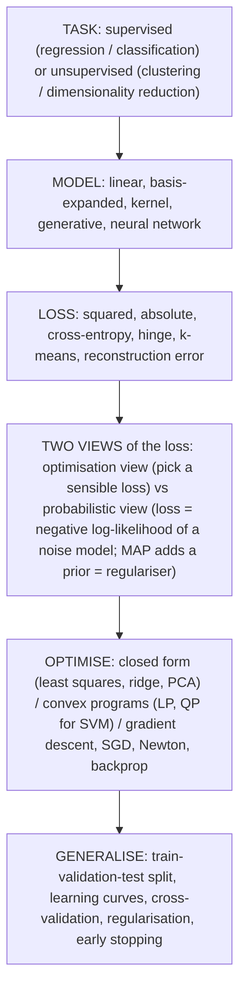

# Machine Learning — Course Summary

*Oxford CS Part A/B Machine Learning · lecture notes by Varun Kanade (MT 2023; summary slides by Seth Flaxman, MT 2024). Written for a reader with **no prior ML knowledge**: every topic starts from what problem it solves, then the maths. Split into parts because GitHub stops rendering maths beyond a few hundred formulas per file. (Lecture 2 was a maths review with no notes file; its content, vectors, matrices, gradients and probability basics, is covered where needed in Parts 1 and 3.)*

| File | Lectures | Covers |
|---|---|---|
| **This page** | 20 | Big picture, how it all ties together, the big takeaways, exam guidance |
| [Part 1 — Linear Regression & Maximum Likelihood](ML-1-Linear-Regression-and-Maximum-Likelihood.md) | 1, 3, 4 | what ML is; least squares (1-D and matrix form, derivation); probability review; MLE; Gaussian vs Laplace noise |
| [Part 2 — Generalisation, Regularisation & Bayes](ML-2-Generalisation-Regularisation-and-Bayes.md) | 5, 6, 7 | basis expansion & kernels; overfitting, bias–variance, learning curves; ridge & lasso; validation & cross-validation; feature selection; Bayesian inference, MAP, priors = regularisers |
| [Part 3 — Optimisation](ML-3-Optimisation.md) | 8, 9 | convex sets/functions, local = global proof; LP for absolute loss; gradient descent; subgradients; Newton; SGD & minibatches |
| [Part 4 — Classification](ML-4-Classification.md) | 10–13 | Naïve Bayes; QDA/LDA & softmax; logistic regression (NLL, Hessian, IRLS); SVM primal, dual, KKT, support vectors; kernels & the kernel trick; multiclass; ROC/precision/recall |
| [Part 5 — Neural Networks](ML-5-Neural-Networks.md) | 14–17 | MLPs; backprop derivation & general equations; saturation, vanishing gradients, ReLU, init, dropout; convnets & pooling; language models, n-grams, RNNs, BPTT |
| [Part 6 — Unsupervised Learning](ML-6-Unsupervised-Learning.md) | 18, 19 | SVD (existence proof), Eckart–Young (proof), PCA, power iteration, kernel PCA; k-means, MDS, hierarchical & spectral clustering |
| [Formula Sheet](ML-7-Formula-Sheet.md) | all | every estimator, distribution, calculus rule, kernel and metric; concepts not to confuse; top 20 mistakes |

---

## 1. The big picture in one paragraph
Machine learning = **choose a model**, **choose a measure of how badly it fits the data (a loss)**, **run an optimisation algorithm to pick the parameters**, then **check it works on data it hasn't seen**. Every method in the course is an instance of this. The two things that make it hard are (1) finite, noisy data, so a flexible model can fit the noise (**overfitting**), and (2) the optimisation itself, which only has a formula in the simplest cases.

## 2. Map of the course

| Lecture | § here | Topic | Big idea in one line |
|---|---|---|---|
| 1 | 1 | Introduction | Learning = improving at a task with experience; supervised vs unsupervised; data and features matter. |
| 2 | — | Maths review | Linear algebra, calculus and probability prerequisites (no notes file; see Part 1 §2.3, §3 and Part 3 §12). |
| 3 | 2 | Linear regression | Least squares has a closed form $`(\mathbf{X}^\top\mathbf{X})^{-1}\mathbf{X}^\top\mathbf{y}`$; squared loss is outlier-sensitive. |
| 4 | 3–4 | Maximum likelihood | A noise model *derives* the loss: Gaussian ⇒ squared, Laplace ⇒ absolute. |
| 5 | 5–6 | Basis expansion, overfitting | Non-linear features keep the linear machinery; complexity trades bias for variance; learning curves diagnose. |
| 6 | 7–8 | Regularisation, model selection | Penalise weight size: ridge shrinks, lasso sparsifies; choose hyperparameters by validation/CV. |
| 7 | 9 | Bayesian ML | Posterior ∝ likelihood × prior; MAP with Gaussian/Laplace prior = ridge/lasso; epistemic vs aleatoric uncertainty. |
| 8–9 | 10–15 | Optimisation | Convex ⇒ local = global; LP, GD, subgradients, Newton, SGD. |
| 10 | 16 | Generative classification | Model $`p(y)p(\mathbf{x}\mid y)`$, classify by Bayes; Naïve Bayes, QDA/LDA ⇒ softmax. |
| 11 | 17 | Logistic regression | Sigmoid of a linear function; convex cross-entropy NLL; IRLS. |
| 12–13 | 18–21 | SVMs & kernels | Maximise the margin; hinge loss; dual depends on inner products ⇒ kernel trick. |
| 14–16 | 22–25 | Neural networks | Learned basis expansion; backprop = chain rule with caching; training tricks; convnets. |
| 17 | 26 | RNNs | Language models via the chain rule; n-grams vs recurrent state; BPTT; exploding/vanishing gradients. |
| 18 | 27–31 | PCA | SVD, Eckart–Young, PCA as best low-rank approximation, power iteration, kernel PCA. |
| 19 | 32–35 | Clustering | k-means (Lloyd's), MDS, hierarchical linkage, spectral clustering via the Laplacian. |
| 20 | here | Course summary | Optimisation view vs probabilistic view; what to know for the exam. |

## 3. How it all ties together

| Thread | Where it shows up |
|---|---|
| **"Set the gradient to zero"** | least squares, ridge, MLE for $`\sigma^2`$, class priors (with Lagrange), SVM dual derivation, Newton's method, backprop |
| **Noise model ⇔ loss (NLL)** | Gaussian ⇒ squared loss; Laplace ⇒ absolute; Bernoulli ⇒ cross-entropy (logistic regression, neural nets); softmax ⇒ multiclass cross-entropy; language models ⇒ cross-entropy/perplexity |
| **Prior ⇔ regulariser (MAP)** | Gaussian prior ⇒ ridge ($`\ell_2`$); Laplace prior ⇒ lasso ($`\ell_1`$); flat prior ⇒ MLE; same $`\frac12\lVert\mathbf{w}\rVert^2`$ in the SVM |
| **"Regulariser + sum of per-point losses"** | ridge, lasso, SVM (hinge), logistic regression (logistic loss), neural nets: the template SGD exploits |
| **Linear in the parameters, non-linear in the inputs** | polynomial / RBF basis expansion; kernels; the hidden layer of an MLP *learns* the expansion |
| **Everything through inner products ⇒ kernelise** | SVM dual, kernel ridge regression (representer argument), kernel PCA, MDS |
| **Convexity** | all losses before neural nets are convex ⇒ GD/Newton find the global optimum; PSD Hessian proofs (logistic regression); concave SVM dual needs a Mercer kernel; neural nets and k-means are non-convex |
| **Lagrange multipliers / KKT** | class priors $`\pi_c = N_c/N`$; distance to a hyperplane; ridge/lasso constrained forms; SVM dual and support vectors (complementary slackness) |
| **Bias–variance** | polynomial degree, kernel width, $`\lambda`$, $`C`$, network size; bagging and dropout reduce variance |
| **Validation** | choosing $`\lambda, \gamma, C, \eta`$, degree, number of components/clusters; early stopping; never touch the test set |
| **Sigmoid / softmax** | two-class / multi-class LDA, logistic regression, output layers of neural nets, language models |
| **Eigenvectors & SVD** | covariance eigenvectors = directions of variance; PCA; power iteration; MDS; spectral clustering (Laplacian) |
| **Chain rule** | backprop (FE/BE equations), BPTT, convolution gradients; also the probabilistic chain rule for language models |

## 4. The big takeaways (if you remember nothing else)
1. **Model + loss + optimiser + validation.** Name the four for any method.
2. **Least squares is maximum likelihood under Gaussian noise**; its closed form comes from two matrix-calculus rules.
3. **Overfitting = fitting noise.** Diagnose with learning curves; fix with simpler models, regularisation, or more data. Never evaluate on training data.
4. **Regularisation = prior.** Ridge/Gaussian shrinks; lasso/Laplace sparsifies; $`\lambda`$ by cross-validation; standardise first.
5. **Bayesians keep a distribution over parameters** (epistemic uncertainty shrinks with data); MAP keeps only the mode.
6. **Convex ⇒ any local optimum is global.** Gradient descent for smooth losses, subgradients for kinks, Newton when $`D`$ is small, SGD when $`N`$ is large.
7. **Generative** (NB, LDA/QDA: model the inputs, classify via Bayes) vs **discriminative** (logistic regression: model $`p(y\mid\mathbf{x})`$). LDA and logistic regression share the sigmoid/softmax form.
8. **Logistic regression** = Bernoulli + sigmoid + cross-entropy; convex; Newton = IRLS.
9. **SVM** = maximum margin = $`\frac12\lVert\mathbf{w}\rVert^2`$ + hinge loss; the dual is a box-constrained QP in $`N`$ variables; only **support vectors** matter; **kernels** replace inner products so you get non-linear classifiers for free (Mercer ⇒ concave dual).
10. **Neural nets** learn their own features; **backprop** is the chain rule run backwards with cached $`\partial\ell/\partial\mathbf{z}^l`$; cross-entropy avoids saturation; ReLU and good initialisation fight vanishing gradients; dropout/early stopping/augmentation fight overfitting.
11. **Convnets** share weights across positions; **RNNs** share weights across time and carry a hidden state; both can suffer exploding/vanishing gradients (RNNs: powers of the same matrix $`V_h`$; deep feed-forward nets: a product of many $`\sigma' \le \tfrac14`$ factors and weights).
12. **PCA = truncated SVD of the centred data** (Eckart–Young: best rank-$`k`$ approximation); choose $`k`$ from the singular values.
13. **Clustering** is ill-posed: k-means (convex clusters, elbow for $`k`$), hierarchical (dendrogram, linkage choice), spectral (Laplacian eigenvectors for non-convex clusters).

## 5. How to attack an ML question (exam recipe)
1. **Identify the task**: regression / classification / unsupervised; what is $`\mathbf{x}`$, what is $`y`$?
2. **Write the model** and its parameters; fold the bias into $`\mathbf{x}`$; say which variables are random (discriminative: only $`y`$).
3. **Write the likelihood or loss**: product over i.i.d. points → log → NLL; add the regulariser or prior if asked.
4. **Differentiate**: use the linear/quadratic-form rules or the chain rule; set to zero if a closed form exists; otherwise name the algorithm (GD/SGD/Newton/subgradient/QP solver) and say why (convex?).
5. **Constraints?** Lagrangian; for inequalities state the KKT conditions and interpret complementary slackness.
6. **Generalisation**: what are the hyperparameters, how would you pick them (validation/CV), what are the bias/variance symptoms, what would you change if overfitting vs underfitting?
7. **Interpretation**: what do the parameters/solution mean (support vectors, principal components, posterior variance, sparsity)?
8. **Sanity checks**: dimensions of every matrix; limits ($`\lambda\to0`$, $`\lambda\to\infty`$, $`N\to\infty`$, $`C\to\infty`$); special cases ($`D = 1`$, 2 classes).

## 6. What to know for the exam (lecture 20)
- Focus is on **understanding ideas**, with some calculations; not calculus prowess.
- Know the basic models (linear regression, logistic regression, …) and be able to reason about them; distribution formulas needed: **Bernoulli and Gaussian only**.
- Learning outcomes: distinguish paradigms (supervised/unsupervised); distinguish **task, model, algorithm**; explain the maths behind the methods; design and implement algorithms.
- Unsupervised learning covers clustering, dimensionality reduction, **search** (finding patterns) and **density estimation** (probabilistic generative models for unsupervised learning were not covered).
- Optimisation recap: beyond GD/SGD/minibatch/Newton the slides name Momentum, Adagrad, Adam, BFGS, L-BFGS. Convex optimisation is "efficient" (polynomial time: LPs, QPs, general convex programs) and gradient methods reach the global optimum; for non-convex problems (deep learning) they give local minima, so initialisation, gradient clipping and randomness matter.
- Learning curves (slide 11): train and test error vs training-set size; both converge to the same high error ⇒ high bias, more data won't help (basis-expand); a persistent gap ⇒ high variance, more data would help (or regularise). Validation curves (slide 12): validation error vs a hyperparameter is U-shaped, training error monotone.
- Think holistically: max-margin, sparsity-inducing regularisation and kernels are reusable tools; know each method's **assumptions** (i.i.d. data almost everywhere; Gaussian noise; conditional independence; linear separability); ask whether the data are noisy or have outliers; diagnose over/underfitting and know what to do.
- Practical workflow: visualise the data (scaling/centring needed?), decide the task and ask whether you're solving a harder problem than necessary (locating an object vs just labelling the image); see if the model can be tweaked, without hurting the objective, to make the optimisation convex; beat a trivial baseline (10% for digit classification) with a simple model (linear/logistic regression), then try kernels/neural nets, keeping aside validation and test data; use library implementations (logistic regression, SVM) where possible and write gradient descent directly only for custom models; be aware of RAM/GPU-memory needs.
- Past exam papers are linked from the course webpage. What next: Kaggle, your own projects, Advanced Topics in ML, Computational Learning Theory.
