# Part 1 — Finite Automata: DFAs, NFAs and the Subset Construction

*[Overview](MoC-Summary.md) · **Part 1** · [Part 2](MoC-2-Regular-Expressions-Pumping-Myhill-Nerode.md) · [Part 3](MoC-3-Context-Free-Grammars.md) · [Part 4](MoC-4-Pushdown-Automata.md) · [Part 5](MoC-5-Turing-Machines.md) · [Part 6a](MoC-6a-Decidability.md) · [Part 6b](MoC-6b-Reductions-Rice-PCP.md) · [Part 7](MoC-7-Complexity.md) · [Formula sheet](MoC-8-Formula-Sheet.md)*

*Covers lecture decks MoC1 (DFAs, product construction) and MoC2 (NFAs, subset construction, closure under union / concatenation / star). Tutorial sheet 1 exercises are referenced where relevant.*

**Diagram conventions used throughout:** `start` arrow = start state; a **double circle** `(((q)))` = accepting state; an edge label `0, 1` means "on input 0 or on input 1"; `ε` = empty string.

---

## 1. Why a precise model of a computer? (MoC1 §1)

The course asks: *what are the capabilities and limitations of computers?* Two sub-questions:

- **Complexity theory**: addition, multiplication and sorting are easy; factorisation and travelling salesman seem hard. *What makes a problem computationally hard?*
- **Computability theory**: can every mathematical problem be solved by a computer? *If not, which can?*

Both need a **precise definition of a computer**. The course builds three models of increasing power:

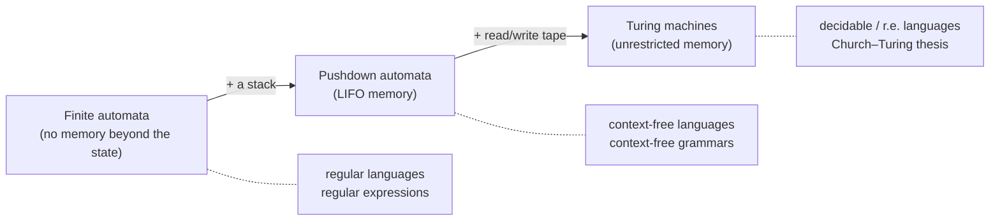

Course texts: Sipser, *Introduction to the Theory of Computation*; Kozen, *Automata and Computability*.

---

## 2. Deterministic finite automata (MoC1 §2)

> [!NOTE]
> **📖 Key definitions**
>
> - **Alphabet** $`\Sigma`$: a finite set of **input symbols**. $`\Sigma^*`$ is the set of all finite **strings** (words) $`a_1\cdots a_k`$ with $`a_i\in\Sigma`$, $`k\ge0`$; it includes the **empty string** $`\epsilon`$ ($`k=0`$).
> - **Language**: any set of strings $`L\subseteq\Sigma^*`$.
> - **DFA**: a 5-tuple $`M=(Q,\Sigma,\delta,q_0,F)`$ with $`Q`$ a finite set of **states**, $`\Sigma`$ the alphabet, $`\delta: Q\times\Sigma\to Q`$ the **transition function**, $`q_0\in Q`$ the **start state**, $`F\subseteq Q`$ the **accepting (final) states**.
> - Write $`q \xrightarrow{a} q'`$ for $`\delta(q,a)=q'`$ ("there is an $`a`$-transition from $`q`$ to $`q'`$"). For a string $`w=a_1\cdots a_n`$, write $`q \xrightarrow{w}{}^* q'`$ if there are states $`q_1,\dots,q_{n-1},q_n=q'`$ (not necessarily distinct) with $`q\xrightarrow{a_1}q_1\xrightarrow{a_2}\cdots\xrightarrow{a_n}q_n`$. Special cases: $`q\xrightarrow{\epsilon}{}^*q'`$ iff $`q=q'`$; $`q\xrightarrow{a}{}^*q'`$ iff $`q\xrightarrow{a}q'`$.
> - **Language recognised (accepted) by $`M`$**: $`L(M)=\{\,w\in\Sigma^* : q_0\xrightarrow{w}{}^*q \text{ for some } q\in F\,\}`$.
> - A language is **regular** if some DFA recognises it.

**How a DFA runs.** Start in $`q_0`$, read the input left to right one symbol at a time, follow the unique transition for each symbol. After the last symbol, answer "yes" iff you are in an accepting state. We do not care about the internal structure of states, only which transitions exist. All transitions form a **finite directed graph with $`\Sigma`$-labelled edges**.

### 2.1 Example $`M_1`$ (the running example)

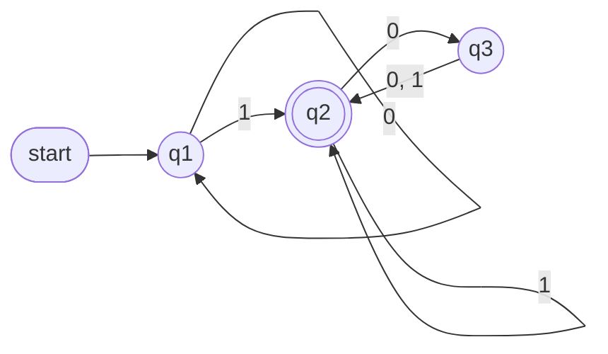

Formally $`M_1=(\{q_1,q_2,q_3\},\{0,1\},\delta,q_1,\{q_2\})`$ with transition table

| $`\delta`$ | 0 | 1 |
|---|---|---|
| $`q_1`$ | $`q_1`$ | $`q_2`$ |
| $`q_2`$ | $`q_3`$ | $`q_2`$ |
| $`q_3`$ | $`q_2`$ | $`q_2`$ |

On input `1101` the states visited are $`q_1,q_2,q_2,q_3,q_2`$, so the answer is "yes". $`L(M_1)`$ = all binary strings that contain at least one 1 **and** an even number of 0s follow the last 1.

### 2.2 More examples

| Automaton | Language |
|---|---|
| $`M_2`$: states $`q_1`$ (start), $`q_2`$ (accept); $`\delta(q_1,0)=q_1`$, $`\delta(q_1,1)=q_2`$, $`\delta(q_2,0)=q_1`$, $`\delta(q_2,1)=q_2`$ | $`\{w : w \text{ ends in a } 1\}`$ |
| $`M_3`$: same transitions but $`F=\{q_1\}`$ | $`\{w : w \text{ ends in a } 0\}\cup\{\epsilon\}`$ |

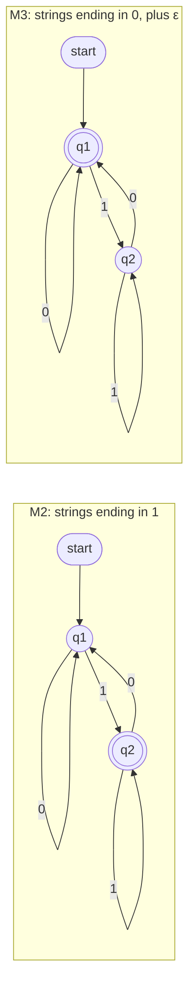

Note the lesson of $`M_3`$: swapping accepting and non-accepting states of a **DFA** gives a DFA for the **complement** (here the complement of "ends in 1" is "ends in 0 or is empty"). This is *not* true for NFAs (§4.4).

### 2.3 Designing DFAs over $`\{0,1\}`$ (MoC1 §3)

The design idea is always: **what finite piece of information about the prefix read so far do I need to remember?** Each state = one value of that information.

| Target language | Design |
|---|---|
| $`L(M)=\emptyset`$ | one state with a self-loop on 0, 1 and **no accepting state** |
| $`L(M)=\{\epsilon,0\}`$ | $`q_1`$ (start, accept) $`\xrightarrow{0}`$ $`q_2`$ (accept) ; $`q_1\xrightarrow{1}q_3`$, $`q_2\xrightarrow{0,1}q_3`$, $`q_3`$ a non-accepting **sink** with a 0, 1 self-loop |
| every odd position of $`w`$ is a 1 ($`\{\epsilon,1,10,11,101,111,1010,\dots\}`$) | $`q_1`$ (start, accept, "at an odd position") $`\xrightarrow{1}`$ $`q_2`$ (accept, "at an even position"); $`q_2\xrightarrow{0,1}q_1`$; $`q_1\xrightarrow{0}q_3`$ sink |

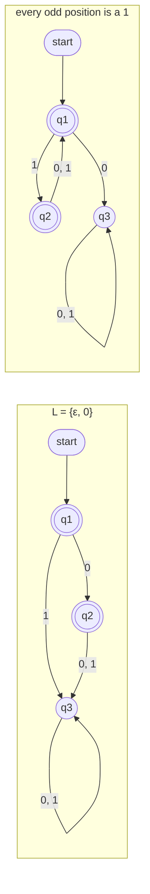

> [!TIP]
> **A DFA must have exactly one transition per (state, symbol).** When you draw one, check every state has an outgoing edge for *every* symbol. If a symbol "can't happen", send it to a non-accepting sink state with a self-loop on everything.

---

## 3. The regular operations and the product construction (MoC1 §4)

> [!NOTE]
> **📖 Key definitions.** For languages $`A,B`$:
> - **Union** $`A\cup B=\{x : x\in A \text{ or } x\in B\}`$
> - **Concatenation** $`A\cdot B=\{xy : x\in A,\ y\in B\}`$
> - **Star** $`A^*=\{x_1x_2\cdots x_k : k\ge0,\ \text{each } x_i\in A\}`$. Note $`\epsilon\in A^*`$ always ($`k=0`$). Informally $`A^*=\{\epsilon\}\cup A\cup(A\cdot A)\cup(A\cdot A\cdot A)\cup\cdots`$

Example: $`A=\{good,bad\}`$, $`B=\{boy,girl\}`$ gives $`A\cdot B=\{goodboy,goodgirl,badboy,badgirl\}`$ and $`A^*=\{\epsilon,good,bad,goodgood,goodbad,badgood,badbad,goodgoodgood,\dots\}`$.

### 3.1 Theorem: regular languages are closed under union

**Proof (product construction): simulate $`M_1`$ and $`M_2`$ simultaneously.** Let $`M_1=(Q_1,\Sigma,\delta_1,q_1,F_1)`$ recognise $`A_1`$ and $`M_2=(Q_2,\Sigma,\delta_2,q_2,F_2)`$ recognise $`A_2`$. Define $`M=(Q,\Sigma,\delta,q_0,F)`$:

```math
Q = Q_1\times Q_2,\qquad \delta((r_1,r_2),a) = (\delta_1(r_1,a),\,\delta_2(r_2,a)),\qquad q_0=(q_1,q_2),\qquad F=(F_1\times Q_2)\cup(Q_1\times F_2).
```

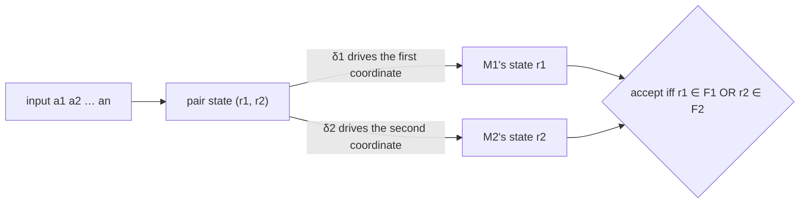

*$`L(M)\subseteq L(M_1)\cup L(M_2)`$:* if $`w=a_1\cdots a_n\in L(M)`$ there are $`M`$-transitions $`(q^1_0,q^2_0)\xrightarrow{a_1}(q^1_1,q^2_1)\xrightarrow{a_2}\cdots\xrightarrow{a_n}(q^1_n,q^2_n)\in F`$. Unpacking $`\delta`$ gives a sequence of $`M_1`$-transitions $`q^1_0\to\cdots\to q^1_n`$ and of $`M_2`$-transitions $`q^2_0\to\cdots\to q^2_n`$. Since $`(q^1_n,q^2_n)\in F`$, either $`q^1_n\in F_1`$ (so $`w\in L(M_1)`$) or $`q^2_n\in F_2`$ (so $`w\in L(M_2)`$).

*$`L(M_1)\subseteq L(M)`$ (the $`M_2`$ case is symmetric):* take $`w\in L(M_1)`$ with accepting run $`q^1_0\to\cdots\to q^1_n\in F_1`$. Because $`\delta_2`$ is a **function**, for every $`q\in Q_2`$ and $`a\in\Sigma`$ there is *some* $`q'`$ with $`q\xrightarrow{a}q'`$, so there exist $`q^2_0=q_2,q^2_1,\dots,q^2_n`$ making $`(q^1_i,q^2_i)`$ a valid run of $`M`$. Its last state is in $`F_1\times Q_2\subseteq F`$, so $`w\in L(M)`$. ∎

> [!TIP]
> **The same construction with a different $`F`$ gives other closures** (tutorial 1, Q2): intersection uses $`F=F_1\times F_2`$; difference $`L_1\setminus L_2`$ uses $`F=F_1\times(Q_2\setminus F_2)`$; complement of a DFA swaps $`F`$ and $`Q\setminus F`$. The "$`\delta`$ is a function" step is exactly where determinism is used, so these work for DFAs, not directly for NFAs.

### 3.2 Why we need non-determinism

**Theorem.** Regular languages are closed under concatenation. *Proof attempt:* build $`M`$ accepting $`w`$ iff $`w=w_1w_2`$ with $`M_1`$ accepting $`w_1`$ and $`M_2`$ accepting $`w_2`$. **But $`M`$ does not know where to break $`w`$ into two!** This motivates non-deterministic finite automata.

---

## 4. Non-deterministic finite automata (MoC2)

> [!NOTE]
> **📖 Key definitions**
>
> - **NFA**: a 5-tuple $`(Q,\Sigma,\delta,q_0,F)`$ with $`\delta: Q\times(\Sigma\cup\{\epsilon\})\to\mathcal{P}(Q)`$ (the **power set** $`\mathcal{P}(Q)=\{X : X\subseteq Q\}`$). Equivalently $`\delta`$ is a relation, a subset of $`(Q\times(\Sigma\cup\{\epsilon\}))\times Q`$. For $`a\in\Sigma\cup\{\epsilon\}`$, $`q\xrightarrow{a}q'`$ means $`q'\in\delta(q,a)`$.
> - **NFA vs DFA**: in a DFA every (state, symbol) has a *unique* transition; an NFA may have *several or none*. A DFA's arrows carry symbols of $`\Sigma`$; an NFA's carry symbols of $`\Sigma\cup\{\epsilon\}`$, i.e. an NFA may have **$`\epsilon`$-transitions** (change state without reading input).
> - **Reachability $`q\overset{w}{\Longrightarrow}q'`$** (double arrow): $`q\overset{\epsilon}{\Longrightarrow}q'`$ iff $`q=q'`$ or there is a sequence of one or more $`\epsilon`$-transitions from $`q`$ to $`q'`$. For $`w=a_1\cdots a_{n+1}`$ with each $`a_i\in\Sigma`$: $`q\overset{w}{\Longrightarrow}q'`$ iff there are states with $`q\overset{\epsilon}{\Longrightarrow}q_1\xrightarrow{a_1}q_1'\overset{\epsilon}{\Longrightarrow}q_2\xrightarrow{a_2}q_2'\overset{\epsilon}{\Longrightarrow}\cdots\xrightarrow{a_{n+1}}q'_{n+1}\overset{\epsilon}{\Longrightarrow}q'`$. Intuitively: "the symbols of $`w`$ occur in order, with 0 or more $`\epsilon`$-moves before or after each one". (Exercise: this is equivalent to $`q\overset{a_1}{\Longrightarrow}q_1\overset{a_2}{\Longrightarrow}\cdots\overset{a_{n+1}}{\Longrightarrow}q'`$.)
> - **Language of an NFA**: $`L(N)=\{w : q_0\overset{w}{\Longrightarrow}q \text{ for some } q\in F\}`$.
> - Two automata are **equivalent** if they recognise the same language.

**Intuition.** Non-determinism is a kind of parallel computation: when the NFA has several choices it "forks" into children, each proceeding separately; the whole computation accepts if **at least one** child accepts. Equivalently the machine "guesses" and the guess is accepted if some guess works.

### 4.1 Example: strings with a 1 in third position from the end

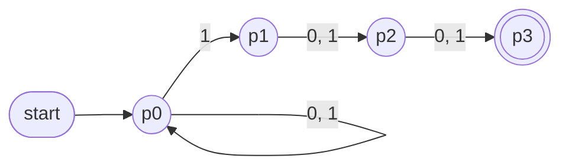

The NFA has 4 states; it *guesses* when it is reading the third-last symbol. The smallest DFA needs **8 states** $`q_{000},\dots,q_{111}`$ (remember the last three bits; $`q_{1xy}`$ accepting). NFAs are more compact; Part 2 §5.4 shows the gap can be exponential.

### 4.2 Example: $`\{0^k : k \text{ a multiple of 2 or 3}\}`$

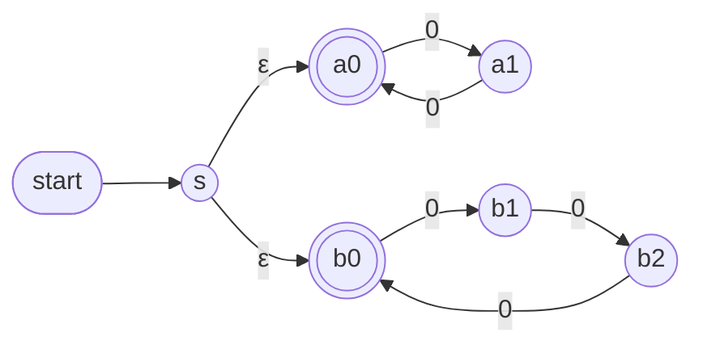

$`\epsilon`$-transitions let you say "either run the mod-2 counter or the mod-3 counter": languages defined by NFAs are often easier to understand.

### 4.3 Theorem: every NFA has an equivalent DFA (the subset construction)

Observation: **every DFA *is* an NFA**, so the surprising direction is NFA → DFA.

**Construction.** Given $`N=(Q_N,\Sigma_N,\delta_N,q_N,F_N)`$ define the DFA $`\mathcal{P}N=(Q_{\mathcal{P}N},\Sigma,\delta_{\mathcal{P}N},q_{\mathcal{P}N},F_{\mathcal{P}N})`$ whose states are **sets of $`N`$-states**:

```math
Q_{\mathcal{P}N}=\{S : S\subseteq Q_N\},\qquad
S\xrightarrow{a}S' \text{ iff } S'=\{q' : \exists q\in S \text{ s.t. } q\overset{a}{\Longrightarrow}q' \text{ in } N\},\qquad
q_{\mathcal{P}N}=\{q : q_N\overset{\epsilon}{\Longrightarrow}q\},\qquad
F_{\mathcal{P}N}=\{S : F_N\cap S\neq\emptyset\}.
```

In words: the DFA state records **the set of all states the NFA could be in**; the start state is the $`\epsilon`$-closure of $`q_N`$; a set is accepting iff it contains some accepting state of $`N`$. Note $`\overset{a}{\Longrightarrow}`$ already absorbs $`\epsilon`$-moves before and after reading $`a`$.

**Example** ("words that begin with a string of 0s followed by a string of 1s"):

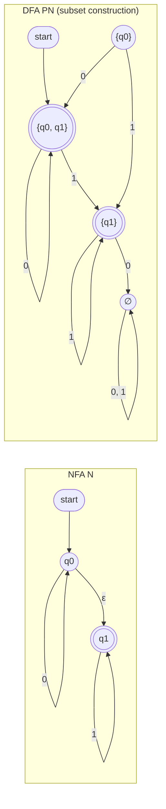

The state $`\{q_0\}`$ is unreachable from the start, hence redundant: in practice **only build the subsets reachable from the start state**. The empty set $`\emptyset`$ is the sink.

**Proof of $`L(N)\subseteq L(\mathcal{P}N)`$.** If $`\epsilon\in L(N)`$ then $`q_N\overset{\epsilon}{\Longrightarrow}q'`$ for some $`q'\in F_N`$, so $`q'\in q_{\mathcal{P}N}`$, so $`q_{\mathcal{P}N}\in F_{\mathcal{P}N}`$. For non-null $`u=a_1\cdots a_n\in L(N)`$ there is an $`N`$-run $`q_N\overset{a_1}{\Longrightarrow}q_1\overset{a_2}{\Longrightarrow}\cdots\overset{a_n}{\Longrightarrow}q_n\in F_N`$. Since $`\mathcal{P}N`$ is deterministic, feeding it $`a_1\cdots a_n`$ produces the unique run $`q_{\mathcal{P}N}\xrightarrow{a_1}S_1\xrightarrow{a_2}\cdots\xrightarrow{a_n}S_n`$ with $`S_1=\{q' : \exists q\in q_{\mathcal{P}N},\ q\overset{a_1}{\Longrightarrow}q'\}`$, $`S_2=\{q' : \exists q\in S_1,\ q\overset{a_2}{\Longrightarrow}q'\}`$, … By definition of $`\delta_{\mathcal{P}N}`$ we get $`q_1\in S_1`$, hence $`q_2\in S_2`$, …, hence $`q_n\in S_n`$, so $`S_n\in F_{\mathcal{P}N}`$ and $`u\in L(\mathcal{P}N)`$.

**Proof of $`L(\mathcal{P}N)\subseteq L(N)`$.** If $`\epsilon\in L(\mathcal{P}N)`$ then $`q_{\mathcal{P}N}\in F_{\mathcal{P}N}`$, i.e. $`F_N\cap\{q : q_N\overset{\epsilon}{\Longrightarrow}q\}\neq\emptyset`$, so $`\epsilon\in L(N)`$. For non-null $`u`$ with $`\mathcal{P}N`$-run ending in $`S_n\in F_{\mathcal{P}N}`$, pick $`q_n\in S_n\cap F_N`$. By definition of $`\delta_{\mathcal{P}N}`$ there is $`q_{n-1}\in S_{n-1}`$ with $`q_{n-1}\overset{a_n}{\Longrightarrow}q_n`$; **working backwards** we build an $`N`$-run $`q_N\overset{a_1}{\Longrightarrow}q_1\cdots\overset{a_n}{\Longrightarrow}q_n\in F_N`$, so $`u\in L(N)`$. ∎

### 4.4 Closure under the regular operations, revisited (easy with NFAs)

Non-determinism makes *some* proofs much easier. In each construction below, states are tagged with 1 or 2 to make the **disjoint union** of $`N_1=(Q_1,\Sigma,\delta_1,q_1,F_1)`$ and $`N_2=(Q_2,\Sigma,\delta_2,q_2,F_2)`$.

**Union.** Add a new start state $`q`$ with $`\epsilon`$-transitions to both old start states.

```math
Q=Q_1\times\{1\}\cup Q_2\times\{2\}\cup\{q\},\quad F=F_1\times\{1\}\cup F_2\times\{2\},\quad
\delta(q,\epsilon)=\{(q_1,1),(q_2,2)\},\quad \delta((r,i),a)=\{(r',i) : r'\in\delta_i(r,a)\}.
```

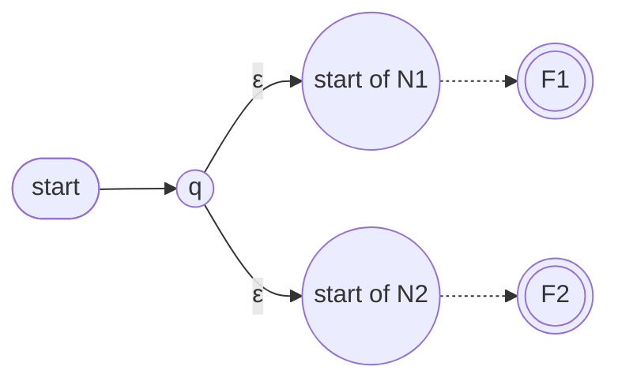

*Proof.* If $`w\in L(N_1)`$ via $`q_1\overset{a_1}{\Longrightarrow}r_1\cdots\overset{a_n}{\Longrightarrow}r_n\in F_1`$ then in $`N`$: $`q\xrightarrow{\epsilon}(q_1,1)\overset{a_1}{\Longrightarrow}(r_1,1)\cdots\overset{a_n}{\Longrightarrow}(r_n,1)\in F`$. Conversely an accepting $`N`$-run must begin $`q\xrightarrow{\epsilon}(q_i,i)`$ and then stay in copy $`i`$, giving an accepting $`N_i`$-run. ∎

**Concatenation.** Start state of $`N_1`$ becomes the start; add an $`\epsilon`$-transition from **each accepting state of $`N_1`$ to the start state of $`N_2`$**; accepting states are those of $`N_2`$ only.

```math
Q=Q_1\times\{1\}\cup Q_2\times\{2\},\quad F=F_2\times\{2\},\quad
\delta((r,1),\epsilon)=\{(r',1): r'\in\delta_1(r,\epsilon)\}\cup\{(q_2,2)\} \text{ for } r\in F_1,
```
with all other transitions copied from $`\delta_1`$ or $`\delta_2`$.

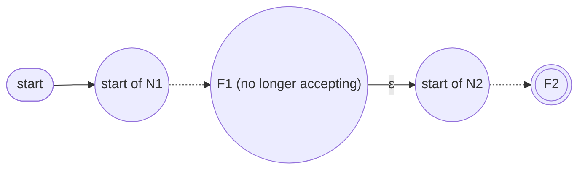

*Proof.* $`w=uv`$ with $`q_1\overset{u}{\Longrightarrow}s_1\in F_1`$ and $`q_2\overset{v}{\Longrightarrow}s_2\in F_2`$ gives $`(q_1,1)\overset{u}{\Longrightarrow}(s_1,1)\xrightarrow{\epsilon}(q_2,2)\overset{v}{\Longrightarrow}(s_2,2)\in F`$. Conversely an accepting run ends in copy 2 and by definition of $`\delta`$ uses **exactly one** of the new $`\epsilon`$-transitions to cross from copy 1 to copy 2; splitting the input there gives $`u\in L(N_1)`$ and $`v\in L(N_2)`$. ∎

**Star — first (wrong) attempt.** Make the start state accepting and add $`\epsilon`$-transitions from each accepting state back to the start. **What is wrong?** The original start state may have incoming transitions, so making it accepting accepts extra strings. Example: $`N_1`$ recognising $`\{0^i1 : i\ge0\}`$ (a 0-loop on the start, then a 1 to the accepting state). The wrong construction accepts `010`, which is **not** in $`L(N_1)^*`$ (after `01` the $`\epsilon`$-move returns to the start, which is now accepting, and then `0` loops there).

**Star — correct construction.** Add a **new** start state $`q_0`$ which is accepting, with an $`\epsilon`$-transition to the old start, and $`\epsilon`$-transitions from each old accepting state to the **old** start $`q_1`$:

```math
N=(Q_1\cup\{q_0\},\Sigma,\delta,q_0,F_1\cup\{q_0\}),\qquad
\delta(q,a)=\begin{cases}
\delta_1(q,a) & q\in Q_1,\ q\notin F_1\\
\delta_1(q,a) & q\in F_1,\ a\neq\epsilon\\
\delta_1(q,a)\cup\{q_1\} & q\in F_1,\ a=\epsilon\\
\{q_1\} & q=q_0,\ a=\epsilon\\
\emptyset & q=q_0,\ a\neq\epsilon
\end{cases}
```

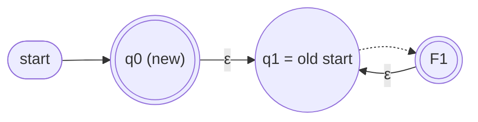

*Proof of $`L(N_1)^*\subseteq L(N)`$.* $`\epsilon\in L(N)`$ since $`q_0\in F`$. For $`w=v_1\cdots v_k`$, $`k\ge1`$, each $`v_i\in L(N_1)`$ with run $`q_1\overset{v_i}{\Longrightarrow}r_i\in F_1`$: chain $`q_0\xrightarrow{\epsilon}q_1\overset{v_1}{\Longrightarrow}r_1\xrightarrow{\epsilon}q_1\overset{v_2}{\Longrightarrow}\cdots\overset{v_k}{\Longrightarrow}r_k\in F`$.
*Proof of $`L(N)\subseteq L(N_1)^*`$.* Take an accepting run of $`N`$ on $`w\neq\epsilon`$. Let $`k-1`$ be the number of uses of the **new** $`\epsilon`$-transitions $`r_j\xrightarrow{\epsilon}q_1`$ ($`r_j\in F_1`$). Splitting the run at these transitions gives $`k`$ runs $`q_1\overset{v_i}{\Longrightarrow}r_i`$ with $`w=v_1\cdots v_k`$ and each $`v_i\in L(N_1)`$. ∎

### 4.5 NFAs and complement (tutorial 1, Q6)

Swapping accepting and non-accepting states of an NFA **does** yield an NFA, but it does **not** necessarily recognise the complement: a string may have one accepting run and one rejecting run, and after the swap it is still accepted. Regular languages *are* closed under complement, but you must **first convert to a DFA** (subset construction), then swap.

---

## ✅ Key takeaways

> [!TIP]
> 1. A DFA is a finite state graph; its only memory is *which state it is in*. Design = "what do I need to remember about the prefix?"
> 2. $`L(M)`$ is defined through runs $`q_0\xrightarrow{w}{}^*q\in F`$; **regular** = recognised by some DFA.
> 3. **Product construction** $`Q_1\times Q_2`$ proves closure under union (and, by changing $`F`$, intersection, difference, complement). It relies on $`\delta`$ being total and deterministic.
> 4. NFAs add **choice** and **$`\epsilon`$-moves**; accept if *some* run accepts. They are more compact and easier to design, but no more powerful: the **subset construction** gives an equivalent DFA with states $`\subseteq Q_N`$ (build only the reachable subsets).
> 5. The three NFA constructions (union: new start + two $`\epsilon`$-edges; concatenation: $`\epsilon`$-edges from $`F_1`$ to start of $`N_2`$; star: **new accepting start** + $`\epsilon`$-edges from $`F_1`$ back to the old start) are the building blocks of Kleene's theorem (Part 2).

## ⚠️ Common misconceptions & errors

> [!WARNING]
> - ❌ "An NFA that is missing a transition rejects." ✅ A missing transition just kills *that branch*; the string is rejected only if **every** branch dies or ends non-accepting. Conversely a DFA with a missing transition is not a DFA: add a sink.
> - ❌ "To complement an NFA, swap accepting and non-accepting states." ✅ Only valid for DFAs. Determinise first.
> - ❌ "$`\epsilon\in A`$ for every language $`A`$." ✅ $`\epsilon\in A^*`$ always, but $`\epsilon\in A`$ only if $`A`$ contains it. Hence the star construction must add a *new* accepting start state rather than reuse the old one.
> - ❌ In the star construction, pointing the $`\epsilon`$-edges from $`F_1`$ to the **new** start (or making the old start accepting). ✅ They go to the **old** start $`q_1`$; the only new accepting state is the fresh $`q_0`$ (needed for $`\epsilon`$ and to avoid accepting e.g. `010` for $`\{0^i1\}^*`$).
> - ❌ Forgetting $`\epsilon`$-closure in the subset construction (start state must be $`\{q : q_N\overset{\epsilon}{\Longrightarrow}q\}`$, and each $`S\xrightarrow{a}S'`$ must include states reachable by $`\epsilon`$-moves after reading $`a`$).
> - ❌ "The subset-construction DFA always has $`2^{\lvert Q\rvert}`$ states." ✅ That is the worst case; usually only a few subsets are reachable. But sometimes the blow-up is unavoidable (Part 2 §5.4: $`L_n`$ needs $`\ge2^n`$ DFA states vs $`n+1`$ NFA states).
> - ❌ Reading $`q\overset{w}{\Longrightarrow}q'`$ as "exactly the symbols of $`w`$, no $`\epsilon`$-moves". ✅ $`\epsilon`$-moves may be interleaved anywhere, including before the first and after the last symbol.
> - ❌ $`L(M_3)`$ = "strings ending in 0" only. ✅ The empty string is also accepted because the start state is accepting: always check $`\epsilon`$ separately.
