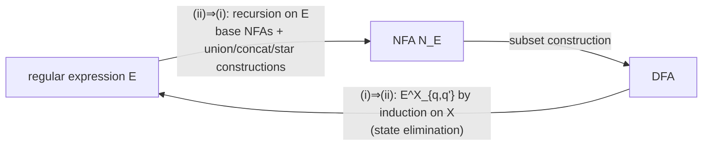
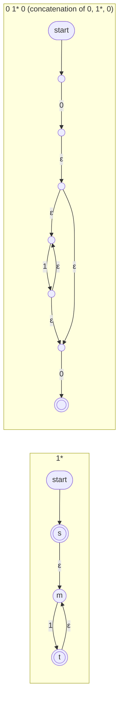
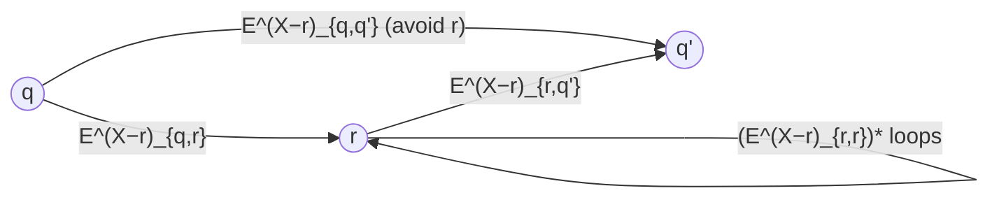
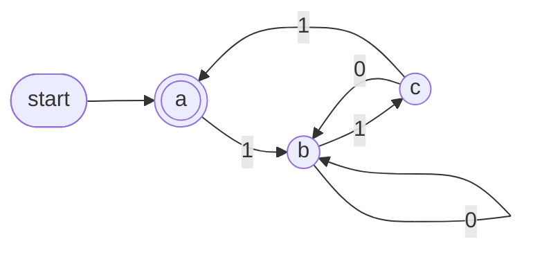
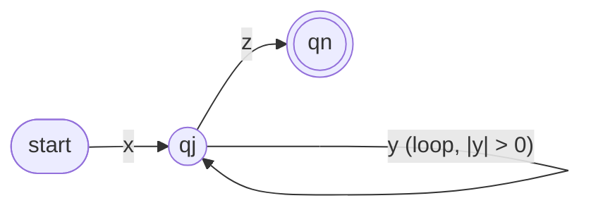

# Part 2 — Regular Expressions, Kleene's Theorem, the Pumping Lemma and Myhill–Nerode

*[Overview](MoC-Summary.md) · [Part 1](MoC-1-Finite-Automata.md) · **Part 2** · [Part 3](MoC-3-Context-Free-Grammars.md) · [Part 4](MoC-4-Pushdown-Automata.md) · [Part 5](MoC-5-Turing-Machines.md) · [Part 6a](MoC-6a-Decidability.md) · [Part 6b](MoC-6b-Reductions-Rice-PCP.md) · [Part 7](MoC-7-Complexity.md) · [Formula sheet](MoC-8-Formula-Sheet.md)*

*Covers MoC3 (regular expressions, Kleene's theorem both ways), MoC3.5 (Kozen's axioms), MoC4 (Pumping Lemma, Myhill–Nerode). Tutorial sheets 2 and 3 exercises referenced where relevant.*

---

## 1. Regular expressions (MoC3 §1–2)

Regular expressions are a **compact notation for string patterns**: "begin with 0s then 1s" is $`0^*\cdot1^*`$; "start and end with the same symbol" is $`0+1+(0(0+1)^*0)+(1(0+1)^*1)`$. Applications: lexical analysis in compilers, search in editors/databases (`grep`, `awk`), Perl, XML.

> [!NOTE]
> **📖 Definition (regular expression $`E`$ and its denotation $`L(E)`$, by simultaneous induction).** Fix $`\Sigma`$.
> - Constants $`\epsilon`$ and $`\emptyset`$ are regular expressions; $`L(\epsilon)=\{\epsilon\}`$, $`L(\emptyset)=\emptyset`$.
> - For $`a\in\Sigma`$, $`a`$ is a regular expression; $`L(a)=\{a\}`$.
> - If $`E,F`$ are regular expressions then so are $`(E+F)`$, $`(E\cdot F)`$, $`(E^*)`$, with
>
> ```math
> L((E+F))=L(E)\cup L(F)\ \text{(union)},\qquad L((E\cdot F))=L(E)\cdot L(F)\ \text{(concatenation)},\qquad L((E^*))=(L(E))^*\ \text{(star)}.
> ```
>
> - A word $`w`$ **matches** $`E`$ whenever $`w\in L(E)`$. $`E`$ and $`F`$ are **equivalent**, $`E\equiv F`$, if $`L(E)=L(F)`$ ($`\equiv`$ is an equivalence relation).

**Notation.** $`+`$ is also written $`\cup`$ or $`\mid`$; $`(E\cdot F)`$ is written $`(EF)`$. Parentheses may be omitted using **precedence (highest first): star, concatenation, union**, and union/concatenation associate to the left (irrelevant since both are associative). So $`01^*`$ means $`0(1^*)`$, not $`(01)^*`$; $`0+10`$ means $`0+(10)`$. Formally $`01^*+1`$ is $`((0\cdot(1^*))+1)`$ and $`(0+1)01^*0`$ is $`((((0+1)\cdot0)\cdot(1^*))\cdot0)`$.

**Examples over $`\{0,1\}`$:** $`0^*10^*`$ = exactly one 1; $`(0+1)^*1(0+1)^*`$ = at least one 1; $`0(0+1)^*0+1(0+1)^*1+0+1`$ = start and end with the same symbol.

**Some identities.** Associativity $`(E+F)+G\equiv E+(F+G)`$, $`(EF)G\equiv E(FG)`$; commutativity $`E+F\equiv F+E`$; $`E\emptyset\equiv\emptyset`$; $`\emptyset^*\equiv\epsilon`$; $`E+\emptyset\equiv E\equiv\emptyset+E`$; $`E\cdot\epsilon\equiv E\equiv\epsilon\cdot E`$. But in general $`E+\epsilon\not\equiv E`$ (holds iff $`\epsilon\in L(E)`$) and $`E\cdot\emptyset\not\equiv E`$ (holds iff $`L(E)=\emptyset`$).

**Example proof of an equivalence: $`(a+b)^*\equiv a^*(ba^*)^*`$.** $`L((a+b)^*)`$ is all strings over $`\{a,b\}`$, so $`\supseteq`$ is trivial. For $`\subseteq`$: any $`s`$ over $`\{a,b\}`$ can be written $`a^{n_0}\,b\,a^{n_1}\,b\cdots a^{n_{r-1}}\,b\,a^{n_r}`$ where $`r`$ is the number of $`b`$s and each $`n_i\ge0`$ ($`r\ge0`$; if $`s=b`$ then $`n_0=n_1=0`$; if $`s=\epsilon`$ then $`n_0=0`$). Each block $`ba^{n_i}`$ matches $`ba^*`$, so $`(ba^{n_1})\cdots(ba^{n_r})`$ matches $`(ba^*)^*`$ and the whole string matches $`a^*(ba^*)^*`$. ∎ — *This "write a generic element of the left side and show it matches the right" is the standard template for proving $`\subseteq`$.*

---

## 2. Kleene's Theorem (MoC3 §3)

> [!NOTE]
> **📖 Kleene's Theorem.** For $`L\subseteq\Sigma^*`$ the following are equivalent:
> (i) $`L`$ is regular, i.e. $`L=L(M)`$ for some finite automaton $`M`$;
> (ii) $`L=L(E)`$ for some regular expression $`E`$.



### 2.1 (ii) ⇒ (i): regular expression → NFA

By recursion on the structure of $`E`$, build $`N_E`$ with $`L(E)=L(N_E)`$.

- **Base cases** $`E=\epsilon,\emptyset,a`$: trivially recognised by tiny NFAs (one accepting start state; one non-accepting state with no transitions; two states joined by an $`a`$-edge).
- **Inductive cases**: given $`N_E,N_F`$ use the Part 1 §4.4 constructions for union, concatenation and star; by definition they recognise $`L(E+F)`$, $`L(E\cdot F)`$, $`L(E^*)`$. ∎

**Worked example: NFA for $`(0+01^*0)^*0`$** (slides build it bottom-up; states are unlabelled dots):



Then $`(0+01^*0)`$ = new start with $`\epsilon`$-edges to the NFA for $`0`$ and the NFA for $`01^*0`$; $`(0+01^*0)^*`$ = new accepting start, $`\epsilon`$-edges from both accepting states back to the old start; finally concatenate with the NFA for $`0`$ ($`\epsilon`$-edges from every accepting state into it, those states lose acceptance). The result is correct but has many $`\epsilon`$-edges; in exams you may simplify afterwards (tutorial 2, Q2).

### 2.2 (i) ⇒ (ii): NFA → regular expression

Given an NFA $`M=(Q,\Sigma,\delta,q_0,F)`$, for $`X\subseteq Q`$ and $`q,q'\in Q`$ construct by induction on $`\lvert X\rvert`$ a regular expression

```math
E^X_{q,q'}\quad\text{with}\quad L(E^X_{q,q'})=\{\,w\in\Sigma^* : q\overset{w}{\Longrightarrow}q' \text{ in } M \text{ with all intermediate states of the path in } X\,\}.
```

**Lemma.** Such $`E^X_{q,q'}`$ exists for every $`X,q,q'`$. Then $`L(M)=L\big(\sum_{f\in F}E^Q_{q_0,f}\big)`$ (union over accepting states, all intermediate states allowed).

**Basis $`X=\emptyset`$** (no intermediate states: a single transition or nothing). Let $`a_1,\dots,a_k`$ be all symbols in $`\Sigma\cup\{\epsilon\}`$ with $`q'\in\delta(q,a_i)`$.

```math
q\neq q':\ E^\emptyset_{q,q'}=\begin{cases}a_1+\cdots+a_k & k\ge1\\ \emptyset & k=0\end{cases}\qquad\qquad
q=q':\ E^\emptyset_{q,q}=\begin{cases}a_1+\cdots+a_k+\epsilon & k\ge1\\ \epsilon & k=0\end{cases}
```

**Inductive step.** For non-empty $`X`$ choose a **separating state** $`r\in X`$. Any path from $`q`$ to $`q'`$ through $`X`$ either (1) never visits $`r`$, or (2) visits $`r`$ for the first time, then does finitely many loops from $`r`$ back to $`r`$ (not visiting $`r`$ in between, staying in $`X`$), then goes from $`r`$ to $`q'`$:

```math
E^X_{q,q'}\;\overset{\text{def}}{=}\;\underbrace{E^{X-\{r\}}_{q,q'}}_{(1)}\;+\;\underbrace{E^{X-\{r\}}_{q,r}\cdot\big(E^{X-\{r\}}_{r,r}\big)^*\cdot E^{X-\{r\}}_{r,q'}}_{(2)} \qquad\blacksquare
```



**Heuristic:** choose a separating state $`r`$ that **disconnects the automaton as much as possible**.

**Worked example.** $`M=(\{a,b,c\},\{0,1\},\delta,a,\{a\})`$ with $`\delta(a,1)=\{b\}`$, $`\delta(b,0)=\{b\}`$, $`\delta(b,1)=\{c\}`$, $`\delta(c,0)=\{b\}`$, $`\delta(c,1)=\{a\}`$, all other entries $`\emptyset`$:



Pick $`b`$ as the first separating state:
$`E^{\{a,b,c\}}_{a,a}=E^{\{a,c\}}_{a,a}+E^{\{a,c\}}_{a,b}\cdot(E^{\{a,c\}}_{b,b})^*\cdot E^{\{a,c\}}_{b,a}`$. By inspection $`E^{\{a,c\}}_{a,a}=\epsilon`$, $`E^{\{a,c\}}_{a,b}=1`$, $`E^{\{a,c\}}_{b,a}=11`$. For $`E^{\{a,c\}}_{b,b}`$ pick $`c`$: $`E^{\{a,c\}}_{b,b}=E^{\{a\}}_{b,b}+E^{\{a\}}_{b,c}(E^{\{a\}}_{c,c})^*E^{\{a\}}_{c,b}`$ with $`E^{\{a\}}_{b,b}=0+\epsilon`$, $`E^{\{a\}}_{b,c}=1`$, $`E^{\{a\}}_{c,c}=\epsilon`$, $`E^{\{a\}}_{c,b}=0+11`$. Putting it together:

```math
E^{\{a,b,c\}}_{a,a}=\epsilon+1\big(0+\epsilon+1\epsilon^*(0+11)\big)^*11\;\equiv\;\epsilon+1\,(0+10+111)^*\,11.
```

**Starting with $`c`$ instead** gives $`\epsilon+10^*1\big((0+11)\,0^*\,1\big)^*1`$: *regular expressions produced by this procedure are not unique; they depend on the choice of separating states* (both denote $`L(M)`$).

**Consequence (MoC3 last slide).** Given a string $`s`$ and regular expression $`E`$, there *is* an algorithm deciding whether $`s`$ matches $`E`$: build $`N_E`$, determinise, run. (Formalised as the decidable language $`A_{\text{regexp}}`$ in Part 6a.)

---

## 3. Kozen's axioms (MoC3.5)

**Question:** is there a finite set of equivalence axioms and rules from which every valid equivalence of regular expressions is derivable? Yes:

| | Axiom | | Axiom |
|---|---|---|---|
| 1 | $`E+(F+G)\equiv(E+F)+G`$ | 7 | $`E(F+G)\equiv EF+EG`$ |
| 2 | $`E+F\equiv F+E`$ | 8 | $`(E+F)G\equiv EG+FG`$ |
| 3 | $`E+\emptyset\equiv E`$ | 9 | $`\emptyset E\equiv E\emptyset\equiv\emptyset`$ |
| 4 | $`E+E\equiv E`$ (idempotence) | 10 | $`\epsilon+EE^*\equiv E^*`$ |
| 5 | $`(EF)G\equiv E(FG)`$ | 11 | $`\epsilon+E^*E\equiv E^*`$ |
| 6 | $`\epsilon E\equiv E\epsilon\equiv E`$ | | |

Two **rules**, where $`E\le F`$ means $`E+F\equiv F`$ (true iff $`L(E)\subseteq L(F)`$):

```math
(12)\ \ F+EG\le G\ \Rightarrow\ E^*F\le G \qquad\qquad (13)\ \ F+GE\le G\ \Rightarrow\ FE^*\le G.
```

- **Soundness**: each axiom is a valid equivalence and each rule is sound (if the premise is valid so is the conclusion). E.g. rule (13) sound means: for any $`E,F,G`$, if $`L(F+GE)\subseteq L(G)`$ then $`L(FE^*)\subseteq L(G)`$.
- **Completeness (Kozen's Theorem)**: all valid equivalences between regular expressions can be derived from the axioms and rules using equational logic. (Completeness proof: beyond the course.)

**Soundness proof of (13).** Suppose $`L(F+GE)\subseteq L(G)`$. Any $`w\in L(FE^*)`$ has the form $`fe_1\cdots e_n`$ with $`n\ge0`$, $`f\in L(F)`$, $`e_i\in L(E)`$. Induction on $`n`$: base $`n=0`$ follows from $`L(F)\subseteq L(G)`$. Step: $`fe_1\cdots e_n\in L(G)`$ by IH, so $`fe_1\cdots e_ne_{n+1}\in L(GE)\subseteq L(G)`$ by supposition. ∎

**Derived facts** (exercises): $`\le`$ is transitive; $`\le`$ is monotonic ($`E\le F`$ implies $`E+G\le F+G`$, $`EG\le FG`$, $`GE\le GF`$, $`E^*\le F^*`$); and if $`E+F\equiv G`$ then $`E\le G`$, since $`E+G\equiv E+E+F\equiv E+F\equiv G`$ by idempotence (4).

**Example: deriving $`(a+b)^*\le a^*(ba^*)^*`$ in Kozen's system.** First $`\epsilon\le(ba^*)^*`$ by A(10), hence $`a^*\le a^*(ba^*)^*`$ by monotonicity; also $`\epsilon\le a^*`$ by A(10), so by transitivity

```math
\epsilon\le a^*(ba^*)^*. \tag{1}
```

Now $`a(a^*(ba^*)^*)\equiv(aa^*)(ba^*)^*\le a^*(ba^*)^*`$ (A(5), A(10), monotonicity) and $`b(a^*(ba^*)^*)\equiv(ba^*)(ba^*)^*\le(ba^*)^*\le a^*(ba^*)^*`$ (A(10), monotonicity). Therefore

```math
\begin{aligned}
a(a^*(ba^*)^*)+b(a^*(ba^*)^*)&\le a^*(ba^*)^* &&\text{(A(4))}\\
(a+b)(a^*(ba^*)^*)&\le a^*(ba^*)^* &&\text{(A(8))}\\
(a+b)(\epsilon+a^*(ba^*)^*)&\le a^*(ba^*)^* &&\text{(eq. (1))}\\
(a+b)+(a+b)(a^*(ba^*)^*)&\le a^*(ba^*)^* &&\text{(A(8))}\\
(a+b)^*(a+b)&\le a^*(ba^*)^* &&\text{(rule 12)}\\
(a+b)^*(a+b)+\epsilon&\le a^*(ba^*)^* &&\text{(eq. (1), A(4))}\\
(a+b)^*&\le a^*(ba^*)^* &&\text{(A(11))}
\end{aligned}
```

(The reverse inequality is easy, giving the equivalence from §1 purely axiomatically.)

---

## 4. The Pumping Lemma (MoC4 §1)

**Motivation.** $`B=\{0^n1^n : n\ge0\}`$ is not regular: a DFA would need to remember how many 0s it has read, an arbitrarily large number, but a DFA has only finitely many states. *But be careful:* both $`L_1=\{w : w \text{ has equally many 0s and 1s}\}`$ and $`L_2=\{w : w \text{ has equally many occurrences of } 01 \text{ and } 10 \text{ as substrings}\}`$ *seem* to need infinite memory, yet $`L_1`$ is not regular while **$`L_2`$ is** ($`L_2`$ = strings that start and end with the same symbol, or are empty/length 1). Intuition is not a proof.

> [!NOTE]
> **📖 Pumping Lemma.** If $`A`$ is regular then there is a number $`p`$ (the **pumping length**) such that every $`s\in A`$ with $`\lvert s\rvert\ge p`$ can be divided as $`s=xyz`$ with
> (i) $`xy^iz\in A`$ for each $`i\ge0`$ (words "pumped up" from $`s`$ stay in $`A`$);
> (ii) $`\lvert y\rvert>0`$;
> (iii) $`\lvert xy\rvert\le p`$.
>
> As a logical statement (note the quantifier alternation):
> ```math
> \forall L\in\mathbf{Reg}\ \exists p\ge1\ \forall s\in L\ \exists x,y,z\in\Sigma^*\ \forall i\ge0:\quad \lvert s\rvert\ge p\ \Rightarrow\ s=xyz\wedge\lvert xy\rvert\le p\wedge\lvert y\rvert>0\wedge xy^iz\in L.
> ```
> Without (ii) the lemma is vacuous (take $`y=\epsilon`$, since $`\epsilon^i=\epsilon`$).

**Proof.** Let $`M=(Q,\Sigma,\delta,q_0,F)`$ recognise $`A`$ and put $`p=\lvert Q\rvert`$. Take $`s=a_1\cdots a_n\in L(M)`$ with $`n\ge p`$ and its run $`q_0\xrightarrow{a_1}q_1\xrightarrow{a_2}\cdots\xrightarrow{a_p}q_p\cdots\xrightarrow{a_n}q_n\in F`$. The first $`p+1`$ states $`q_0,\dots,q_p`$ cannot all be distinct (**pigeonhole**), so $`q_j=q_{j'}`$ for some $`0\le j<j'\le p`$. Set $`x=a_1\cdots a_j`$, $`y=a_{j+1}\cdots a_{j'}`$, $`z=a_{j'+1}\cdots a_n`$. Then $`\lvert xy\rvert=j'\le p`$, $`\lvert y\rvert>0`$, and the run is $`q_0\xrightarrow{x}{}^*q_j\xrightarrow{y}{}^*q_j\xrightarrow{z}{}^*q_n\in F`$; the $`y`$-loop can be traversed $`i`$ times for any $`i\ge0`$, so $`xy^iz\in L(M)`$. ∎



### 4.1 Using it: the contrapositive

The Pumping Lemma is **not** a characterisation of regular languages (not an iff), so it is used in contrapositive form to prove **non**-regularity:

> **Pumping Lemma (contrapositive).** If for all $`p\ge1`$ there exists $`s\in L`$ with $`\lvert s\rvert\ge p`$ such that for all $`x,y,z`$ with $`s=xyz`$, $`\lvert y\rvert>0`$, $`\lvert xy\rvert\le p`$ there is an $`i\ge0`$ with $`xy^iz\notin L`$, then $`L`$ is not regular.

So the proof template is an **adversary game**: the adversary picks $`p`$; *you* pick one clever $`s`$ (depending on $`p`$); the adversary picks any split $`xyz`$ obeying (ii)–(iii); *you* pick $`i`$ and show $`xy^iz\notin L`$.

**Example: $`B=\{0^i1^i : i\ge0\}`$ is not regular.** Suppose it is, with pumping length $`p`$. Take $`s=0^p1^p\in B`$. Since $`\lvert s\rvert\ge p`$ the Lemma gives $`s=xyz`$ with $`\lvert xy\rvert\le p`$ and $`\lvert y\rvert>0`$; because the first $`p`$ symbols are all 0s, $`x=0^a`$, $`y=0^b`$, $`z=0^{p-a-b}1^p`$ with $`b>0`$, $`a+b\le p`$. The Lemma asserts $`xy^iz=0^a0^{bi}0^{p-a-b}1^p\in B`$ for every $`i`$; taking $`i=2`$ gives $`0^{p+b}1^p\in B`$, a contradiction. ∎ (The same argument shows $`L_1`$ above is not regular.)

> [!TIP]
> The Pumping Lemma is not always easy to apply: **the trick is to choose the right word to pump** (make the first $`p`$ symbols uniform so the split is forced), and it is often useful to **pump down** ($`i=0`$). Tutorial 3 examples: $`\{0^n1^m0^n\}`$, $`\Sigma^*\setminus\{0^n1^n\}`$ (use closure under complement instead!), non-palindromes.

The poem (Cohn & Mairson) on the slides is a mnemonic: any regular $`L`$ has a magic number $`p`$; in any long-enough word a segment among the first $`p`$ symbols can be repeated or omitted staying in $`L`$; if some long word fails this acid test, $`L`$ is not regular; if it passes, either $`L`$ is regular "or else you chose not well"; the proof generalises to a pumping lemma for context-free languages (Part 3) but not for r.e. languages.

---

## 5. The Myhill–Nerode Theorem (MoC4 §2)

> [!NOTE]
> **📖 Definitions.** Let $`L\subseteq\Sigma^*`$ and $`x,y\in\Sigma^*`$.
> - $`x`$ and $`y`$ are **$`L`$-indistinguishable**, $`x\equiv_L y`$, if for every $`z\in\Sigma^*`$: $`xz\in L`$ iff $`yz\in L`$. (No continuation can tell them apart.) **Fact:** $`\equiv_L`$ is an equivalence relation.
> - The **index** of $`L`$ is the number of equivalence classes of $`\equiv_L`$ (finite or infinite).
>
> **📖 Myhill–Nerode Theorem.** $`L`$ is regular **iff** $`\equiv_L`$ has finite index. Moreover the index equals the number of states of the **smallest DFA** recognising $`L`$.

Unlike the Pumping Lemma, this **is** a characterisation (an iff), so it can prove both regularity and non-regularity, and it gives the minimal DFA size.

**Examples** over $`\{0,1\}`$:
- $`L_3=\{w : \lvert w\rvert \text{ even}\}`$: $`u\equiv_{L_3}v`$ iff $`\lvert u\rvert\equiv\lvert v\rvert\pmod 2`$; two classes $`[\epsilon]=[00]=[10]=\cdots`$ (even length) and $`[0]=[1]=[010]=\cdots`$ (odd length). Index 2 ⇒ regular, minimal DFA has 2 states.
- $`L_1=\{w : \text{equal numbers of 0s and 1s}\}`$: for $`i\neq j`$, $`0^i\not\equiv_{L_1}0^j`$ because $`0^i1^i\in L_1`$ but $`0^j1^i\notin L_1`$. Infinitely many classes ⇒ not regular.
- $`L=\{ww : w\in\{0,1\}^*\}`$: for distinct $`i,j`$, $`0^i1\not\equiv_L0^j1`$ since $`0^i10^i1\in L`$ but $`0^j10^i1\notin L`$. Infinite index ⇒ not regular.

**Proof of Myhill–Nerode.** It suffices to prove (i) if $`L`$ is recognised by a DFA with $`k`$ states then $`L`$ has index $`\le k`$; (ii) if $`L`$ has finite index $`k`$ then it is recognised by a DFA with $`k`$ states. Notation: $`\hat\delta(q,x)=q'`$ iff $`q\xrightarrow{x}{}^*q'`$ (the extended transition function).

*(i)* Let $`M=(Q,\Sigma,\delta,q_0,F)`$ recognise $`L`$. Note $`\hat\delta(q_0,x)=\hat\delta(q_0,y)\Rightarrow x\equiv_L y`$ (from the same state, every continuation $`z`$ behaves identically). Take $`k+1`$ distinct strings $`x_1,\dots,x_{k+1}`$; since $`M`$ has only $`k`$ states, by pigeonhole $`\hat\delta(q_0,x_i)=\hat\delta(q_0,x_j)`$ for some $`i<j`$, so $`x_i\equiv_L x_j`$. Hence $`\equiv_L`$ has at most $`k`$ classes.

*(ii)* Assume finite index. Define $`M=(Q,\Sigma,\delta,q_0,F)`$ by

```math
Q=\{[x] : x\in\Sigma^*\},\qquad q_0=[\epsilon],\qquad \delta([x],a)=[xa],\qquad F=\{[w] : w\in L\}.
```

(a) $`M`$ is a DFA: $`\lvert Q\rvert`$ = index of $`L`$, finite; $`\delta`$ is **well defined** because $`x\equiv_L y`$ implies $`xa\equiv_L ya`$ for any $`a\in\Sigma`$ (if $`xaz\in L\Leftrightarrow yaz\in L`$ for all $`z`$, which follows from indistinguishability with continuation $`az`$). (b) $`M`$ recognises $`L`$: for any $`w`$, $`w\in L(M)`$ iff $`[\epsilon]\xrightarrow{w}{}^*[w]\in F`$ iff $`w\in L`$ (note $`[w]\in F`$ iff $`w\in L`$, because $`w\equiv_L w'`$ with $`w'\in L`$ gives $`w\in L`$ using $`z=\epsilon`$). ∎

### 5.1 NFAs can be exponentially more compact than DFAs

$`L_n=\{w : \text{the } n\text{-th last letter of } w \text{ is } 1\}`$ is regular for every $`n`$: NFA with $`n+1`$ states (guess the position; see Part 1 §4.1 for $`n=3`$), or the regular expression $`(0+1)^*1\underbrace{(0+1)\cdots(0+1)}_{n-1}`$.

**Index of $`\equiv_{L_n}`$.** Suppose $`w,w'`$ differ somewhere in their last $`n`$ letters: $`w=x1y`$, $`w'=x'0y'`$ with $`\lvert y\rvert=\lvert y'\rvert=m<n`$. Then $`w0^{n-1-m}\in L_n`$ but $`w'0^{n-1-m}\notin L_n`$, so $`w\not\equiv_{L_n}w'`$. Every one of the $`2^n`$ possible last-$`n`$-letter patterns is therefore in a different class: the index is **at least $`2^n`$**, so the smallest DFA has $`\ge2^n`$ states while an NFA has $`n+1`$. The subset-construction blow-up is sometimes unavoidable.

### 5.2 A language that passes the Pumping Lemma but is not regular (tutorial 3, Q3)

$`L=\{01^i01^j01^j : i,j>0\}\cup\{w : w \text{ contains } 00\}`$ satisfies the Pumping Lemma with $`p=3`$ (every long word can be pumped on a prefix that keeps it in the "contains 00" part or pumps the first block of 1s), yet Myhill–Nerode shows it is not regular ($`01^j0`$ and $`01^k0`$ are distinguishable for $`j\neq k`$ via $`1^j01^j`$). No contradiction: the Pumping Lemma is only a necessary condition.

---

## ✅ Key takeaways

> [!TIP]
> 1. Regular expressions are built from $`\epsilon,\emptyset,a`$ with $`+`$, $`\cdot`$, $`{}^*`$; precedence star > concatenation > union. $`L(E)`$ is defined compositionally.
> 2. **Kleene**: regular expressions, NFAs and DFAs all describe exactly the regular languages. RE → NFA by the three constructions; NFA → RE via $`E^X_{q,q'}=E^{X-r}_{q,q'}+E^{X-r}_{q,r}(E^{X-r}_{r,r})^*E^{X-r}_{r,q'}`$, picking separating states that disconnect the graph.
> 3. **Kozen's axioms** (1–11) + rules (12, 13) are sound and complete for $`\equiv`$; $`E\le F`$ means $`E+F\equiv F`$.
> 4. **Pumping Lemma** ($`p=\lvert Q\rvert`$, pigeonhole on the first $`p+1`$ states): regular ⇒ long words have a short non-empty pumpable prefix segment. Use the contrapositive with a cleverly chosen $`s=0^p1^p`$-style word; pumping down ($`i=0`$) often helps. It is **not** an iff.
> 5. **Myhill–Nerode**: regular ⇔ finitely many $`\equiv_L`$-classes; the number of classes = size of the minimal DFA. To prove non-regularity exhibit infinitely many pairwise distinguishable strings (give the distinguishing suffix $`z`$).
> 6. NFAs can be exponentially smaller than the minimal DFA ($`L_n`$: $`n+1`$ vs $`2^n`$).

## ⚠️ Common misconceptions & errors

> [!WARNING]
> - ❌ Treating $`01^*`$ as $`(01)^*`$. ✅ Star binds tightest: $`01^*=0(1^*)`$.
> - ❌ "$`E+\epsilon\equiv E`$ always." ✅ Only when $`\epsilon\in L(E)`$. Similarly $`E\emptyset\equiv\emptyset`$, not $`E`$.
> - ❌ "The Pumping Lemma says a language with a pumpable word is regular." ✅ It is one-directional. Satisfying it proves nothing (§5.2); only *failing* it proves non-regularity.
> - ❌ In a Pumping-Lemma proof, choosing the split $`xyz`$ yourself. ✅ You choose $`p`$-dependent $`s`$ and $`i`$; the split is the *adversary's* (any split satisfying $`\lvert xy\rvert\le p`$, $`\lvert y\rvert>0`$), so your argument must cover every such split. Use $`\lvert xy\rvert\le p`$ to force $`y`$ into a uniform block.
> - ❌ Choosing $`s`$ independent of $`p`$ or with $`\lvert s\rvert<p`$. ✅ $`s`$ must depend on $`p`$ and be at least $`p`$ long.
> - ❌ For Myhill–Nerode non-regularity, showing two strings are distinguishable. ✅ You need **infinitely many pairwise** distinguishable strings (an infinite family $`x_i`$ with a suffix $`z_{ij}`$ separating $`x_i`$ from $`x_j`$).
> - ❌ "$`x\equiv_L y`$ means $`x,y`$ are both in $`L`$ or both not." ✅ That is only the $`z=\epsilon`$ case; indistinguishability quantifies over **all** continuations $`z`$.
> - ❌ Thinking the state-elimination regular expression is unique. ✅ Different separating-state orders give different (equivalent) expressions; any correct one is fine.
> - ❌ Forgetting the $`+\epsilon`$ in $`E^\emptyset_{q,q}`$ (the empty path from $`q`$ to itself) or the $`E^{X-r}_{q,q'}`$ "avoid $`r`$" term in the inductive step.
