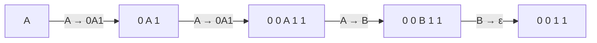
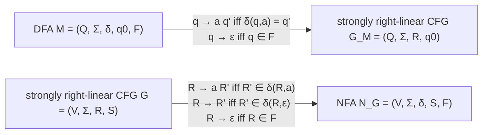
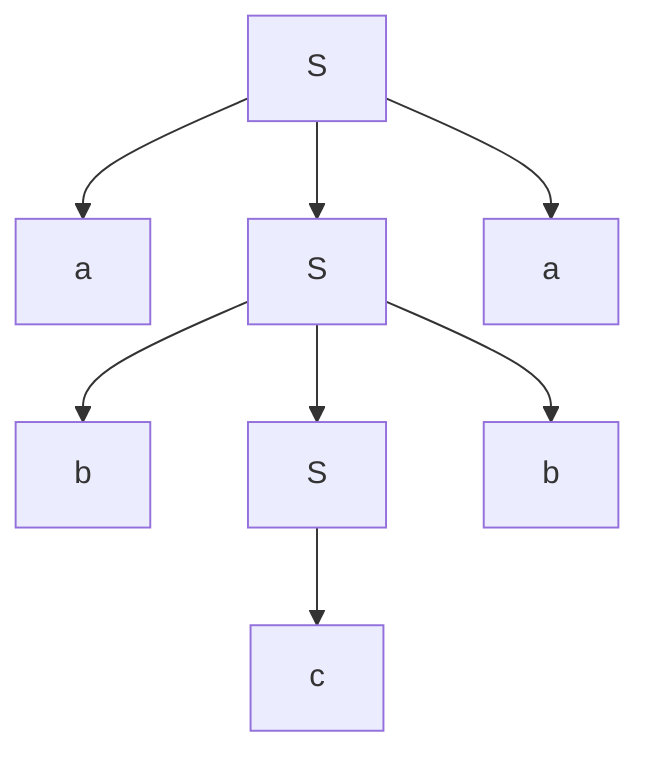
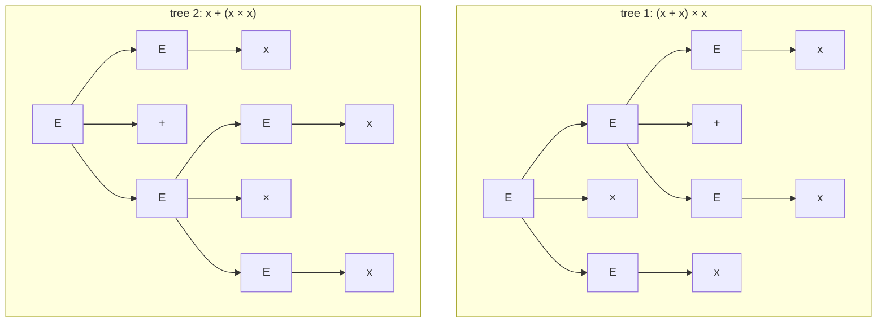
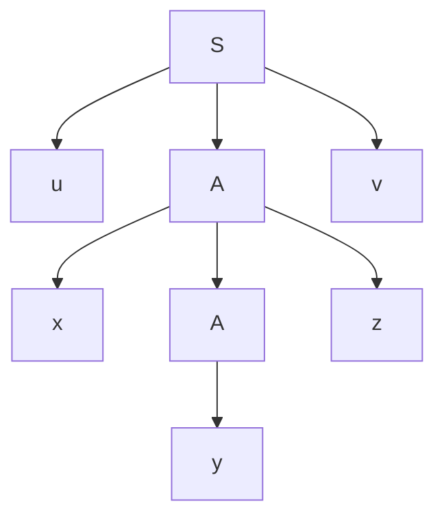

# Part 3 — Context-Free Grammars

*[Overview](MoC-Summary.md) · [Part 1](MoC-1-Finite-Automata.md) · [Part 2](MoC-2-Regular-Expressions-Pumping-Myhill-Nerode.md) · **Part 3** · [Part 4](MoC-4-Pushdown-Automata.md) · [Part 5](MoC-5-Turing-Machines.md) · [Part 6a](MoC-6a-Decidability.md) · [Part 6b](MoC-6b-Reductions-Rice-PCP.md) · [Part 7](MoC-7-Complexity.md) · [Formula sheet](MoC-8-Formula-Sheet.md)*

*Covers MoC5: context-free grammars, derivations, parse trees, ambiguity, right-linear grammars = regular, Chomsky normal form, the Pumping Lemma for CFLs, non-closure under complement. Tutorial sheets 3 (Q4–6) and 4 (Q1–2).*

---

## 1. A generative way to specify languages (MoC5 §1–2)

Regular languages were specified by **finite automata** (accept/reject strings) and **regular expressions** (strings have to match). A **grammar** is a new, *generative* specification: a set of rewriting rules that **produce** strings.

> [!NOTE]
> **📖 Definition (CFG).** A **context-free grammar** is a 4-tuple $`G=(V,\Sigma,\mathcal{R},S)`$ where
> (i) $`V`$ is a finite set of **variables** (non-terminals);
> (ii) $`\Sigma`$ is a finite set of **terminals**, disjoint from $`V`$;
> (iii) $`\mathcal{R}`$ is a finite set of **rules** (productions), each an element of $`V\times(V\cup\Sigma)^*`$, written $`A\to w`$;
> (iv) $`S\in V`$ is the **start symbol**.
>
> **📖 Derivation relation.** For $`u,v\in(V\cup\Sigma)^*`$ and each rule $`A\to w`$: $`uAv\Rightarrow uwv`$ (replace one occurrence of a variable by a right-hand side). $`\Rightarrow^*`$ is the reflexive-transitive closure.
>
> **📖 Language generated.** $`L(G)=\{w\in\Sigma^* : S\Rightarrow^*w\}`$. A language is **context-free** (a CFL) iff it is generated by some CFG.

"Context-free" because a variable $`A`$ may be rewritten regardless of what surrounds it ($`u`$ and $`v`$).

**How to generate a string.** (1) Set $`w`$ = start symbol. (2) Choose an occurrence of a variable $`X`$ in $`w`$, if any; otherwise STOP. (3) Pick a rule with left-hand side $`X`$ and replace the chosen occurrence by its right-hand side. (4) GOTO 2. Such a sequence is a **derivation**.

**Example.** $`G=(\{A,B\},\{0,1\},\{A\to0A1,\ A\to B,\ B\to\epsilon\},A)`$ generates $`\{0^i1^i : i\ge0\}`$:

```math
A\Rightarrow0A1\Rightarrow00A11\Rightarrow00B11\Rightarrow00\epsilon11=0^21^2.
```

(Write $`A\to0A1\mid B`$ to save writing: `|` separates alternatives.)



**More examples.**

| Language | Grammar |
|---|---|
| Palindromes over $`\{a,b,c\}`$ | $`S\to aSa\mid bSb\mid cSc\mid a\mid b\mid c\mid\epsilon`$ (7 rules) |
| Well-balanced parentheses | $`S\to(S)\mid SS\mid\epsilon`$, e.g. `((())())()` (exercise: prove it generates exactly the balanced strings) |
| Arithmetic expressions | $`E\to E+T\mid T`$, $`T\to T\times F\mid F`$, $`F\to(E)\mid x`$ (6 rules, unambiguous) |
| A small English fragment | $`\langle\text{SENTENCE}\rangle\to\langle\text{NOUN-PHRASE}\rangle\langle\text{VERB-PHRASE}\rangle`$, … , $`\langle\text{NOUN}\rangle\to`$ boy $`\mid`$ girl $`\mid`$ flower, $`\langle\text{PREP}\rangle\to`$ with (10 variables, 9 terminals, 18 rules); derives "a girl with a flower likes the boy" |

> [!TIP]
> **Design patterns for CFGs.** Matching pairs ⇒ $`S\to aSb`$ (counts must match); nesting ⇒ $`S\to(S)`$; sequencing ⇒ $`S\to SS`$; "anything" ⇒ $`X\to0X\mid1X\mid\epsilon`$; "at least three 1s" ⇒ $`S\to X1X1X1X`$; odd length with middle 0 ⇒ $`S\to0S0\mid0S1\mid1S0\mid1S1\mid0`$ (tutorial 3, Q4). Inequalities like $`n\le m+3`$: generate the matched part then pad ($`S\to aSb\mid B\mid a\mid aa\mid aaa`$, $`B\to bB\mid\epsilon`$). Disjunctions ($`n\neq2m`$) ⇒ union of a "too many" grammar and a "too few" grammar via $`S\to S_1\mid S_2`$.

---

## 2. Regular languages are context-free (MoC5 §3)

> [!NOTE]
> **📖 Definition.** A CFG is **right-linear** if every rule has the form $`R\to wT`$ or $`R\to w`$ with $`w\in\Sigma^*`$ a string of terminals and $`R,T`$ variables. It is **strongly right-linear** if each rule is $`R\to aT`$, $`R\to T`$ or $`R\to\epsilon`$ ($`a\in\Sigma`$).
>
> **Theorem.** A language is regular iff it is generated by a right-linear CFG.

**Fact.** Each right-linear CFG is equivalent to a strongly right-linear one: replace $`R\to a_0a_1\cdots a_nT`$ by $`R\to a_0V_1,\ V_1\to a_1V_2,\ \dots,\ V_n\to a_nT`$ with fresh variables $`V_1,\dots,V_n`$ (and $`R\to a_0\cdots a_n`$ similarly ending in $`V_n\to a_n V_{n+1}`$, $`V_{n+1}\to\epsilon`$).

**Proof idea: variables are states.**



"⇒": from a DFA $`M`$ build $`G_M=(Q,\Sigma,\mathcal{R},q_0)`$ with $`q\to aq'\in\mathcal{R}`$ iff $`\delta(q,a)=q'`$ and $`q\to\epsilon\in\mathcal{R}`$ iff $`q\in F`$. A derivation $`q_0\Rightarrow a_1q_1\Rightarrow a_1a_2q_2\Rightarrow\cdots\Rightarrow a_1\cdots a_n`$ is exactly an accepting run. "⇐": from a strongly right-linear $`G`$ build the NFA $`N_G=(V,\Sigma,\delta,S,F)`$ with $`R\xrightarrow{a}R'`$ iff $`R\to aR'`$, $`R\xrightarrow{\epsilon}R'`$ iff $`R\to R'`$, and $`R\in F`$ iff $`R\to\epsilon`$. ∎

Easy exercise: a right-linear CFG for $`0^*1^*0^*`$: $`S\to0S\mid T`$, $`T\to1T\mid U`$, $`U\to0U\mid\epsilon`$.

---

## 3. Parse trees, leftmost derivations and ambiguity (MoC5 §4)

> [!NOTE]
> **📖 Parse tree.** Each derivation determines a **parse tree**: root $`S`$; a node labelled $`A`$ rewritten by $`A\to X_1\cdots X_k`$ has ordered children $`X_1,\dots,X_k`$ (a rule $`A\to\epsilon`$ gives a single child $`\epsilon`$). Parse trees are **ordered** trees; reading the leaves left to right gives the derived string. The parse tree **abstracts away the order** in which variables were replaced.
>
> **📖 Leftmost derivation**: at every step the leftmost occurring variable is replaced. There is a **1–1 correspondence between parse trees and leftmost derivations**.
>
> **📖 Ambiguity.** Two derivations are **essentially different** if they determine distinct parse trees. A CFG $`G`$ is **ambiguous** if some word in $`L(G)`$ has two (or more) different leftmost derivations (equivalently, two parse trees). A language is **inherently ambiguous** if every CFG generating it is ambiguous.

**Example (palindrome grammar).** Derivation $`S\Rightarrow aSa\Rightarrow abSba\Rightarrow abcba`$ has the parse tree below.



**Example (parentheses).** With $`S\to(S)\mid SS\mid\epsilon`$ the string `((())())()` has the derivation $`S\Rightarrow SS\Rightarrow(S)S\Rightarrow(SS)S\Rightarrow^2((S)(S))S\Rightarrow^3((\epsilon)((S)))(S)\Rightarrow^2((\epsilon)((\epsilon)))(\epsilon)`$ = `((())())()`. (Note this grammar is itself ambiguous: $`SS`$ can split `()()` with either $`S\to SS`$ first or via $`\epsilon`$ padding, e.g. $`S\Rightarrow SS\Rightarrow SSS`$ in two ways.)

**Example (ambiguous arithmetic).** $`E\to E+E\mid E\times E\mid x`$. The string $`x+x\times x`$ has two essentially different leftmost derivations:

```math
E\Rightarrow\underline{E}\times E\Rightarrow\underline{E}+E\times E\Rightarrow x+\underline{E}\times E\Rightarrow x+x\times\underline{E}\Rightarrow x+x\times x
\qquad
E\Rightarrow\underline{E}+E\Rightarrow x+\underline{E}\Rightarrow x+\underline{E}\times E\Rightarrow x+x\times\underline{E}\Rightarrow x+x\times x
```



The **6-rule grammar** $`E\to E+T\mid T`$, $`T\to T\times F\mid F`$, $`F\to(E)\mid x`$ generates the same language **unambiguously**: it forces $`\times`$ to bind tighter than $`+`$ and both to associate left; $`x+x\times x`$ has the single leftmost derivation $`E\Rightarrow E+T\Rightarrow T+T\Rightarrow F+T\Rightarrow x+T\Rightarrow x+T\times F\Rightarrow x+F\times F\Rightarrow x+x\times F\Rightarrow x+x\times x`$ (exercise: prove unambiguity). Sometimes an ambiguous grammar's language has an equivalent unambiguous grammar; some languages are inherently ambiguous, e.g. $`\{0^i1^j2^k : i=j\vee j=k\}`$ (hard exercise).

**Undecidability note.** Whether a given CFG is ambiguous, and whether two CFGs are equivalent, are **undecidable** problems (Part 6a).

> [!TIP]
> **To show a grammar is ambiguous** (tutorial 4, Q1): exhibit one string with **two distinct leftmost derivations** (or two parse trees). E.g. $`S\to aSbS\mid bSaS\mid\epsilon`$: the string `abab` can be derived as $`S\Rightarrow aSbS\Rightarrow abS\Rightarrow abaSbS\Rightarrow\cdots`$ or $`S\Rightarrow aSbS\Rightarrow abSaSbS\Rightarrow\cdots`$. **To build an unambiguous grammar**, find a *unique* decomposition of every word (tutorial 4, Q2: strings whose every suffix has at least as many 0s as 1s decompose uniquely into blocks of 0s and "completely paired" blocks).

---

## 4. Chomsky normal form (MoC5 §5)

> [!NOTE]
> **📖 Definition.** A CFG is in **Chomsky normal form** (CNF) if every rule has one of the forms
> ```math
> A\to BC\qquad\text{or}\qquad A\to a
> ```
> where $`a`$ is a terminal and $`A,B,C`$ are variables, **except that $`B,C`$ may not be the start variable**; in addition $`S\to\epsilon`$ is permitted for the start variable $`S`$.
>
> **Theorem.** Any CFL can be generated by a CFG in Chomsky normal form.

Why it matters: in CNF every derivation of a word of length $`n\ge1`$ has **exactly $`2n-1`$ steps** ($`n-1`$ binary rules to produce $`n`$ variables, then $`n`$ terminal rules), which makes the acceptance problem $`A_{\text{CFG}}`$ decidable (Part 6a §2.3) and underlies CYK parsing.

---

## 5. The Pumping Lemma for context-free languages (MoC5 §6)

> [!NOTE]
> **📖 Pumping Lemma for CFLs.** If $`L`$ is context-free then there is a number $`p`$ (the pumping length) such that every $`w\in L`$ with $`\lvert w\rvert\ge p`$ can be divided into **five** pieces $`w=uxyzv`$ satisfying
> - $`ux^iyz^iv\in L`$ for each $`i\ge0`$;
> - $`\lvert xz\rvert>0`$;
> - $`\lvert xyz\rvert\le p`$.

Intuition: a long word has a tall parse tree, so some variable $`A`$ repeats on a root-to-leaf path; the subtree between the two $`A`$s generates $`x\,\cdot\,z`$ around the inner $`y`$ and can be repeated or removed. The two pumped pieces $`x`$ and $`z`$ **must be pumped together** (same $`i`$).



**Standard applications (not context-free):**
- $`\{ww : w\in\{0,1\}^*\}`$ — use $`w=0^p1^p0^p1^p`$.
- $`\{0^n1^n0^n : n\ge0\}`$ — use $`w=0^p1^p0^p`$ (with $`\lvert xyz\rvert\le p`$ the pumped parts touch at most two of the three blocks, so counts go out of sync).
- Also $`\{a^nb^nc^n\}`$, $`\{a^p : p \text{ prime}\}`$ (Part 5 shows TMs decide these).

---

## 6. Complementation and context-free languages (MoC5 §7)

> **Context-free languages are not closed under complementation.**

**Proof idea.** $`A=\{ww : w\in\{0,1\}^*\}`$ is not context-free (§5), but its complement $`B=\{0,1\}^*\setminus A`$ **is**, generated by $`(\{S,A,B,C\},\{0,1\},\mathcal{R},S)`$ with

```math
S\to AB\mid BA\mid A\mid B,\qquad A\to CAC\mid0,\qquad B\to CBC\mid1,\qquad C\to0\mid1.
```

$`A`$ generates all odd-length strings with a 0 in the middle, $`B`$ all odd-length strings with a 1 in the middle. So the grammar generates all strings of odd length (via $`S\to A`$ or $`S\to B`$) and all strings of the form $`x0yu1v`$ or $`u1vx0y`$ with $`\lvert x\rvert=\lvert y\rvert`$, $`\lvert u\rvert=\lvert v\rvert`$ — i.e. even-length strings with a mismatched position between the two halves. That is every string **except** those of the form $`ww`$. ∎ (Why does $`x0y\,u1v`$ with $`\lvert x\rvert=\lvert y\rvert,\lvert u\rvert=\lvert v\rvert`$ mean a mismatch between halves? The 0 is at position $`\lvert x\rvert+1`$ and the 1 at position $`2\lvert x\rvert+1+\lvert u\rvert+1`$; in a string of length $`2(\lvert x\rvert+\lvert u\rvert+1)`$ these are exactly half a length apart.)

Closure under union, concatenation, star, and intersection with a regular language, and non-closure under intersection, are in Part 4 §4.

---

## ✅ Key takeaways

> [!TIP]
> 1. A CFG **generates** strings by rewriting variables; $`L(G)=\{w\in\Sigma^* : S\Rightarrow^*w\}`$. Matching/nesting is what CFGs can do and DFAs cannot ($`S\to aSb`$).
> 2. **Right-linear grammars = regular languages** (variables ↔ states, $`q\to aq'`$ ↔ $`\delta(q,a)=q'`$, $`q\to\epsilon`$ ↔ accepting).
> 3. **Parse tree ↔ leftmost derivation** (1–1). **Ambiguous** = some word has two parse trees. Fix ambiguity by encoding precedence/associativity in the grammar ($`E\to E+T\mid T`$, …). Some languages are inherently ambiguous; ambiguity and CFG-equivalence are undecidable.
> 4. **Chomsky normal form** ($`A\to BC`$, $`A\to a`$, plus $`S\to\epsilon`$): every CFL has one; derivations of length-$`n`$ words take exactly $`2n-1`$ steps.
> 5. **CFL Pumping Lemma**: five pieces $`uxyzv`$, pump $`x`$ and $`z`$ together, $`\lvert xz\rvert>0`$, $`\lvert xyz\rvert\le p`$. Kills $`\{ww\}`$, $`\{0^n1^n0^n\}`$, $`\{a^nb^nc^n\}`$.
> 6. CFLs are **not closed under complement** (nor intersection): $`\{ww\}`$ is not CF but its complement is.

## ⚠️ Common misconceptions & errors

> [!WARNING]
> - ❌ "A derivation and a parse tree are the same thing." ✅ Many derivations (different replacement orders) give the *same* tree; ambiguity is about *different trees* / different **leftmost** derivations, not different derivations.
> - ❌ Proving ambiguity with two derivations that differ only in order. ✅ Both must be leftmost (or you must exhibit two different trees).
> - ❌ "If a grammar is ambiguous, the language is inherently ambiguous." ✅ Usually there is an unambiguous grammar (arithmetic expressions). Inherent ambiguity is a property of the *language*.
> - ❌ In the CFL Pumping Lemma, pumping $`x`$ and $`z`$ with different exponents, or forgetting that $`y`$ sits *between* them. ✅ $`ux^iyz^iv`$ with the same $`i`$.
> - ❌ "CFLs are closed under complement because regular languages are." ✅ No: $`\overline{\{ww\}}`$ is CF but $`\{ww\}`$ is not. (Deterministic PDAs would be closed under complement, but CFLs = *non-deterministic* PDAs.)
> - ❌ Writing CNF rules with the start symbol on the right ($`A\to SB`$). ✅ Not allowed; introduce a new start symbol $`S_0\to S`$ first.
> - ❌ "$`S\to SS\mid(S)\mid\epsilon`$ is unambiguous." ✅ It is ambiguous (`()()` has several trees); unambiguity requires a unique decomposition, e.g. $`S\to(S)S\mid\epsilon`$.
> - ❌ Forgetting the terminal/variable distinction: $`\Sigma\cap V=\emptyset`$; the generated language contains only strings of **terminals**.
