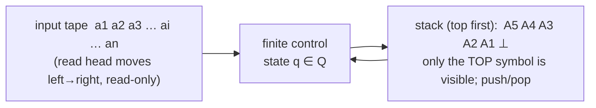
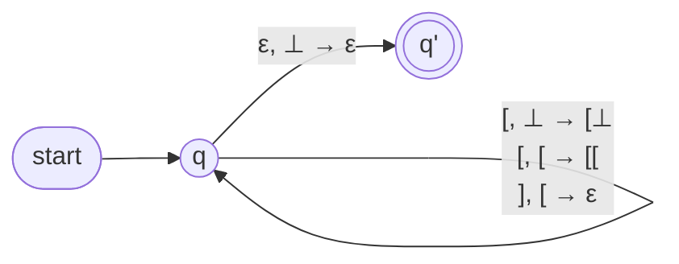
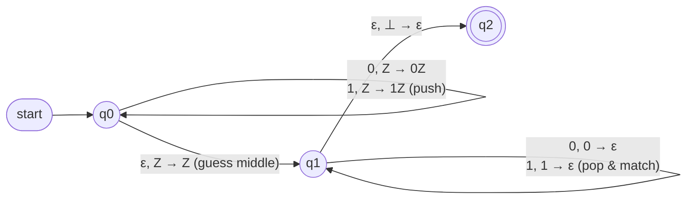
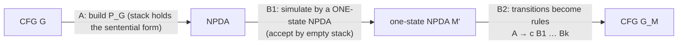
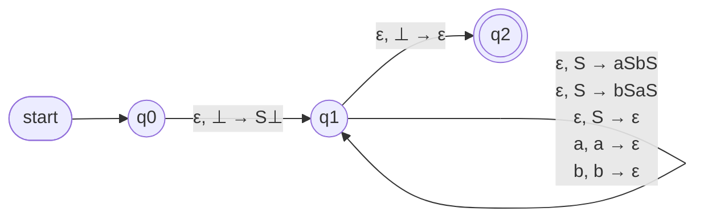
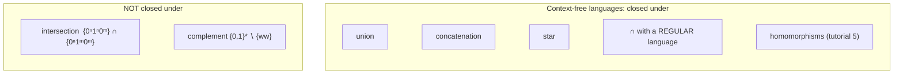

# Part 4 — Non-deterministic Pushdown Automata and Context-Free Languages

*[Overview](MoC-Summary.md) · [Part 1](MoC-1-Finite-Automata.md) · [Part 2](MoC-2-Regular-Expressions-Pumping-Myhill-Nerode.md) · [Part 3](MoC-3-Context-Free-Grammars.md) · **Part 4** · [Part 5](MoC-5-Turing-Machines.md) · [Part 6a](MoC-6a-Decidability.md) · [Part 6b](MoC-6b-Reductions-Rice-PCP.md) · [Part 7](MoC-7-Complexity.md) · [Formula sheet](MoC-8-Formula-Sheet.md)*

*Covers MoC6: NPDAs, configurations, acceptance by final state / empty stack, CFG ⇔ NPDA (both directions), closure properties of CFLs. Tutorial 4 Q3.*

---

## 1. Machines with a stack (MoC6 §1)

Regular languages are recognised by (non-)deterministic finite automata; **context-free languages are recognised by non-deterministic pushdown automata (NPDAs)**. (We follow Kozen's definitions.) An NPDA is an NFA plus a **stack** (pushdown store) holding a potentially unbounded amount of information in **last-in-first-out** order. Think of an NPDA as an algorithm for a decision problem whose only memory is a stack.



**One step of an NPDA.** It **pops** the top stack symbol; based on (1) that symbol, (2) the current input symbol (or none, for an $`\epsilon`$-transition), (3) the current state, it can (a) push a sequence of symbols (possibly $`\epsilon`$) onto the stack, (b) move its read head one cell right (not for $`\epsilon`$-transitions), (c) enter a new state. **Only the top-of-stack symbol is accessible in each step.**

> [!NOTE]
> **📖 Definition (NPDA).** A non-deterministic pushdown automaton is a 7-tuple $`(Q,\Sigma,\Gamma,\delta,q_0,\bot,F)`$ with all components finite:
> - $`Q`$ states, $`\Sigma`$ **input alphabet**, $`\Gamma`$ **stack alphabet**;
> - $`\delta: Q\times(\Sigma\cup\{\epsilon\})\times\Gamma\to\mathcal{P}(Q\times\Gamma^*)`$ the transition function;
> - $`q_0\in Q`$ start state, $`\bot\in\Gamma`$ the **initial stack symbol**, $`F\subseteq Q`$ accept states.
>
> An NPDA is strictly more powerful than a *deterministic* PDA (not studied here).
>
> **📖 Configuration**: an element $`(q,v,\gamma)\in Q\times\Sigma^*\times\Gamma^*`$ = (current state, **unread** input, stack contents with the top written first). **Start configuration** on input $`w`$: $`(q_0,w,\bot)`$.
>
> **📖 Next-configuration relation $`\to`$**: if $`(q,\gamma)\in\delta(p,a,A)`$ then for any $`v\in\Sigma^*`$, $`\beta\in\Gamma^*`$,
> ```math
> (p,\,av,\,A\beta)\to(q,\,v,\,\gamma\beta)\qquad\text{(input } a \text{ consumed; } A \text{ popped, } \gamma \text{ pushed; new state } q\text{)}
> ```
> and if $`(q,\gamma)\in\delta(p,\epsilon,A)`$ then $`(p,v,A\beta)\to(q,v,\gamma\beta)`$ (no input consumed). $`\overset{*}{\to}`$ is the reflexive-transitive closure: $`C\overset{0}{\to}D`$ iff $`C=D`$; $`C\overset{n+1}{\to}D`$ iff $`\exists E`$ with $`C\overset{n}{\to}E\to D`$; $`C\overset{*}{\to}D`$ iff $`C\overset{n}{\to}D`$ for some $`n\ge0`$.
>
> **📖 Acceptance by final state**: $`M`$ accepts $`x`$ if $`(q_0,x,\bot)\overset{*}{\to}(q,\epsilon,\gamma)`$ for some $`q\in F`$, $`\gamma\in\Gamma^*`$ (all input read, in an accept state, *any* stack). Configurations $`(q,\epsilon,\gamma)`$ with $`q\in F`$ are **accepting**. $`L(M)`$ = set of accepted strings.
>
> **📖 Acceptance by empty stack**: $`M`$ accepts $`x`$ if $`(q_0,x,\bot)\overset{*}{\to}(q,\epsilon,\epsilon)`$ for some $`q\in Q`$ ($`F`$ is irrelevant). **The two conventions are equivalent** (each can simulate the other).

**Transition-graph notation.** $`(q',\gamma)\in\delta(q,a,Z)`$ is drawn as an edge from $`q`$ to $`q'`$ labelled "$`a,Z\to\gamma`$": *read $`a`$, pop $`Z`$, push $`\gamma`$*. Pushing $`\gamma=\epsilon`$ is a pure pop; pushing $`\gamma=Z`$ leaves the stack unchanged; pushing $`\gamma=AZ`$ pushes $`A`$ on top of the old $`Z`$.

> [!TIP]
> **Every step pops.** The definition always pops the top symbol and pushes a string; "leave the stack alone" is $`Z\to Z`$, "push $`A`$" is $`Z\to AZ`$, "pop" is $`Z\to\epsilon`$. If the stack is empty no transition is possible (that branch dies). The bottom marker $`\bot`$ lets the machine detect the empty stack.

---

## 2. Examples (MoC6 §2)

### 2.1 Balanced strings of `[` and `]` (intuitive, then formal)

Intuitive algorithm: (1) if the input symbol is `[`, push `[`; (2) if the input symbol is `]` and the top of stack is `[`, pop; (3) if all input is read and the top of stack is $`\bot`$, accept.

Implementation-level: $`(\{q,q'\},\{[,]\},\{\bot,[\},\delta,q,\bot,\{q'\})`$ with

```math
\delta(q,[,\bot)=\{(q,[\bot)\},\quad \delta(q,[,[)=\{(q,[[)\},\quad \delta(q,],[)=\{(q,\epsilon)\},\quad \delta(q,\epsilon,\bot)=\{(q',\epsilon)\}.
```



On input `[[][]]` the stack goes $`\bot\to[\bot\to[[\bot\to[\bot\to[[\bot\to[\bot\to\bot`$, then the $`\epsilon`$-move accepts.

### 2.2 $`\{ww^R : w\in\{0,1\}^*\}`$ (even palindromes)

**High-level description.** (1) Push the input symbols onto the stack one at a time. (2) **Non-deterministically guess** that the middle has been reached, then switch to popping one symbol per input symbol read, checking that the popped and read symbols agree. (3) If they always agree and the stack empties exactly when the input is finished, accept.

**Implementation-level description.** $`(\{q_0,q_1,q_2\},\{0,1\},\{0,1,\bot\},\delta,q_0,\bot,\{q_2\})`$ where, for $`Z\in\{0,1,\bot\}`$,

```math
\begin{array}{lll}
(q_0,0,Z)\mapsto\{(q_0,0Z)\} & (q_0,1,Z)\mapsto\{(q_0,1Z)\} & (q_0,\epsilon,Z)\mapsto\{(q_1,Z)\}\\
(q_1,0,0)\mapsto\{(q_1,\epsilon)\} & (q_1,1,1)\mapsto\{(q_1,\epsilon)\} & (q_1,\epsilon,\bot)\mapsto\{(q_2,\epsilon)\}
\end{array}
```



**An accepting run on `011110`:**

```math
(q_0,011110,\bot)\to(q_0,11110,0\bot)\to(q_0,1110,10\bot)\to(q_0,110,110\bot)\to(q_1,110,110\bot)\to(q_1,10,10\bot)\to(q_1,0,0\bot)\to(q_1,\epsilon,\bot)\to(q_2,\epsilon,\epsilon).
```

Other branches (guessing the middle elsewhere) die; the input is accepted because **some** branch accepts.

---

## 3. Equivalence of NPDAs and CFGs (MoC6 §3)

> [!NOTE]
> **📖 Theorem.** A language is context-free iff some NPDA recognises it.



### 3.1 A: CFG ⇒ NPDA

**Lemma.** Given a CFG $`G`$ there is an equivalent NPDA $`P_G`$.

**Proof idea.** The stack alphabet of $`P_G`$ is $`V\cup\Sigma\cup\{\bot\}`$. $`P_G`$ does a **leftmost derivation on the stack**:
1. Place the start variable $`S`$ on the stack.
2. Repeat forever: pop the top of stack $`x`$. Three cases:
   (a) $`x`$ is a variable $`A`$: non-deterministically select a rule $`A\to w`$ and push $`w`$ (so the leftmost symbol of $`w`$ is on top).
   (b) $`x`$ is a terminal $`a`$: read the next input symbol and compare with $`a`$; if they differ, this branch dies (reject).
   (c) $`x=\bot`$: enter the accept state.

**Claim:** $`P_G`$ recognises $`L(G)`$ (each accepting run corresponds to a leftmost derivation and vice versa).

**Example: $`S\to aSbS\mid bSaS\mid\epsilon`$.** $`P_G=(\{q_0,q_1,q_2\},\{a,b\},\{\bot,S,a,b\},\delta,q_0,\bot,\{q_2\})`$ with

```math
\delta(q_0,\epsilon,\bot)=\{(q_1,S\bot)\},\quad
\delta(q_1,\epsilon,S)=\{(q_1,aSbS),(q_1,bSaS),(q_1,\epsilon)\},\quad
\delta(q_1,a,a)=\delta(q_1,b,b)=\{(q_1,\epsilon)\},\quad
\delta(q_1,\epsilon,\bot)=\{(q_2,\epsilon)\}.
```



Run on `abab` (rule used in brackets): $`(q_0,abab,\bot)\to(q_1,abab,S\bot)\to_{(1)}(q_1,abab,aSbS\bot)\to(q_1,bab,SbS\bot)\to_{(2)}(q_1,bab,bSaSbS\bot)\to(q_1,ab,SaSbS\bot)\to_{(3)}(q_1,ab,aSbS\bot)\to(q_1,b,SbS\bot)\to_{(3)}(q_1,b,bS\bot)\to(q_1,\epsilon,S\bot)\to_{(3)}(q_1,\epsilon,\bot)\to(q_2,\epsilon,\epsilon)`$, mirroring the leftmost derivation $`S\to aSbS\to abSaSbS\to abaSbS\to ababS\to abab`$.

### 3.2 B2: one-state NPDA ⇒ CFG

Take a one-state NPDA $`M=(\{q\},\Sigma,\Gamma,\delta,q,\bot,\emptyset)`$ accepting by empty stack. Define the CFG $`G_M=(\Gamma,\Sigma,P,\bot)`$ — **stack symbols become variables, $`\bot`$ is the start symbol** — where $`P`$ contains the rule

```math
A\to cB_1\cdots B_k\qquad\text{for every transition } (q,B_1\cdots B_k)\in\delta(q,c,A),\ c\in\Sigma\cup\{\epsilon\}.
```

Then $`L(M)=L(G_M)`$: "popping $`A`$ and eventually emptying what was pushed" corresponds to "$`A`$ generates the input consumed meanwhile".

### 3.3 B1: every NPDA can be simulated by a one-state NPDA

**Idea: keep all state information on the stack.** W.l.o.g. $`M=(Q,\Sigma,\Gamma,\delta,s,\bot,\{t\})`$ has a single final state $`t`$ and can empty its stack after entering $`t`$. Set $`\Gamma'=Q\times\Gamma\times Q`$, elements written $`\langle pAq\rangle`$, meaning "**$`M`$ is in state $`p`$ with $`A`$ on top, and will be in state $`q`$ when this $`A`$ is finally popped**". Define the one-state NPDA

```math
M'=(\{*\},\Sigma,\Gamma',\delta',*,\langle s\bot t\rangle,\emptyset)\quad\text{(accept by empty stack).}
```

For each transition $`(q_0,B_1\cdots B_k)\in\delta(p,c,A)`$, $`c\in\Sigma\cup\{\epsilon\}`$, include in $`\delta'`$ the transition

```math
\big(*,\ \langle q_0B_1q_1\rangle\langle q_1B_2q_2\rangle\cdots\langle q_{k-1}B_kq_k\rangle\big)\in\delta'\big(*,c,\langle pAq_k\rangle\big)\qquad\text{for all choices of } q_1,\dots,q_k\in Q.
```

$`M'`$ **guesses** non-deterministically which states $`M`$ will be in at future points (when each pushed symbol is popped), saves the guesses on the stack, and verifies them later: the guess $`q_i`$ written as the right component of $`\langle q_{i-1}B_iq_i\rangle`$ must equal the left component of the next triple.

**Lemma.** $`M'`$ can scan $`x`$ starting with only $`\langle pAq\rangle`$ on its stack and end with an empty stack iff $`M`$ can scan $`x`$ from state $`p`$ with only $`A`$ on its stack and end in state $`q`$ with an empty stack:

```math
(*,x,\langle pAq\rangle)\overset{n}{\to}_{M'}(*,\epsilon,\epsilon)\iff(p,x,A)\overset{n}{\to}_M(q,\epsilon,\epsilon).
```

$`M'`$ starts with $`\langle s\bot t\rangle`$; by the lemma it empties its stack on $`x`$ iff $`M`$ goes from $`s`$ to $`t`$ with empty stack on $`x`$, so $`L(M)=L(M')`$. ∎

---

## 4. Closure properties of context-free languages (MoC6 §4)

> [!NOTE]
> **📖 Theorem.** CFLs are closed under the regular operations: union, concatenation and star.

**Proof idea.** Let $`G_1=(V_1,\Sigma,\mathcal{R}_1,S_1)`$ and $`G_2=(V_2,\Sigma,\mathcal{R}_2,S_2)`$ with $`V_1\cap V_2=\emptyset`$ (rename variables). With a fresh start variable $`S`$:

```math
\begin{aligned}
G_{\text{union}}&=(V_1\cup V_2\cup\{S\},\Sigma,\mathcal{R}_1\cup\mathcal{R}_2\cup\{S\to S_1,\ S\to S_2\},S)\\
G_{\text{concat}}&=(V_1\cup V_2\cup\{S\},\Sigma,\mathcal{R}_1\cup\mathcal{R}_2\cup\{S\to S_1S_2\},S)\\
G_{\text{star}}&=(V_1\cup\{S\},\Sigma,\mathcal{R}_1\cup\{S\to S_1S,\ S\to\epsilon\},S)
\end{aligned}
```

Then $`L(G_{\text{union}})=L(G_1)\cup L(G_2)`$, $`L(G_{\text{concat}})=L(G_1)\cdot L(G_2)`$, $`L(G_{\text{star}})=L(G_1)^*`$.

> **CFLs are not closed under intersection.** $`A=\{0^n1^n0^m : n,m\ge0\}`$ and $`B=\{0^n1^m0^m : n,m\ge0\}`$ are context-free, but $`A\cap B=\{0^n1^n0^n : n\ge0\}`$ is not (CFL Pumping Lemma, Part 3 §5). Combined with closure under union and De Morgan, this also re-proves non-closure under complement.

> **The intersection of a CFL with a regular language is context-free.** Let $`A`$ be regular, recognised by NFA $`M=(Q_1,\Sigma,\delta_1,q_1,F_1)`$, and $`B`$ context-free, recognised by NPDA $`N=(Q_2,\Sigma,\Gamma,\delta_2,q_2,\bot,F_2)`$. The **product automaton** $`P=(Q_1\times Q_2,\Sigma,\Gamma,\delta,(q_1,q_2),\bot,F_1\times F_2)`$ with
> ```math
> \delta((r,t),a,A)=\{((r',t'),\alpha) : r'\in\delta_1(r,a),\ (t',\alpha)\in\delta_2(t,a,A)\}
> ```
> is an NPDA recognising $`A\cap B`$ (one stack suffices because the NFA needs none).



**Summary of Part One of the course / outlook.** Regular languages: finite automata, regular expressions, right-linear grammars; Pumping Lemma, Myhill–Nerode. Context-free languages: CFGs and NPDAs; CFL Pumping Lemma. Next: decidable and recursively enumerable languages — Turing machines, the Halting Problem and other undecidable problems.

---

## ✅ Key takeaways

> [!TIP]
> 1. NPDA = NFA + stack. A transition $`a,Z\to\gamma`$ reads $`a`$ (or $`\epsilon`$), **pops** $`Z`$, **pushes** $`\gamma`$; only the top symbol is visible.
> 2. Configurations $`(q,\text{unread input},\text{stack})`$; accept by **final state** ($`(q_0,x,\bot)\overset{*}{\to}(q\in F,\epsilon,\gamma)`$) or by **empty stack** ($`\overset{*}{\to}(q,\epsilon,\epsilon)`$); equivalent conventions.
> 3. Non-determinism is essential: the $`ww^R`$ machine **guesses the middle**; the CFG-simulating machine **guesses which rule to apply**.
> 4. **CFG ⇒ NPDA**: run a leftmost derivation on the stack (expand variables non-deterministically, match terminals against input). **NPDA ⇒ CFG**: first compress to one state by storing $`\langle pAq\rangle`$ triples ("I am in $`p`$, $`A`$ on top, will be in $`q`$ when $`A`$ is popped"), then each transition becomes a rule $`A\to cB_1\cdots B_k`$.
> 5. **Closure**: CFLs are closed under union, concatenation, star, and intersection with a regular language; **not** under intersection or complement.

## ⚠️ Common misconceptions & errors

> [!WARNING]
> - ❌ Writing a transition that reads the top of the stack without popping it. ✅ Every step pops; write $`Z\to Z`$ to keep it, $`Z\to AZ`$ to push $`A`$ on top of it.
> - ❌ Forgetting $`\bot`$, or popping $`\bot`$ too early so the machine gets stuck. ✅ Keep $`\bot`$ until the final $`\epsilon,\bot\to\epsilon`$ (or $`\bot\to\bot`$ into the accept state when accepting by final state).
> - ❌ "The NPDA for $`ww^R`$ rejects `011110` because the branch that guesses the middle after one symbol fails." ✅ Acceptance requires **some** branch to accept; dead branches are irrelevant.
> - ❌ "Acceptance by final state requires the stack to be empty." ✅ Any stack contents $`\gamma`$ are allowed, but **all input must be read**. Conversely acceptance by empty stack ignores $`F`$.
> - ❌ "PDAs are closed under complement/intersection like DFAs." ✅ The product construction needs two stacks for two NPDAs; it only works when one machine is a finite automaton (CFL ∩ regular).
> - ❌ "Deterministic and non-deterministic PDAs are equivalent (like DFA/NFA)." ✅ They are **not**: NPDAs are strictly more powerful (e.g. even palindromes need non-determinism).
> - ❌ In CFG → NPDA, pushing the rule's right-hand side **reversed**. ✅ Push it so the **leftmost** symbol is on top (we simulate a *leftmost* derivation).
> - ❌ In the one-state simulation, treating $`\langle pAq\rangle`$ as a state. ✅ It is a **stack symbol**; the single state is $`*`$. The $`q`$ component is a *guess* verified when adjacent triples are chained.
