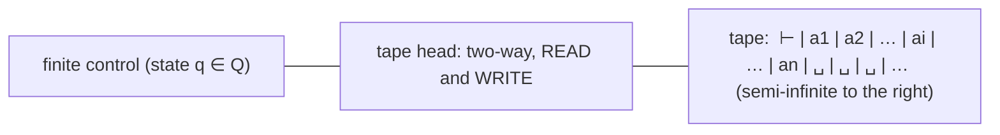
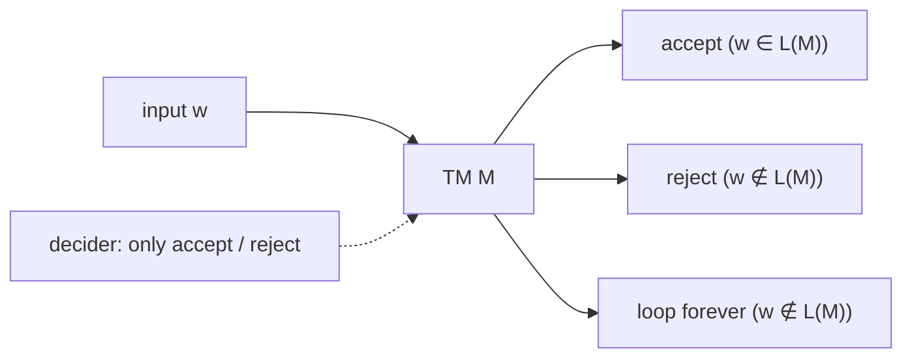
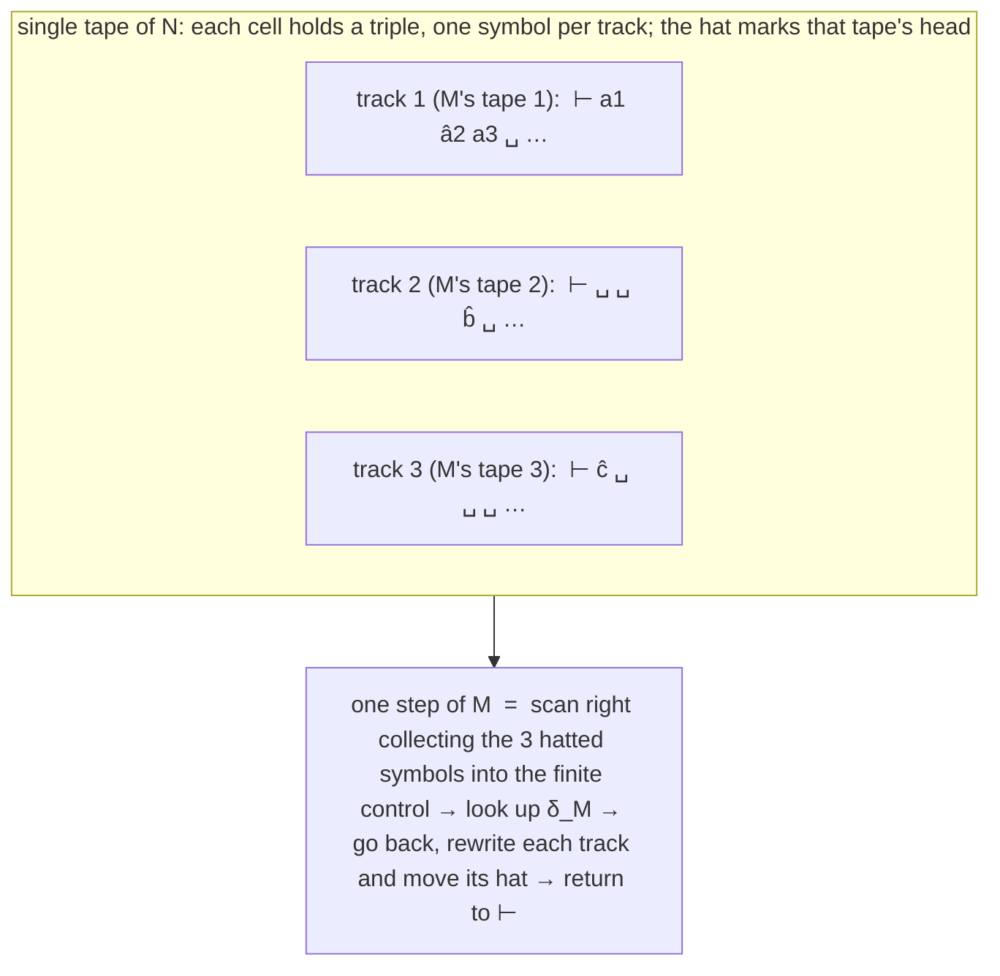
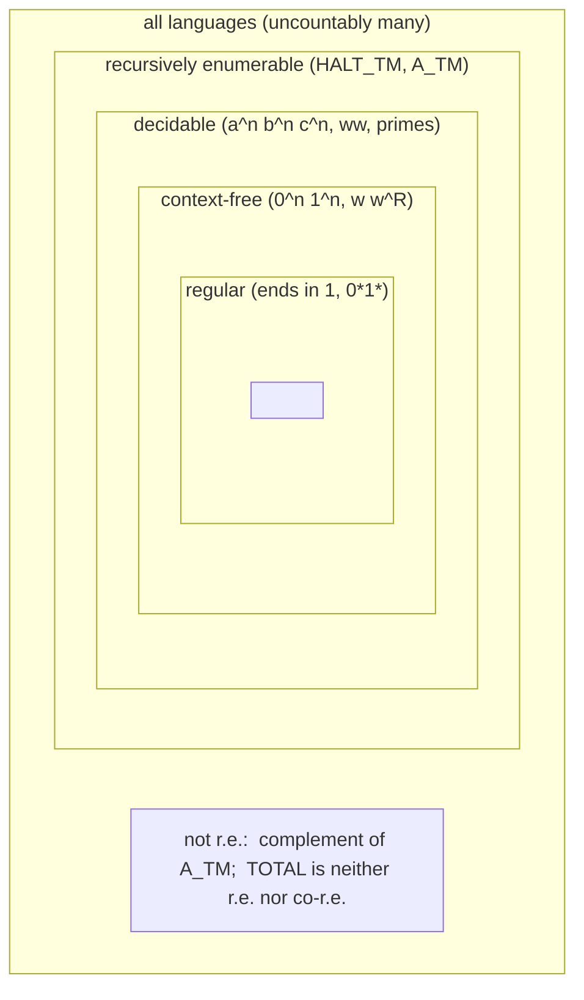

# Part 5 — Turing Machines, Effective Computability and the Church–Turing Thesis

*[Overview](MoC-Summary.md) · [Part 1](MoC-1-Finite-Automata.md) · [Part 2](MoC-2-Regular-Expressions-Pumping-Myhill-Nerode.md) · [Part 3](MoC-3-Context-Free-Grammars.md) · [Part 4](MoC-4-Pushdown-Automata.md) · **Part 5** · [Part 6a](MoC-6a-Decidability.md) · [Part 6b](MoC-6b-Reductions-Rice-PCP.md) · [Part 7](MoC-7-Complexity.md) · [Formula sheet](MoC-8-Formula-Sheet.md)*

*Covers MoC7 (Turing machines: definition, configurations, r.e. vs decidable, worked TMs for $`a^nb^nc^n`$, $`ww`$, $`a^p`$; multi-tape and non-deterministic variants) and MoC7.5 (What is an algorithm? Hilbert's 10th problem, Church–Turing thesis, the language-class table). Tutorial 4 Q4–6, tutorial 5 Q2–3.*

---

## 1. Informal description (MoC7 §1)

Turing machines (TMs) are the most powerful automata we study: they can compute any function normally considered computable — indeed we *define* **computable** to mean computable by a Turing machine.



A (one-tape deterministic) TM consists of a finite **input alphabet** $`\Sigma`$ and finite **tape alphabet** $`\Gamma\supset\Sigma`$; a finite set of **states** $`Q`$; a **semi-infinite tape** of cells (infinite to the right); a **tape head** that moves left and right, reading *and writing* symbols. At the start the tape holds $`\vdash w_1\cdots w_n\sqcup\sqcup\sqcup\cdots`$ where $`w=w_1\cdots w_n`$ is the input, $`\vdash\in\Gamma`$ is the **left endmarker**, and all cells to the right of the input hold the **blank** $`\sqcup\in\Gamma`$; the head is over $`\vdash`$.

**Workings.** The machine starts in its start state with the head on the leftmost cell. At each step it reads the symbol under the head, and depending on that symbol and the current state, it *writes* a new symbol on that cell, *moves* the head left or right one cell, and *enters* a new state (all determined by the transition function $`\delta`$). It **accepts** by entering the accept state, **rejects** by entering the reject state. On some inputs it may run forever without accepting or rejecting: it **loops**. (Definitions in the literature differ in inessential details; we use Kozen's.)

> [!NOTE]
> **📖 Definition (TM).** A one-tape deterministic Turing machine is a 9-tuple
> ```math
> (Q,\Sigma,\Gamma,\vdash,\sqcup,\delta,q_0,q_{\text{acc}},q_{\text{rej}})
> ```
> - $`Q`$ finite set of states; $`\Sigma`$ finite input alphabet; $`\Gamma\supseteq\Sigma`$ finite tape alphabet;
> - $`\vdash\in\Gamma-\Sigma`$ left endmarker; $`\sqcup\in\Gamma-\Sigma`$ blank symbol;
> - $`\delta: Q\times\Gamma\to Q\times\Gamma\times\{L,R\}`$ transition function;
> - $`q_0,q_{\text{acc}},q_{\text{rej}}\in Q`$ start, accept and reject states, $`q_{\text{acc}}\neq q_{\text{rej}}`$.
>
> $`\delta(q,a)=(q',b,L)`$ means: "in state $`q`$ scanning $`a`$: enter $`q'`$, write $`b`$ over the cell, move the head left one cell".
>
> **Restrictions (conventions).** (1) The endmarker is never overwritten and the head never moves left of it: for all $`p`$ there is $`q`$ with $`\delta(p,\vdash)=(q,\vdash,R)`$. (2) Once in $`q_{\text{acc}}`$ (resp. $`q_{\text{rej}}`$) the machine never leaves: $`\delta(q_{\text{acc}},b)=(q_{\text{acc}},c,D)`$ and $`\delta(q_{\text{rej}},b)=(q_{\text{rej}},c',D')`$ for all $`b`$.

**Three levels of describing a TM** (used throughout): *high-level* (an informal algorithm: "scan right, mark the first unmarked $`a`$ …"), *implementation-level* (states, tape alphabet, what the head does, but no $`\delta`$ table), and *formal* (the full tuple and $`\delta`$).

---

## 2. Configurations and the language recognised (MoC7 §2)

> [!NOTE]
> **📖 Configuration**: a triple $`(u,q,v)`$ = (tape to the left of the head, current state, tape from the head rightwards): the tape content is $`uv`$ and the head is over the **first symbol of $`v`$**. If the head is at the right end, $`(ua,q,\epsilon)`$ is equivalent to $`(ua,q,\sqcup)`$.
>
> **📖 Next-configuration relation $`\to`$** ("$`C`$ yields $`C'`$"):
> ```math
> (ua,q,bv)\to(u,q',acv)\ \text{ if } \delta(q,b)=(q',c,L),\qquad\qquad (ua,q,bv)\to(uac,q',v)\ \text{ if } \delta(q,b)=(q',c,R).
> ```
> $`\overset{*}{\to}`$ (reflexive-transitive closure, "yields in finitely many steps"): $`C\overset{0}{\to}C`$; $`C\overset{n+1}{\to}C''`$ if $`C\overset{n}{\to}C'`$ and $`C'\to C''`$; $`C\overset{*}{\to}C'`$ iff $`C\overset{n}{\to}C'`$ for some $`n\ge0`$.
>
> **📖 Start configuration** on input $`w`$: $`(\epsilon,q_0,\vdash w)`$. An **accepting configuration** has state $`q_{\text{acc}}`$; a **rejecting configuration** has state $`q_{\text{rej}}`$.
>
> **📖 $`M`$ accepts $`w`$** iff $`(\epsilon,q_0,\vdash w)\overset{*}{\to}C`$ for some accepting configuration $`C`$. **$`L(M)`$** = set of strings $`M`$ accepts.
>
> **📖 Recursively enumerable (r.e.)**: a language recognised by *some* TM.
>
> **📖 Halting.** On an input, $`M`$ may **accept, reject, or loop**. $`M`$ **halts** on an input if it accepts or rejects. $`M`$ is **total** (a **decider**) if it halts on *all* inputs. A language is **decidable** (= **recursive**) if it is recognised by some total TM; that TM **decides** it.



> [!TIP]
> **r.e. vs decidable in one sentence.** For r.e. you only need the "yes" instances to be accepted eventually; "no" instances may be rejected *or loop*. For decidable, every input must halt. Every decidable language is r.e.; the converse fails (Part 6a: $`A_{\text{TM}}`$, the Halting Problem).

---

## 3. Worked Turing machines (MoC7 §3)

### 3.1 A TM accepting $`\{a^nb^nc^n : n\ge0\}`$ (not context-free)

**High-level.** In the start state scan right over the input checking it matches $`a^*b^*c^*`$, writing nothing (overwrite each letter with itself); on the first $`\sqcup`$ write a **right endmarker $`\dashv`$**. Then scan left, *erasing* (overwriting with $`\sqcup`$) the first $`c`$ seen, then the first $`b`$, then the first $`a`$, until $`\vdash`$. Then scan right erasing one $`a`$, one $`b`$, one $`c`$. Keep sweeping, erasing one of each letter per pass. If in some pass you see at least one occurrence of one letter but none of another, **reject**. Otherwise eventually all letters are erased and one pass from $`\vdash`$ to $`\dashv`$ sees only blanks: **accept**.

**Implementation-level.** $`Q=\{1,\dots,10,q_0,q_{\text{acc}},q_{\text{rej}}\}`$, $`\Sigma=\{a,b,c\}`$, $`\Gamma=\Sigma\cup\{\vdash,\sqcup,\dashv\}`$. The $`\delta`$ table (slide 8; "−" = don't care):

| | $`\vdash`$ | $`a`$ | $`b`$ | $`c`$ | $`\sqcup`$ | $`\dashv`$ |
|---|---|---|---|---|---|---|
| $`q_0`$ | $`(q_0,\vdash,R)`$ | $`(q_0,a,R)`$ | $`(1,b,R)`$ | $`(2,c,R)`$ | $`(3,\dashv,L)`$ | − |
| 1 | − | $`q_{\text{rej}}`$ | $`(1,b,R)`$ | $`(2,c,R)`$ | $`(3,\dashv,L)`$ | − |
| 2 | − | $`q_{\text{rej}}`$ | $`q_{\text{rej}}`$ | $`(2,c,R)`$ | $`(3,\dashv,L)`$ | − |
| 3 | $`q_{\text{acc}}`$ | $`q_{\text{rej}}`$ | $`q_{\text{rej}}`$ | $`(4,\sqcup,L)`$ | $`(3,\sqcup,L)`$ | − |
| 4 | $`q_{\text{rej}}`$ | $`q_{\text{rej}}`$ | $`(5,\sqcup,L)`$ | $`(4,c,L)`$ | $`(4,\sqcup,L)`$ | − |
| 5 | $`q_{\text{rej}}`$ | $`(6,\sqcup,L)`$ | $`(5,b,L)`$ | − | $`(5,\sqcup,L)`$ | − |
| 6 | $`(7,\vdash,R)`$ | $`(6,a,L)`$ | − | − | $`(6,\sqcup,L)`$ | − |
| 7 | − | $`(8,\sqcup,R)`$ | $`q_{\text{rej}}`$ | $`q_{\text{rej}}`$ | $`(7,\sqcup,R)`$ | $`q_{\text{acc}}`$ |
| 8 | − | $`(8,a,R)`$ | $`(9,\sqcup,R)`$ | $`q_{\text{rej}}`$ | $`(8,\sqcup,R)`$ | $`q_{\text{rej}}`$ |
| 9 | − | − | $`(9,b,R)`$ | $`(10,\sqcup,R)`$ | $`(9,\sqcup,R)`$ | $`q_{\text{rej}}`$ |
| 10 | − | − | − | $`(10,c,R)`$ | $`(10,\sqcup,R)`$ | $`(3,\dashv,L)`$ |

Reading the table: states $`q_0,1,2`$ check the shape $`a^*b^*c^*`$ ($`q_0`$ = "in the $`a`$s", 1 = "in the $`b`$s", 2 = "in the $`c`$s"); states 3–6 sweep left erasing one $`c`$, one $`b`$, one $`a`$ (3 = looking for a $`c`$, 4 = found $`c`$ looking for $`b`$, 5 = looking for $`a`$, 6 = done, return to $`\vdash`$); states 7–10 sweep right erasing one $`a`$, one $`b`$, one $`c`$ (7 = looking for $`a`$; reaching $`\dashv`$ in 7 means only blanks were seen: accept). Accepting run on `abc`: $`q_0q_0q_0\,1\,2\,3\,4\,5\,6\,7\,7\,7\,7\,q_{\text{acc}}`$ (the head writes $`\dashv`$, erases $`c,b,a`$ going left, then sweeps right over blanks to $`\dashv`$).

### 3.2 A TM that decides $`\{ww : w\in\{a,b\}^*\}`$ (non-context-free but decidable)

$`\Gamma=\{a,b,\vdash,\dashv,\sqcup,\grave a,\grave b,\acute a,\acute b\}`$ (marked copies of the letters). Two stages:

**Stage I: marking.** Scan out to the first blank, checking that the input has **even length** (reject immediately if not); lay down $`\dashv`$. Then repeatedly scan back and forth: each right-to-left pass marks the first unmarked $`a`$/$`b`$ it sees with ´ (acute: $`\acute a,\acute b`$); each left-to-right pass marks the first unmarked letter with ` (grave: $`\grave a,\grave b`$). Continue until all symbols are marked. *Reason: this identifies the centre* — the left half ends up grave-marked, the right half acute-marked:

```math
\vdash a\,a\,b\,b\,a\,a\,a\,b\,b\,a\sqcup\cdots\qquad\leadsto\qquad\vdash\grave a\,\grave a\,\grave b\,\grave b\,\grave a\,\acute a\,\acute a\,\acute b\,\acute b\,\acute a\dashv\sqcup\cdots
```

**Stage II: erasing.** Repeatedly: from the left, erase the first grave-marked symbol but **remember it in the finite control**; scan right to the first acute-marked symbol, check it is the same letter, erase it (else reject). When everything is erased, accept.

Implementation-level (slide 17, 13 states): $`q_0,1`$ check even length (alternate on each letter; blank in $`q_0`$ means odd ⇒ reject; blank in 1 ⇒ write $`\dashv`$, enter 2); 2–6 do the marking (2 moves left looking for an unmarked letter to acute-mark, 3/4/5 move right to grave-mark one, 6 returns; $`\vdash`$ in state 2 ⇒ everything marked ⇒ accept… in the slide table state 2 on $`\vdash`$ goes to $`q_{\text{acc}}`$ only when stage II has already been entered — read the slide table for the exact bookkeeping); 7–10 do the erasing (7 finds the next grave symbol, 8/9 remember "$`a`$"/"$`b`$" and seek the matching acute symbol, 10 returns left; $`\dashv`$ in state 7 ⇒ accept).

### 3.3 A TM that decides $`\{a^p : p \text{ prime}\}`$ (sieve of Eratosthenes)

Another non-context-free decidable language. **Idea:** write down $`2,\dots,n`$; repeatedly take the smallest remaining number (a prime) and cross off its multiples; stop when $`n`$ is crossed off (not prime) or all smaller numbers are gone (prime). On a tape the "numbers" are positions. $`\Gamma=\{a,\vdash,\dashv,\sqcup,\grave a,\grave\sqcup\}`$.

**Stage I: setup.** On input $`a^k`$ erase the first letter and scan right to the first blank; reject if there was none or only one $`a`$ ($`k\le1`$). Replace the last $`a`$ by $`\dashv`$. (Position $`i`$ now represents the number $`i`$; positions $`2..k-1`$ hold $`a`$.)

**Stage II: sieving.** Find the leftmost $`a`$, say at position $`p`$ (a prime); erase it and mark all $`p-1`$ blanks to its left with ` . Move the marks along one cell at a time (a sliding ruler of length $`p`$) to find positions that are multiples of $`p`$ and erase them. If it tries to erase the right endmarker, **reject** ($`p`$ divides $`k`$). Otherwise erase the marks and repeat Stage II. If no $`a`$ is left, **accept** (no $`p<k`$ divides $`k`$). The slide shows the run for $`k=13`$: $`p=2`$ erases 4, 6, …; $`p=3`$ erases 9; $`p=5,7,11`$ erase nothing new; then no $`a`$ remains ⇒ accept. (Implementation-level description: exercise.)

> [!TIP]
> **TM design toolkit** (seen in these examples and tutorial 4 Q5): add a **right endmarker**; use **marked copies** of symbols ($`\grave a,\acute a`$) to remember progress on the tape; use **states to remember a symbol** while moving the head; **zig-zag** sweeps to compare/count; "**erase one of each per pass**" to check equal counts; sliding marks to measure distances (divisibility). Always say what happens on every symbol in every state (or declare "don't care"/reject), and make sure the machine halts for a decider.

---

## 4. Variations: TMs are robust (MoC7 §4)

Fairly broad variations of the definition give equivalent machines (same class of recognised languages).

### 4.1 Multi-tape TMs

A $`k`$-tape TM has $`k`$ semi-infinite tapes, each with its own independent read/write head; the input starts on tape 1, the others blank. Each step reads the $`k`$ symbols under the heads, writes a symbol on each tape, moves each head (independently) and changes state:

```math
\delta: Q\times\Gamma^k\to Q\times\Gamma^k\times\{L,R\}^k.
```

**Simulating a 3-tape $`M`$ by a single-tape $`N`$.** $`\Sigma_N=\Sigma_M`$ and tape alphabet

```math
\Gamma_N=\Sigma_M\cup\{\vdash\}\cup(\Gamma_M\cup\widehat{\Gamma_M})^3,\qquad\widehat{\Gamma_M}=\{\hat a : a\in\Gamma_M\},
```

so $`N`$'s tape is divided into **three tracks**, each holding one of $`M`$'s tapes, and each track has exactly one **marked** symbol $`\hat a`$ recording where that tape's head is. On input $`x=a_1\cdots a_n`$, $`N`$ first copies the input to the top track, fills the other tracks with blanks and shifts everything right one cell to fit the simulated left end. Each step of $`M`$ is simulated by several steps of $`N`$: scan from the left until all three marks have been seen, remembering the marked symbols in the finite control; determine what $`\delta_M`$ does; go back to all three marks, rewrite the symbols on each track and move the marks; return to the left end.



(Running-time cost of this simulation: Part 7 §2.)

### 4.2 Non-deterministic TMs (NDTM)

At any point a NDTM may proceed in one of several ways: $`\delta: Q\times\Gamma\to\mathcal{P}(Q\times\Gamma\times\{L,R\})`$. Its computation on an input is a **tree** whose branches are the possible runs; it **accepts** if *any* branch reaches the accept state.

> **Lemma.** A language is recognised by some TM iff it is recognised by some NDTM.

(Simulate by exploring the computation tree breadth-first on a 3-tape deterministic TM; Part 7 §4.) Other equivalent variants: atomic TMs (each transition either writes or moves, not both — tutorial 4 Q4), two-way infinite tapes, several heads, etc.

---

## 5. What is an algorithm? The Church–Turing thesis (MoC7.5)

### 5.1 Decision problems as languages

A **decision problem** expects a yes/no answer: PRIME (is a number prime?), CYCLIC (is a graph cyclic?), DFA ACCEPTANCE (does DFA $`B`$ accept $`w`$?). **We represent decision problems as languages** by fixing an encoding $`\langle\cdot\rangle`$ of the objects as strings; e.g. CYCLIC becomes $`\{\langle G\rangle : G \text{ is a cyclic graph}\}`$ over $`\Sigma=\{0,1,(,),\#\}`$, where the graph $`(\{1,2,3\},\{(1,2),(2,3),(3,1)\})`$ is encoded as `(1#10#11)#((1#10)#(10#11)#(11#1))`. The exact encoding is unimportant.

> [!NOTE]
> **📖** A decision problem is **decidable** if the corresponding language is decidable by a TM; it is **RE / semi-decidable** if the corresponding language is r.e. (recognised by a TM).

### 5.2 Hilbert's 10th problem

At the 1900 ICM Hilbert posed 23 problems. **Hilbert's 10th Problem:** devise an *algorithm* (in his words "a process according to which it can be determined by a finite number of operations") that tests whether a polynomial has an integral root. E.g. $`p(x,y,z)=6x^3yz^2+3xy^2-x^3-10`$ has the root $`(5,3,0)`$. Hilbert assumed such an algorithm exists and need only be found.

**Theorem (Matijasevich, 1970).** Hilbert's 10th Problem is algorithmically unsolvable: no algorithm (= Turing machine) solves it. *Without a precise definition of "algorithm", mathematicians of Hilbert's era could not even have stated this.* We need an accepted definition of algorithm before we can prove that none exists for a problem.

In our terminology: $`D=\{p : p \text{ is a polynomial with an integral root}\}`$ is **not decidable, but it is r.e.** A TM for $`D_1=\{p : p \text{ a polynomial over } x \text{ with an integral root}\}`$: evaluate $`p`$ at $`x=0,1,-1,2,-2,\dots`$ and accept if it ever evaluates to 0. If a root exists it is found; if not, the machine runs forever — so $`M_1`$ recognises but does not decide $`D_1`$. (For multivariate $`D`$, enumerate all integer tuples.) But $`M_1`$ *can* be turned into a decider because roots of a single-variable polynomial are bounded: they lie in

```math
\Big[-k\frac{c_{\max}}{c_1},\ k\frac{c_{\max}}{c_1}\Big],\qquad k=\text{number of terms},\ c_{\max}=\text{largest }|\text{coefficient}|,\ c_1=\text{leading coefficient},
```

so the search can be restricted. Matijasevich's theorem shows no such bound can be computed for multivariate polynomials.

### 5.3 Effective computability and the thesis

An **algorithm** is informally a collection of simple instructions for a task (a procedure/recipe); having one means knowing a way of *effectively computing* the answer (long division, the sieve, Euclid's gcd). Various formalisms were proposed to make "effectively computable" precise: **Turing machines** (Turing 1936), **Post systems** (Post), **$`\mu`$-recursive functions** (Gödel, Herbrand), **$`\lambda`$-calculus** (Church, Kleene), **combinatory logic** (Schönfinkel, Curry).

> **Theorem.** All these formalisms are equivalent: a problem is solvable (decidable) w.r.t. one iff it is solvable by any of the others.

This remarkable coincidence says there is only **one** notion of computability:

> [!NOTE]
> **📖 Church–Turing Thesis.** *Intuitive notions of algorithm = Turing machines.*
>
> This is **not a theorem** (it cannot be proved, since "intuitive algorithm" is not a mathematical object); it is best regarded as a **definition** of "algorithm". It is widely accepted by mathematicians and computer scientists. Practical consequence: we may describe TMs at a high level ("simulate $`M`$ on $`w`$", "enumerate all tuples") and trust they can be implemented.

### 5.4 The big table (MoC7.5 slide 12)

| | **regular** | **context-free** | **semi-decidable / r.e.** |
|---|---|---|---|
| **Grammar** (rules) | right-linear: $`A\to wB`$, $`A\to w`$ | context-free: $`A\to\alpha`$ | unrestricted: $`\alpha\to\beta`$ |
| **Machine** (memory) | DFA or NFA (finite) | NPDA (finite + one stack) | Turing machine (unrestricted) |
| **Other descriptions** | regular expression; Myhill–Nerode | — | $`\lambda`$-calculus, $`\mu`$-recursive functions, … |
| **Example** | $`\{w : w \text{ contains } 10\}`$, $`\{0^n1^m : n,m\ge0\}`$ | $`\{ww^R\}`$, $`\{0^n1^n\}`$ | $`\{0^n1^m0^{n+m}\}`$ (even CF), $`\{Mx : M \text{ halts on } x\}`$ (HP) |
| **Counterexample** | $`\{0^n1^n\}`$ | $`\{0^n1^n0^n\}`$, $`\{ww\}`$ | $`\{M : M \text{ halts on every } x\}`$ |
| **Application** | tokenizer, model checker | parser | general computing |



---

## ✅ Key takeaways

> [!TIP]
> 1. A TM = finite control + one semi-infinite read/write tape with endmarker $`\vdash`$ and blanks $`\sqcup`$; $`\delta(q,a)=(q',b,D)`$ writes, moves, changes state. Three outcomes: **accept, reject, loop**.
> 2. Configurations $`(u,q,v)`$ (head on the first symbol of $`v`$); $`L(M)`$ = inputs with $`(\epsilon,q_0,\vdash w)\overset{*}{\to}`$ an accepting configuration.
> 3. **r.e.** (recognised) vs **decidable** (recognised by a *total* TM = decider). Decidable ⊂ r.e. ⊂ all languages (Part 6a makes the inclusions strict).
> 4. TMs are **robust**: multi-tape (tracks + marked head positions), non-deterministic (computation tree), atomic, … all recognise the same languages. This robustness is the evidence for the **Church–Turing thesis**: algorithm = TM (a definition, not a theorem).
> 5. Decision problems ↔ languages via encodings $`\langle\cdot\rangle`$; Hilbert's 10th problem is r.e. but undecidable (Matijasevich). You need a definition of "algorithm" to prove one does not exist.
> 6. Know the big table: grammar/machine/memory/examples/counterexamples for regular, context-free and r.e.

## ⚠️ Common misconceptions & errors

> [!WARNING]
> - ❌ "A TM that rejects some inputs by looping still decides its language." ✅ Looping is **not** rejecting. A decider must halt (accept or reject) on **every** input.
> - ❌ "r.e. means the machine says no for strings outside the language." ✅ Outside the language it may reject *or loop*; only "yes" answers are guaranteed.
> - ❌ "If $`L`$ is r.e. then $`\overline L`$ is r.e." ✅ False in general ($`\overline{A_{\text{TM}}}`$, Part 6a). It holds for decidable languages (swap $`q_{\text{acc}}`$/$`q_{\text{rej}}`$ **only in a decider**).
> - ❌ Swapping accept/reject in a non-total TM to get the complement. ✅ Looping inputs stay looping, so they are still rejected; this does not recognise the complement.
> - ❌ "The Church–Turing thesis has been proved." ✅ It is a thesis/definition. What *is* proved is the pairwise equivalence of the formalisms (TMs, $`\lambda`$-calculus, …).
> - ❌ Confusing $`\Sigma`$ and $`\Gamma`$: input strings are over $`\Sigma`$; $`\vdash`$, $`\sqcup`$ and marker symbols live in $`\Gamma-\Sigma`$ and never appear in the input.
> - ❌ Moving left from $`\vdash`$ or overwriting it. ✅ Convention (1): $`\delta(p,\vdash)=(q,\vdash,R)`$ always.
> - ❌ Confusing the quantifier order of "universal TM" (one $`U`$ simulates *every* $`M`$; Part 6a) with "every NDTM can be simulated by *some* deterministic TM" (one simulator per machine).
> - ❌ "Hilbert's 10th problem is not r.e. because it is undecidable." ✅ It **is** r.e. (search all tuples); undecidable ≠ not r.e.
