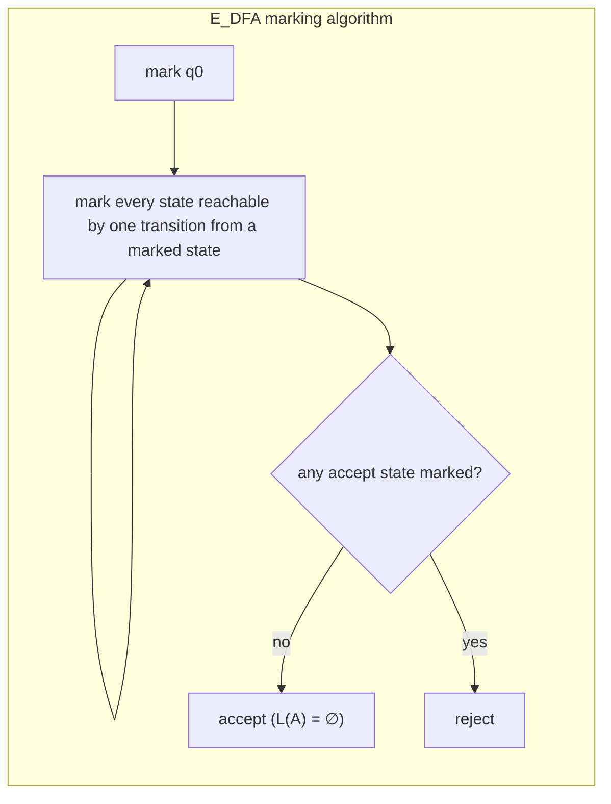
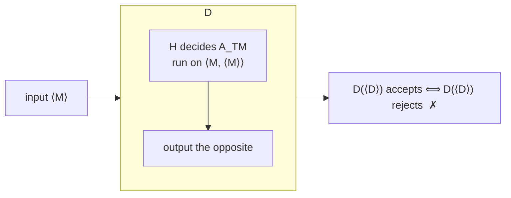
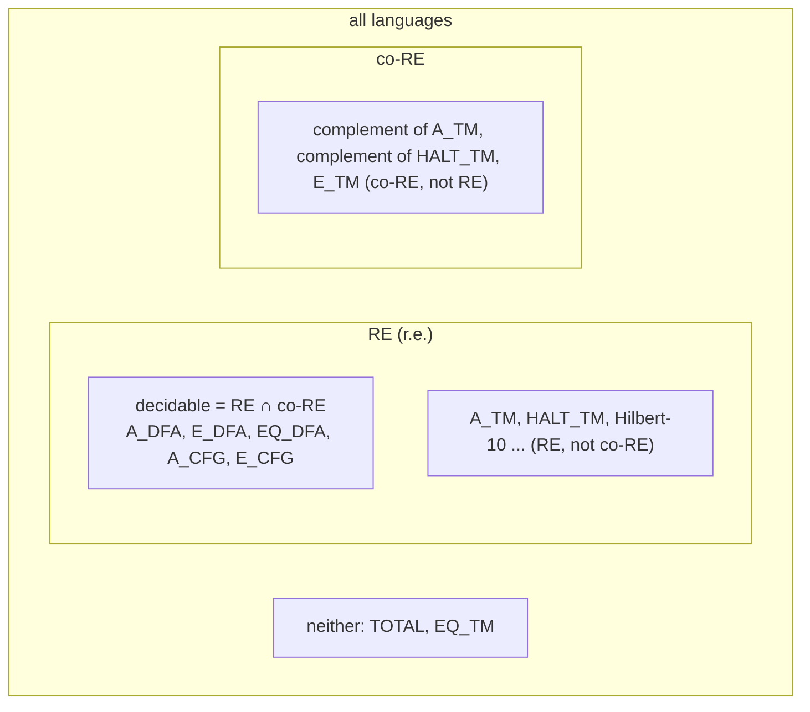

# Part 6a — Decidability and Undecidability: Universal TMs, A_TM, the Halting Problem

*[Overview](MoC-Summary.md) · [Part 1](MoC-1-Finite-Automata.md) · [Part 2](MoC-2-Regular-Expressions-Pumping-Myhill-Nerode.md) · [Part 3](MoC-3-Context-Free-Grammars.md) · [Part 4](MoC-4-Pushdown-Automata.md) · [Part 5](MoC-5-Turing-Machines.md) · **Part 6a** · [Part 6b](MoC-6b-Reductions-Rice-PCP.md) · [Part 7](MoC-7-Complexity.md) · [Formula sheet](MoC-8-Formula-Sheet.md)*

*Covers MoC8: encoding TMs, countability, decidable problems about DFAs/CFGs, universal TM, $`A_{\text{TM}}`$ undecidable, RE and co-RE, $`\mathit{HALT}_{\text{TM}}`$, $`E_{\text{TM}}`$, $`EQ_{\text{TM}}`$, TOTAL. (Reductions in general, Rice's theorem and PCP are in [Part 6b](MoC-6b-Reductions-Rice-PCP.md).) Tutorial 5 Q2–3, Q5.*

**Goal:** investigate the power of algorithms. Some problems can be solved algorithmically, others cannot; we explore the **limits of algorithmic solvability**.

---

## 1. Encoding TMs and counting (MoC8 §1)

**TMs as strings.** Any TM can be encoded as a string over any non-empty alphabet, e.g. a prefix $`0^n10^m10^k10^s10^t10^r10^u10^v`$ saying "$`n`$ states $`0..n-1`$, $`m`$ tape symbols of which the first $`k`$ are input symbols, start/accept/reject states $`s,t,r`$, endmarker $`u`$, blank $`v`$", followed by substrings like $`0^p10^a10^q10^b10`$ encoding each transition $`((p,a),(q,b,L))`$. **The exact details are unimportant**; write $`\langle M\rangle`$ for the encoding of $`M`$ and $`\langle M,w\rangle`$ for a pair.

> [!NOTE]
> **📖 There are languages that are not r.e.** *Proof.* (1) **There are only countably many TMs**: $`\Sigma^*`$ is countable and $`\langle M\rangle\in\Sigma^*`$, so enumerate $`\Sigma^*`$ and omit the strings that are not encodings. (2) **The set of languages $`\mathcal{P}(\Sigma^*)`$ is uncountable** (Cantor diagonalisation): suppose $`L_1,L_2,L_3,\dots`$ enumerates $`\mathcal{P}(\Sigma^*)`$ and $`x_1,x_2,\dots`$ enumerates $`\Sigma^*`$; define $`L`$ by
> ```math
> x_i\in L\iff x_i\notin L_i\qquad(i\ge1).
> ```
> Then $`L\in\mathcal{P}(\Sigma^*)`$ but $`L\neq L_i`$ for every $`i`$ (they differ on $`x_i`$). So $`\mathcal{P}(\Sigma^*)`$ is not in 1–1 correspondence with the TMs: there are more languages than TMs, hence some language is recognised by no TM. ∎

This is an existence proof; §4 exhibits a *concrete* non-r.e. language.

---

## 2. Decidable problems about automata and grammars (MoC8 §2)

Each problem is a language of encodings; "decidable" means a decider (total TM) exists, described at high level (Church–Turing).

| Problem | Language | Decider |
|---|---|---|
| **DFA acceptance** | $`A_{\text{DFA}}=\{\langle B,w\rangle : B \text{ a DFA accepting } w\}`$ | Simulate $`B`$ on $`w`$; accept iff the simulation ends in an accept state. (Hence $`A_{\text{NFA}}`$, $`A_{\text{regexp}}`$ are decidable too: convert first.) |
| **DFA emptiness** | $`E_{\text{DFA}}=\{\langle A\rangle : L(A)=\emptyset\}`$ | **Marking algorithm** $`T`$: mark the start state; repeat until no change: mark any state with a transition from a marked state; accept iff no accept state is marked. |
| **DFA equivalence** | $`EQ_{\text{DFA}}=\{\langle A,B\rangle : L(A)=L(B)\}`$ | Key idea: $`P\subseteq Q`$ iff $`P\cap\overline Q=\emptyset`$. Construct $`C`$ with $`L(C)=(L(A)\cap\overline{L(B)})\cup(L(B)\cap\overline{L(A)})`$ (symmetric difference; DFAs are closed under $`\cup,\cap`$, complement), run $`T`$ on $`\langle C\rangle`$; accept iff $`T`$ accepts. |
| **CFG acceptance** | $`A_{\text{CFG}}=\{\langle G,w\rangle : G \text{ generates } w\}`$ | Convert $`G`$ to Chomsky normal form; list all derivations with exactly $`2n-1`$ steps, $`n=\lvert w\rvert`$ (fact: in CNF every derivation of $`w`$ has $`2n-1`$ steps; for $`w=\epsilon`$ check for $`S\to\epsilon`$); accept iff one generates $`w`$. Extremely inefficient but a decider. |
| **CFG emptiness** | $`E_{\text{CFG}}=\{\langle G\rangle : L(G)=\emptyset\}`$ | Mark all terminals; repeat until no change: mark any variable $`A`$ with a rule $`A\to U_1\cdots U_k`$ whose symbols are all marked; accept iff the start symbol is **not** marked. |
| **CFG equivalence** | $`EQ_{\text{CFG}}`$ | The $`EQ_{\text{DFA}}`$ trick fails: CFLs are closed under neither intersection nor complement. In fact $`EQ_{\text{CFG}}`$ is **undecidable**. |



---

## 3. Universal TMs and $`A_{\text{TM}}`$ (MoC8 §3)

> [!NOTE]
> **📖 Universal TM.** A TM $`U`$ that can simulate the actions of any TM: for any TM $`M`$ and input $`x`$, $`U`$ accepts (resp. rejects, loops on) $`\langle M,x\rangle`$ iff $`M`$ accepts (resp. rejects, loops on) $`x`$. "An interpreter for C written in C." Note the quantifier order (one $`U`$ for all $`M`$) is different from results like "every NDTM can be simulated by a deterministic TM".

**Simulation.** $`U`$'s tape has 3 tracks: the top holds $`\delta_M`$ (from $`\langle M\rangle`$), the middle holds the simulated contents of $`M`$'s tape, the bottom holds $`M`$'s current state and head position. $`U`$ simulates $`M`$ one step at a time, shuttling between tracks, updating state/tape/head as dictated by $`\delta_M`$; if $`M`$ halts and accepts/rejects, so does $`U`$. (The input alphabets of $`M`$ and $`U`$ may differ.)

> [!NOTE]
> **📖 Acceptance problem for TMs.** $`A_{\text{TM}}=\{\langle M,w\rangle : M \text{ is a TM that accepts } w\}`$.
>
> **Theorem.** $`A_{\text{TM}}`$ is r.e. *Proof.* $`U`$ on $`\langle M,w\rangle`$: simulate $`M`$ on $`w`$; if $`M`$ enters its accept state, accept; if it enters its reject state, reject. ∎ — $`U`$ **loops** on $`\langle M,w\rangle`$ if $`M`$ loops on $`w`$, which is why $`U`$ is not a decider. If the algorithm had some way to determine that $`M`$ was not halting, it could reject.
>
> **Theorem.** $`A_{\text{TM}}`$ is **undecidable**.

**Proof (diagonalisation).** Suppose for a contradiction that TM $`H`$ decides $`A_{\text{TM}}`$:

```math
H(\langle M,w\rangle)=\begin{cases}\text{accept} & \text{if } M \text{ accepts } w\\ \text{reject} & \text{if } M \text{ does not accept } w\end{cases}
```

Construct $`D`$ using $`H`$ as a subroutine. $`D`$: on input $`\langle M\rangle`$, (1) run $`H`$ on $`\langle M,\langle M\rangle\rangle`$; (2) output the **opposite**: if $`H`$ accepts, reject; if $`H`$ rejects, accept. Thus

```math
D(\langle M\rangle)=\begin{cases}\text{reject} & \text{if } M \text{ accepts } \langle M\rangle\\ \text{accept} & \text{if } M \text{ does not accept } \langle M\rangle\end{cases}
\qquad\Longrightarrow\qquad
D(\langle D\rangle)=\begin{cases}\text{reject} & \text{if } D \text{ accepts } \langle D\rangle\\ \text{accept} & \text{if } D \text{ does not accept } \langle D\rangle\end{cases}
```

i.e. $`D`$ accepts $`\langle D\rangle`$ iff $`D`$ rejects $`\langle D\rangle`$: contradiction. So neither $`D`$ nor $`H`$ exists. ∎ **Summary: $`A_{\text{TM}}`$ is r.e. but undecidable.**



---

## 4. RE, co-RE and a language that is not r.e. (MoC8 §4)

> [!NOTE]
> **📖** $`L`$ is **co-RE** if its complement $`\overline L`$ is r.e.
>
> **Theorem.** A language is decidable **iff** it is both RE and co-RE.

**Proof.** (⇒) A decider for $`L`$ recognises $`L`$; swapping its accept/reject states gives a decider for $`\overline L`$. (⇐) Suppose $`M`$ recognises $`L`$ and $`M'`$ recognises $`\overline L`$. Define $`N`$: on input $`x`$, (1) write $`x`$ on the input tapes of $`M`$ and $`M'`$; (2) run $`M`$ and $`M'`$ **in parallel** (dovetailing: alternate one step of each); (3) if $`M`$ accepts, accept; if $`M'`$ accepts, reject. $`N`$ is a decider for $`L`$: for any $`x`$ either $`x\in L`$ (then $`M`$ halts and accepts at some point, so $`N`$ accepts) or $`x\in\overline L`$ (then $`M'`$ halts and accepts, so $`N`$ rejects). ∎

**Corollary.** $`\overline{A_{\text{TM}}}`$ is **not r.e.** (otherwise $`A_{\text{TM}}`$ would be RE and co-RE, hence decidable).



(The overlap of the RE and co-RE regions is exactly the decidable languages.)

---

## 5. More undecidable problems via reductions (MoC8 §5)

The pattern: *if $`P`$ were decidable, we could decide $`A_{\text{TM}}`$ (or HALT), contradiction.*

### 5.1 The Halting Problem

> [!NOTE]
> **📖** $`\mathit{HALT}_{\text{TM}}=\{\langle M,w\rangle : M \text{ is a TM and } M \text{ halts on input } w\}`$. **Theorem.** $`\mathit{HALT}_{\text{TM}}`$ is undecidable.

**Proof.** Suppose $`H`$ decides $`\mathit{HALT}_{\text{TM}}`$. Build $`S`$ to decide $`A_{\text{TM}}`$: on input $`\langle M,w\rangle`$, (1) run $`H`$ on $`\langle M,w\rangle`$; (2) if $`H`$ rejects ($`M`$ loops), **reject**; (3) if $`H`$ accepts, run $`M`$ on $`w`$ until it halts (it will); (4) if $`M`$ accepted, accept; if it rejected, reject. $`S`$ is a decider for $`A_{\text{TM}}`$, contradiction. ∎ ($`\mathit{HALT}_{\text{TM}}`$ is r.e.: simulate and accept on halting. So $`\overline{\mathit{HALT}_{\text{TM}}}`$ is not r.e.)

### 5.2 Emptiness for TMs

> [!NOTE]
> **📖** $`E_{\text{TM}}=\{\langle M\rangle : L(M)=\emptyset\}`$. **Theorem.** $`E_{\text{TM}}`$ is undecidable.

**Proof.** Suppose $`E`$ decides $`E_{\text{TM}}`$. Define $`S`$ deciding $`A_{\text{TM}}`$: on input $`\langle M,x\rangle`$, (1) construct the TM $`M_x`$: "on input $`y`$: (a) if $`y\neq x`$ reject; (b) run $`M`$ on $`x`$ and accept if $`M`$ does"; (2) run $`E`$ on $`\langle M_x\rangle`$; if $`E`$ accepts, **reject**; if $`E`$ rejects, **accept**. Now

```math
M \text{ accepts } x\ \Rightarrow\ L(M_x)=\{x\}\ \Rightarrow\ S \text{ accepts } \langle M,x\rangle;\qquad
M \text{ does not accept } x\ \Rightarrow\ L(M_x)=\emptyset\ \Rightarrow\ S \text{ rejects } \langle M,x\rangle.
```

So $`S`$ decides $`A_{\text{TM}}`$: contradiction. ∎ (Note $`S`$ never *runs* $`M_x`$; it only writes down its description.) $`E_{\text{TM}}`$ is co-RE (its complement is r.e.: dovetail $`M`$ on all inputs, accept if any accepts) but not r.e.

### 5.3 Equivalence for TMs

> [!NOTE]
> **📖** $`EQ_{\text{TM}}=\{\langle M_1,M_2\rangle : L(M_1)=L(M_2)\}`$. **Theorem.** $`EQ_{\text{TM}}`$ is undecidable.

**Proof.** Suppose $`Q`$ decides $`EQ_{\text{TM}}`$. Define $`S`$ deciding $`E_{\text{TM}}`$: on input $`\langle M\rangle`$, run $`Q`$ on $`\langle M,M_1\rangle`$ where $`M_1`$ is a fixed TM accepting nothing ($`L(M_1)=\emptyset`$); accept iff $`Q`$ accepts. Contradiction with §5.2. ∎

### 5.4 TOTAL is neither RE nor co-RE

> [!NOTE]
> **📖** $`\mathit{TOTAL}=\{\langle M\rangle : M \text{ halts on all inputs}\}`$. **Theorem.** TOTAL is neither r.e. nor co-r.e.

**Proof.** Use: decidable iff RE and co-RE. $`\mathit{HALT}_{\text{TM}}`$ is RE but undecidable, hence $`\overline{\mathit{HALT}_{\text{TM}}}`$ is **not RE**. It suffices to reduce $`\overline{\mathit{HALT}_{\text{TM}}}`$ to (i) TOTAL and to (ii) $`\overline{\mathit{TOTAL}}`$ (a reduction from a non-r.e. language to $`X`$ shows $`X`$ is not r.e.).

(i) Given $`\langle M,x\rangle`$ let $`N_{M,x}`$ be the TM: on input $`y`$, (1) run $`M`$ on $`x`$ for **up to $`\lvert y\rvert`$ steps**; (2) if $`M`$ has halted, **loop**; if not yet halted, **accept**. Then $`\langle M,x\rangle\in\overline{\mathit{HALT}_{\text{TM}}}`$ iff $`M`$ never halts on $`x`$ iff $`N_{M,x}`$ halts on every $`y`$ iff $`\langle N_{M,x}\rangle\in\mathit{TOTAL}`$. (If $`M`$ halts after $`t`$ steps, $`N_{M,x}`$ loops on all $`y`$ with $`\lvert y\rvert\ge t`$.) So TOTAL is not RE.

(ii) Given $`\langle M,x\rangle`$ let $`N_{M,x}`$ be: on input $`y`$, (1) erase $`y`$; (2) write $`x`$ on the tape and run $`M`$ on $`x`$; (3) if $`M`$ accepts, accept; if it rejects, reject. Either $`N_{M,x}`$ loops on **all** inputs or halts on **all** inputs. $`\langle M,x\rangle\in\overline{\mathit{HALT}_{\text{TM}}}`$ iff $`N_{M,x}`$ loops on all inputs iff $`\langle N_{M,x}\rangle\notin\mathit{TOTAL}`$, i.e. $`\in\overline{\mathit{TOTAL}}`$. So $`\overline{\mathit{TOTAL}}`$ is not RE, i.e. TOTAL is not co-RE. ∎

---


## ✅ Key takeaways

> [!TIP]
> 1. Countably many TMs vs uncountably many languages ⇒ most languages are not r.e. (diagonalisation).
> 2. Everything about **DFAs** is decidable ($`A`$, $`E`$ via marking, $`EQ`$ via symmetric difference); **CFGs**: $`A_{\text{CFG}}`$ (CNF, $`2n-1`$ steps) and $`E_{\text{CFG}}`$ (mark generating variables) decidable, $`EQ_{\text{CFG}}`$ undecidable.
> 3. A **universal TM** gives $`A_{\text{TM}}\in`$ RE; **diagonalisation** ($`D`$ runs $`H`$ on $`\langle M,\langle M\rangle\rangle`$ and flips) shows $`A_{\text{TM}}`$ undecidable.
> 4. **Decidable = RE ∩ co-RE** (dovetail the two recognisers). Hence $`\overline{A_{\text{TM}}}`$, $`\overline{\mathit{HALT}}`$ are not r.e.; $`E_{\text{TM}}`$ is co-RE not RE; TOTAL and $`EQ_{\text{TM}}`$ are neither.
> 5. The undecidability proofs for HALT, $`E_{\text{TM}}`$, $`EQ_{\text{TM}}`$, TOTAL all follow one template: *suppose a decider for the new problem existed; use it to build a decider (or recogniser) for a problem already known to be undecidable (or non-r.e.); contradiction.* Part 6b names and classifies these **reductions**.

## ⚠️ Common misconceptions & errors

> [!WARNING]
> - ❌ "Undecidable means not r.e." ✅ $`A_{\text{TM}}`$ and HALT are undecidable **and** r.e. Undecidable splits into: RE-not-co-RE, co-RE-not-RE, neither.
> - ❌ "In the $`E_{\text{TM}}`$ proof, $`S`$ runs $`M_x`$ and might loop." ✅ $`S`$ only **constructs the description** $`\langle M_x\rangle`$ (a finite string) and hands it to the hypothetical decider $`E`$; it never runs $`M_x`$.
> - ❌ "co-RE means the complement is decidable." ✅ co-RE means the complement is **r.e.**; decidable = RE ∩ co-RE.
> - ❌ In the $`A_{\text{TM}}`$ diagonal proof, worrying that $`D`$ "runs itself". ✅ $`D`$ is a fixed finite machine; feeding it its own encoding $`\langle D\rangle`$ is an ordinary input. The contradiction is purely logical.
> - ❌ "The universal TM decides $`A_{\text{TM}}`$." ✅ $`U`$ loops whenever $`M`$ loops on $`w`$, so it only *recognises* $`A_{\text{TM}}`$.
> - ❌ "$`EQ_{\text{CFG}}`$ is decidable like $`EQ_{\text{DFA}}`$." ✅ The symmetric-difference trick needs closure under ∩ and complement, which CFLs lack; $`EQ_{\text{CFG}}`$ is undecidable.
> - ❌ "TOTAL is undecidable by diagonalisation." ✅ The slides' proof reduces $`\overline{\mathit{HALT}}`$ to *both* TOTAL and its complement, the standard way to show "neither RE nor co-RE".
