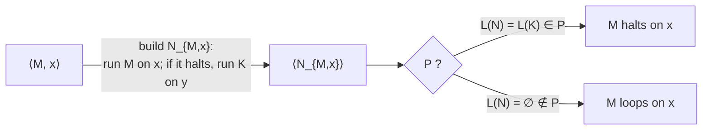
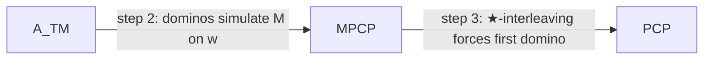

# Part 6b — Reductions, Rice's Theorem and the Post Correspondence Problem

*[Overview](MoC-Summary.md) · [Part 1](MoC-1-Finite-Automata.md) · [Part 2](MoC-2-Regular-Expressions-Pumping-Myhill-Nerode.md) · [Part 3](MoC-3-Context-Free-Grammars.md) · [Part 4](MoC-4-Pushdown-Automata.md) · [Part 5](MoC-5-Turing-Machines.md) · [Part 6a](MoC-6a-Decidability.md) · **Part 6b** · [Part 7](MoC-7-Complexity.md) · [Formula sheet](MoC-8-Formula-Sheet.md)*

*Covers MoC8.5: diagonalisation vs Turing reductions vs mapping reductions, Rice's theorem (proof and applications), PCP (undecidability via MPCP). Tutorial 5 Q4–6.*

---

## 6. Three ways to prove undecidability (MoC8.5 §1)

> [!NOTE]
> **📖 Diagonalisation** (used for $`A_{\text{TM}}`$): create a TM that cannot exist without contradiction. *Advantage:* direct, needs no previously known undecidable problem. *Disadvantage:* works easily only for a few problems ($`A_{\text{TM}}`$, $`\mathit{HALT}_{\text{TM}}`$, …).
>
> **📖 Reductions** transform one problem into another in a computable way. If there is a reduction from a known undecidable problem to $`P`$, then $`P`$ is undecidable. Reductions also work for showing a problem is or is not RE.
>
> **📖 Turing reduction** (used for $`\mathit{HALT}`$, $`E_{\text{TM}}`$, $`EQ_{\text{TM}}`$ above): create an algorithm for a known undecidable problem **using a decider for the target problem as a subroutine** (possibly called several times, with post-processing). *Advantage:* easy. *Disadvantage:* algorithmic; gives no insight into the relationship between the problems.
>
> **📖 Mapping (many-one) reduction.** A function $`f:\Sigma^*\to\Sigma^*`$ is **computable** if some TM, on every input $`w`$, halts with just $`f(w)`$ on its tape. $`A`$ is **mapping reducible** to $`B`$, written $`A\le_m B`$, if there is a computable $`f`$ with
> ```math
> w\in A\iff f(w)\in B\qquad\text{for every } w.
> ```
> If $`B`$ can be decided, this gives a method of deciding $`A`$: compute $`f(w)`$, then decide whether $`f(w)\in B`$.
>
> **Theorem.** If $`A\le_m B`$ and $`B`$ is decidable, then $`A`$ is decidable. (So if $`A\le_m B`$ and $`A`$ is undecidable, $`B`$ is undecidable.)
> **Theorem.** If $`A\le_m B`$ and $`B`$ is r.e., then $`A`$ is r.e. (So if $`A\le_m B`$ and $`A`$ is not r.e., $`B`$ is not r.e.)
>
> *Advantage:* a true problem transformation, relationships useful elsewhere (complexity, Part 7). *Disadvantage:* stronger than Turing reduction, so harder to find.


**Which earlier arguments are mapping reductions?** $`E_{\text{TM}}\le_m EQ_{\text{TM}}`$ via $`f(\langle M\rangle)=\langle M,M_1\rangle`$; $`\overline{\mathit{HALT}_{\text{TM}}}\le_m\mathit{TOTAL}`$ and $`\overline{\mathit{HALT}_{\text{TM}}}\le_m\overline{\mathit{TOTAL}}`$ via $`f(\langle M,x\rangle)=\langle N_{M,x}\rangle`$ (the two constructions in Part 6a §5.4). **NB** the reduction from $`A_{\text{TM}}`$ to $`E_{\text{TM}}`$ (Part 6a §5.2) is **not** a mapping reduction: $`S`$ *flips* the answer of $`E`$ ($`M`$ accepts $`x`$ iff $`\langle M_x\rangle\notin E_{\text{TM}}`$), so it is $`A_{\text{TM}}\le_m\overline{E_{\text{TM}}}`$; as written it is a Turing reduction. (Indeed $`A_{\text{TM}}\le_m E_{\text{TM}}`$ is impossible: $`E_{\text{TM}}`$ is co-RE and $`A_{\text{TM}}`$ is not.)

> [!TIP]
> **Direction of a reduction.** To prove $`B`$ is hard, reduce a **known hard** problem $`A`$ **to** $`B`$ ($`A\le_m B`$): "if I could solve $`B`$, I could solve $`A`$". Reducing $`B`$ to $`A`$ proves nothing. Tutorial 5 Q6: $`\mathit{HALT}_{\text{TM}}`$ is **RE-hard** (every r.e. language mapping-reduces to it: $`w\in L(M)`$ iff $`M'`$ halts on $`w`$, where $`M'`$ runs $`M`$ and loops instead of rejecting), while $`\overline{\mathit{HALT}_{\text{TM}}}`$ is not RE-hard (else, since $`\overline{\mathit{HALT}}`$ reduces to itself trivially and RE-hardness would make $`\mathit{HALT}\le_m\overline{\mathit{HALT}}`$, $`\mathit{HALT}`$ would be co-RE hence decidable).

---

## 7. Rice's Theorem (MoC8.5 §2)

> [!NOTE]
> **📖 Rice's Theorem.** Every **non-trivial property of the RE sets** is undecidable.
>
> **Reformulation.** Let $`P`$ be a decision problem about TMs (a language of encodings) satisfying
> (1) for any TMs $`M_1,M_2`$ with $`L(M_1)=L(M_2)`$: $`\langle M_1\rangle\in P`$ iff $`\langle M_2\rangle\in P`$ (**membership depends only on the language** of $`M`$ — a *semantic* property);
> (2) there are TMs $`M_1,M_2`$ with $`\langle M_1\rangle\in P`$ and $`\langle M_2\rangle\notin P`$ (**non-trivial**).
> Then $`P`$ is undecidable.

**Proof.** Take $`P`$ satisfying (1), (2). W.l.o.g. assume that for any TM $`E`$ with $`L(E)=\emptyset`$, $`\langle E\rangle\notin P`$ (otherwise work with $`\overline P`$, which is decidable iff $`P`$ is). By (2) take a TM $`K`$ with $`\langle K\rangle\in P`$. Given $`\langle M,x\rangle`$ construct $`N_{M,x}`$: on input $`y`$, (1) save $`y`$ on a separate track; (2) write $`x`$ on the input tape and run $`M`$ on $`x`$; (3) if $`M`$ halts on $`x`$, run $`K`$ on $`y`$; (4) if $`K`$ accepts, accept. Either $`M`$ halts on $`x`$ or not:

```math
M \text{ halts on } x\ \Rightarrow\ L(N_{M,x})=L(K)\ \Rightarrow\ \langle N_{M,x}\rangle\in P;\qquad
M \text{ does not halt on } x\ \Rightarrow\ L(N_{M,x})=\emptyset\ \Rightarrow\ \langle N_{M,x}\rangle\notin P.
```

(If $`M`$ does not halt, the simulation in step 2 never finishes, so no $`y`$ is accepted.) Thus $`\mathit{HALT}_{\text{TM}}\le_m P`$; since $`\mathit{HALT}_{\text{TM}}`$ is undecidable, so is $`P`$. [Explicitly: a decider $`A`$ for $`P`$ gives a decider for HALT: on $`\langle M,x\rangle`$ construct $`\langle N_{M,x}\rangle`$ and run $`A`$ on it.] ∎



**Applications.** For an arbitrary TM $`M`$ over $`\{a,b\}`$ the following are undecidable: whether $`M`$ accepts $`ababa`$ (i.e. $`ababa\in L(M)`$); whether $`L(M)`$ contains two different strings of the same length; whether $`L(M)`$ contains a string of length five; whether $`L(M)`$ is regular; whether $`L(M)`$ is context-free. **Not** properties of RE sets (Rice does **not** apply; decide case by case): $`M`$ has at least 341 states (decidable: count); $`M`$ halts on all inputs (TOTAL: undecidable, but by Part 6a §5.4 not Rice); $`M`$ rejects $`ababa`$ (depends on *how* $`M`$ behaves, not on $`L(M)`$: a machine with the same language might loop instead); there exists a smaller machine equivalent to $`M`$.

> [!TIP]
> **Rice checklist.** (a) Is the property about $`L(M)`$ only? (Would any two machines with the same language agree?) (b) Is some TM in and some TM out? If both yes ⇒ undecidable, done. If (a) fails you need a direct argument (tutorial 5 Q5: "runs for at least $`127^{127}`$ steps on $`a^{127}`$" is decidable by simulation; "ever re-enters its start state on some input" is undecidable by a reduction from HALT, not by Rice).

---

## 8. The Post Correspondence Problem (MoC8.5 §3)

> [!NOTE]
> **📖 PCP.** *Instance:* a collection $`P`$ of **dominos** $`\big[\tfrac{t_1}{b_1}\big],\dots,\big[\tfrac{t_k}{b_k}\big]`$, $`k\ge1`$, with all $`t_i,b_j`$ strings over $`\Sigma`$. *Question:* is there a **match**, i.e. a non-empty sequence $`i_1,\dots,i_l`$ (repetitions allowed, $`1\le i_j\le k`$) with
> ```math
> t_{i_1}t_{i_2}\cdots t_{i_l}=b_{i_1}b_{i_2}\cdots b_{i_l}\ ?
> ```
> **Theorem.** PCP is undecidable.

**Examples.** $`P=\{[\tfrac{b}{ca}],[\tfrac{a}{ab}],[\tfrac{ca}{a}],[\tfrac{abc}{c}]\}`$ has the match $`2,1,3,2,4`$: top $`a\cdot b\cdot ca\cdot a\cdot abc`$ = bottom $`ab\cdot ca\cdot a\cdot ab\cdot c`$ = $`abcaaabc`$. Over $`\{0,1\}`$, $`\{[\tfrac{11}{111}],[\tfrac{111}{11}],[\tfrac{1100}{001}]\}`$ has the match $`1,1,3,2`$. Some instances have no match, e.g. $`\{[\tfrac{abc}{ab}],[\tfrac{ca}{a}],[\tfrac{acc}{bc}]\}`$ (every top string is longer than its bottom string).

### 8.1 Outline proof of undecidability

1. Define the **modified** problem $`\mathit{MPCP}=\{P : P \text{ has a match that starts with the first domino}\}`$.
2. Show MPCP undecidable by a reduction from $`A_{\text{TM}}`$: given $`M`$ and $`w`$, construct dominos $`P'`$ with $`\langle M,w\rangle\in A_{\text{TM}}\iff P'\in\mathit{MPCP}`$.
3. Convert $`P'`$ to a PCP instance $`P`$ with $`P'\in\mathit{MPCP}\iff P\in\mathit{PCP}`$.



**Idea for step 2.** If $`M`$ accepts $`w`$ there is a sequence of configurations $`(\epsilon,q_0,\vdash w)\to(u_1,q_1,v_1)\to\cdots\to(u_n,q_{\text{acc}},v_n)`$. Build dominos that **simulate** $`M`$ on $`w`$ so that a match, read across the top, begins $`\#q_0\vdash w\#u_1q_1v_1\#u_2q_2v_2\#\cdots\#u_nq_{\text{acc}}v_n`$ (configurations written as strings with the state just left of the scanned symbol), followed by a second portion $`\#\cdots\#\cdots\#q_{\text{acc}}\#\#`$ of progressively shorter segments. *The bottom string is always one configuration ahead of the top*: to extend the match the top must copy the bottom's configuration, which forces it to apply exactly $`M`$'s transitions.

**Definition of $`P'`$** (Part 1 domino must come first):

| Part | Dominos | Purpose |
|---|---|---|
| 1 | $`\big[\tfrac{\#}{\#q_0\vdash w_1\cdots w_n\#}\big]`$ as the first domino | the bottom starts one configuration ahead |
| 2 | for each $`a,b\in\Gamma`$, $`q,r\in Q`$ with $`\delta(q,a)=(r,b,R)`$: $`\big[\tfrac{qa}{br}\big]`$ | right moves |
| 3 | for each $`a,b,c\in\Gamma`$, $`q,r\in Q`$ with $`\delta(q,a)=(r,b,L)`$: $`\big[\tfrac{cqa}{rcb}\big]`$ | left moves |
| 4 | for every $`a\in\Gamma`$: $`\big[\tfrac{a}{a}\big]`$ | copy unchanged tape cells |
| 5 | $`\big[\tfrac{\#}{\#}\big]`$ and $`\big[\tfrac{\#}{\sqcup\#}\big]`$ | separate configurations; the second adds a blank when the head runs onto fresh tape |
| 6 | for every $`a\in\Gamma`$: $`\big[\tfrac{aq_{\text{acc}}}{q_{\text{acc}}}\big]`$ and $`\big[\tfrac{q_{\text{acc}}a}{q_{\text{acc}}}\big]`$ | once accepted, "eat" the tape symbols one per configuration |
| 7 | $`\big[\tfrac{q_{\text{acc}}\#\#}{\#}\big]`$ | finish: lets the top catch up and close the match |

**Example (slides 18–21).** $`M`$ with $`\delta(q_0,\vdash)=(q_0,\vdash,R)`$, $`\delta(q_0,a)=(q_3,c,R)`$, $`\delta(q_3,b)=(q_4,a,R)`$, $`\delta(q_4,\sqcup)=(q_{\text{acc}},b,L)`$ on $`w=ab`$ has the accepting computation $`(\epsilon,q_0,\vdash ab)\to(\vdash,q_0,ab)\to(\vdash c,q_3,b)\to(\vdash ca,q_4,\sqcup)\to(\vdash c,q_{\text{acc}},ab)`$. The match builds up as:

```
top:     #  | q0 ⊢ | a | b | # | ⊢ | q0 a | b | # | ⊢ | c  q3 b | # | ...
bottom:  # q0 ⊢ a b # | ⊢ q0 | a | b | # | ⊢ | c q3 | b | # | ⊢ | c a q4 ␣ | # | ...
parts:   1  | 2     | 4 | 4 | 5 | 4 | 2    | 4 | 5 | 4 | 3        | 5 | ...
```

After $`\vdash c\,q_{\text{acc}}\,ab\#`$ the Part-6 dominos shrink the configuration each round ($`\vdash q_{\text{acc}}ab\#`$, $`q_{\text{acc}}ab\#`$, $`q_{\text{acc}}b\#`$, $`q_{\text{acc}}\#`$) and the Part-7 domino closes with $`\#\#`$ on top matching the final $`\#`$ below. (Tidying-up dominos used: 4 6 4 4 5 / 6 4 4 5 / 6 4 5 / 6 5 / 7.)

**Step 3: MPCP → PCP.** For $`u=u_1\cdots u_n`$ define $`\star u=*u_1*u_2*\cdots*u_n`$, $`u\star=u_1*u_2*\cdots*u_n*`$, $`\star u\star=*u_1*u_2*\cdots*u_n*`$. From the MPCP instance $`\{[\tfrac{t_1}{b_1}],\dots,[\tfrac{t_k}{b_k}]\}`$ over $`\Theta`$ build the PCP instance over $`\Theta\cup\{*,\diamond\}`$:

```math
\Big\{\Big[\tfrac{\star t_1}{\star b_1\star}\Big],\ \Big[\tfrac{\star t_2}{b_2\star}\Big],\ \Big[\tfrac{\star t_3}{b_3\star}\Big],\dots,\Big[\tfrac{\star t_k}{b_k\star}\Big],\ \Big[\tfrac{\star\diamond}{\diamond}\Big]\Big\}.
```

The only domino that can **start** a match is the first one (the only one whose top and bottom both start with the same symbol, $`*`$). Original symbols occur at even positions of the match; $`[\tfrac{\star\diamond}{\diamond}]`$ lets the top add the final $`*`$ at the end. ∎

---


## ✅ Key takeaways

> [!TIP]
> 1. Three ways to prove undecidability: **diagonalisation** (direct, rarely applicable), **Turing reduction** (use a decider for the new problem as a subroutine), **mapping reduction** $`A\le_m B`$ (one computable $`f`$ with $`w\in A\iff f(w)\in B`$).
> 2. $`A\le_m B`$ transfers decidability/RE-ness **from $`B`$ to $`A`$**, so undecidability/non-RE-ness **from $`A`$ to $`B`$**. Always reduce the known-hard problem *to* the new one.
> 3. **Rice**: any non-trivial property of $`L(M)`$ is undecidable (reduce HALT via $`N_{M,x}`$ = "run $`M`$ on $`x`$, then behave like $`K`$"). Properties of the *machine* (number of states, halting behaviour, rejecting a string) are not covered: handle them directly.
> 4. **PCP** is undecidable: $`A_{\text{TM}}\le_m\mathit{MPCP}\le_m\mathit{PCP}`$; dominos simulate a TM computation with the bottom one configuration ahead; the $`\star`$ trick forces the first domino.
> 5. HALT is **RE-hard** (every r.e. language mapping-reduces to it); its complement is not.

## ⚠️ Common misconceptions & errors

> [!WARNING]
> - ❌ Reducing in the wrong direction (showing $`B\le_m A_{\text{TM}}`$ to prove $`B`$ undecidable). ✅ Everything r.e. reduces to $`A_{\text{TM}}`$; that proves nothing. You need $`A_{\text{TM}}\le_m B`$ (or a Turing reduction that *uses* a decider for $`B`$).
> - ❌ Calling a reduction a mapping reduction when the answer is flipped or the decider is called twice. ✅ A mapping reduction is a single computable $`f`$ with $`w\in A\iff f(w)\in B`$, no post-processing; the $`A_{\text{TM}}`$-to-$`E_{\text{TM}}`$ argument is a Turing reduction (equivalently $`A_{\text{TM}}\le_m\overline{E_{\text{TM}}}`$).
> - ❌ Applying Rice to "$`M`$ halts on all inputs" or "$`M`$ has 341 states" or "$`M`$ rejects $`w`$". ✅ These depend on the machine, not only on $`L(M)`$; Rice is silent (the first is still undecidable, by Part 6a §5.4; the second is decidable).
> - ❌ Applying Rice to a trivial property ("$`L(M)`$ is r.e.", true of every TM). ✅ Trivial properties are decidable (answer is constant).
> - ❌ Forgetting to check **both** directions of $`w\in A\iff f(w)\in B`$, or that $`f`$ is computable (it must only *write down* a machine description, never run it).
> - ❌ In PCP, allowing the empty sequence of dominos or forgetting repetitions are allowed. ✅ A match is **non-empty**, dominos may repeat; a PCP instance is a *set* of dominos, not a sequence.
> - ❌ "MPCP and PCP are the same problem." ✅ MPCP additionally requires the match to start with the first domino; the $`\star`$-construction removes that requirement.
