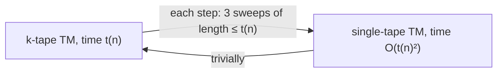
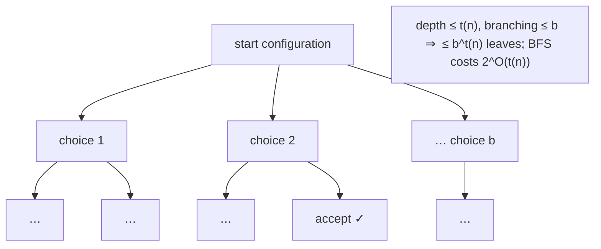
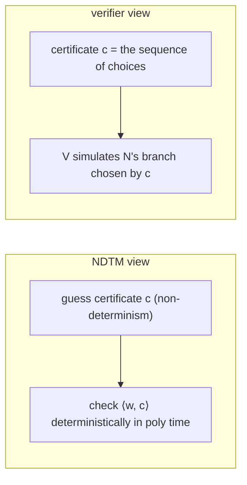
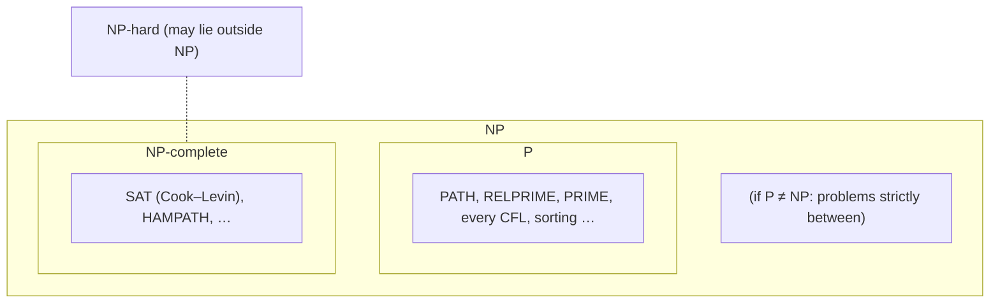

# Part 7 — Computational Complexity: Time, P, NP and NP-Completeness

*[Overview](MoC-Summary.md) · [Part 1](MoC-1-Finite-Automata.md) · [Part 2](MoC-2-Regular-Expressions-Pumping-Myhill-Nerode.md) · [Part 3](MoC-3-Context-Free-Grammars.md) · [Part 4](MoC-4-Pushdown-Automata.md) · [Part 5](MoC-5-Turing-Machines.md) · [Part 6a](MoC-6a-Decidability.md) · [Part 6b](MoC-6b-Reductions-Rice-PCP.md) · **Part 7** · [Formula sheet](MoC-8-Formula-Sheet.md)*

*Covers MoC9: running time on TMs, linear speed-up, big-O, TIME classes, multitape vs single-tape cost, P, NDTM running time and simulation, NP, verifiers, P vs NP, polynomial reductions, NP-hard/NP-complete, SAT and Cook–Levin.*

---

## 1. From computability to complexity (MoC9 §1)

**Language theory** classifies sets by *structural* complexity (regular sets are "simpler" than context-free languages) and **computability** asks what can be computed *in principle*. **Complexity** asks *how much resource* (time, space, tape-head reversals, …) is needed to recognise a language on a universal device such as a TM. This introduction concentrates on **time**. (A more abstract, axiomatic approach exists: Blum 1967.)

> [!NOTE]
> **📖 Running time.** For a TM, time = number of steps (moves of the tape head) on an input "of given size"; size of the input = length of the string encoding it. We consider **total** TMs only and **worst-case** running time (not average).
>
> For a deterministic total TM $`M`$, the **running time** (time complexity) of $`M`$ is $`f:\mathbb{N}\to\mathbb{N}`$ where $`f(n)`$ is the **maximum** number of steps $`M`$ takes (before entering the accept or reject state) on any input of length $`n`$.
>
> **📖 Big-O.** For $`f,g:\mathbb{N}\to\mathbb{R}^+`$, $`f(n)=O(g(n))`$ if there exist integers $`c,n_0`$ with $`f(n)\le c\cdot g(n)`$ for all $`n\ge n_0`$. For large inputs the highest-order term dominates, so we are content with this *estimate*.
>
> **📖 Time complexity class.** For $`t:\mathbb{N}\to\mathbb{R}^+`$, $`\mathrm{TIME}(t(n))`$ = the set of all languages decidable by a TM with running time $`O(t(n))`$.

**Linear speed-up theorem.** If $`L`$ is recognised by a $`k`$-tape TM $`M_1`$ with running time bounded by $`f(n)`$ then, for any $`c>0`$, $`L`$ is recognised by a $`k`$-tape TM $`M_2`$ with running time bounded by $`c\cdot f(n)`$, provided $`f(n)/n\to\infty`$. *Proof idea:* $`M_2`$ encodes $`m`$ tape symbols of $`M_1`$ as one symbol of an expanded alphabet and simulates many steps of $`M_1`$ in a small fixed number of steps; its finite control records which of the $`m`$ symbols is being scanned. (Hopcroft & Ullman.) **Consequence:** constant factors are meaningless for TMs, which justifies big-O.

### 1.1 Worked example: deciding $`A=\{0^n1^n : n\ge0\}`$

Single-tape algorithm on input $`w`$: (1) scan left to right, reject if the substring `10` occurs; (2) repeat while both 0s and 1s remain: (3) scan left to right crossing off a single 0 and a single 1; (4) if neither 0s nor 1s remain, accept, otherwise reject. **Running time:** line 1 is $`O(n)`$; line 3 is $`O(n)`$ and executes at most $`n/2`$ times, giving $`O(n^2)`$; line 4 is $`O(n)`$; total $`O(n^2)`$, so $`A\in\mathrm{TIME}(n^2)`$.

**Two-tape algorithm:** (1) scan for `10`, reject if found; (2) scan across the 0s on tape 1 copying them to tape 2 until the first 1; (3) scan across the 1s, erasing one 0 on tape 2 per 1; if the 0s run out while 1s remain, reject; (4) if all 0s have been erased, accept, else reject. **Running time $`O(n)`$.** *Time complexity depends on the model of computation.*

---

## 2. Multitape vs single-tape TMs (MoC9 §2)

There is "only" a **polynomial** difference between single-tape and multitape TMs.

> [!NOTE]
> **📖 Theorem.** Let $`t(n)\ge n`$. Every $`k`$-tape TM with running time $`t(n)`$ has an equivalent $`O(t^2(n))`$ single-tape TM.

**Proof sketch (analysing the Part 5 §4.1 construction).** The single-tape $`N`$ uses $`\Gamma_N=\Sigma_M\cup\{\vdash\}\cup(\Gamma_M\cup\widehat{\Gamma_M})^3`$: three tracks, each with one hatted symbol marking its head. On input $`w`$: (1) copy the input to the top track, blanks elsewhere: $`O(n)`$. (2) For each of the $`O(t(n))`$ simulated steps: (a) scan from the left end to find all three marks, remembering the symbols: $`O(t(n))`$; (b) go back to the three marks, rewrite the tracks and move the marks: $`O(t(n))`$; (c) return to the left end: $`O(t(n))`$. **Main observation:** the string on each tape of $`M`$ has length at most $`t(n)`$ (a head cannot move further than the number of steps), so each simulated step costs $`O(t(n))`$ and the total is $`O(n)+O(t(n))\cdot O(t(n))=O(t^2(n))`$. ∎ (Sipser proves the same with a different construction.)



---

## 3. The class P (MoC9 §3)

**Observation.** All "reasonable" deterministic computational models are **polynomially equivalent**: they simulate each other with only a polynomial increase in running time. So "polynomial time" is model-independent.

> [!NOTE]
> **📖 Definition.** $`\mathbf{P}`$ is the class of languages decidable in polynomial time on a deterministic single-tape TM:
> ```math
> \mathbf{P}=\bigcup_{k\ge0}\mathrm{TIME}(n^k).
> ```
> Problems in $`\mathbf{P}`$ are **tractable**; problems whose running time is not bounded by any polynomial $`n^k`$ ("super-polynomial": exponential, factorial, …) are **intractable**. (In practice there is still a huge difference between $`n`$, $`n\log n`$, $`n^2`$ and $`n^{100}`$.)

**Examples in P** (constructions in Sipser): $`\mathit{PATH}=\{\langle G,s,t\rangle : G \text{ a directed graph with a path from } s \text{ to } t\}`$; $`\mathit{RELPRIME}=\{\langle x,y\rangle : x,y \text{ relatively prime}\}`$ (Euclid); **every context-free language is in P**; and most algorithms from Design and Analysis of Algorithms.

**Primality.** $`\mathit{PRIME}=\{\langle n\rangle : n \text{ is prime}\}`$, input size = **number of digits** of $`\langle n\rangle`$ (so trial division up to $`\sqrt n`$ is *exponential* in the input size). Proved to be in $`\mathbf{P}`$ by Agrawal, Kayal and Saxena (IIT Kanpur, 2002), time $`O(\ln^{12}n)`$, soon improved to $`O(\ln^6 n)`$; Kayal and Saxena were undergraduates; Gödel Prize and Fulkerson Prize 2006 ("AKS primes").

---

## 4. Non-deterministic time and NP (MoC9 §4)

> [!NOTE]
> **📖 Running time of a NDTM** (Sipser). For a non-deterministic TM $`N`$ that is a decider, the running time is $`f(n)`$ = the **maximum number of steps $`N`$ uses on any branch** of its computation on any input of length $`n`$. The computation is a tree whose branches are the possible runs; $`N`$ **accepts** if *any branch* reaches the accept state; $`N`$ is a **decider** if **all branches halt** on all inputs.
>
> **📖 Theorem (NDTM ⇒ DTM).** Let $`t(n)\ge n`$. Every non-deterministic single-tape TM with running time $`t(n)`$ has an equivalent **$`2^{O(t(n))}`$-time** deterministic single-tape TM.

**Construction.** Given NDTM $`N`$ build a deterministic **3-tape** TM $`D`$ that explores all branches of $`N`$'s computation tree **breadth-first**; if $`D`$ encounters an accept state on some branch, accept. If $`N`$ is a decider, $`D`$ can be made total (exercise in Sipser).

**Running-time analysis (sketch).** Every branch has length $`\le t(n)`$. If $`b`$ is the maximum number of choices for any configuration (from $`N`$'s transition function), there are at most $`b^{t(n)}`$ leaves, and $`O(b^{t(n)})`$ nodes in total. Visiting any node from the root costs $`O(t(n))`$, so $`D`$ runs in $`O(t(n)\,b^{t(n)})=2^{O(t(n))}`$. Converting the 3-tape $`D`$ to a single tape at most squares the time: $`(2^{O(t(n))})^2=2^{2\cdot O(t(n))}=2^{O(t(n))}`$. ∎



> [!NOTE]
> **📖 Definition.** $`\mathrm{NTIME}(t(n))`$ = the set of languages decidable by an $`O(t(n))`$-time **non-deterministic** TM. $`\mathbf{NP}`$ is the class of languages decidable in polynomial time on a non-deterministic single-tape TM:
> ```math
> \mathbf{NP}=\bigcup_{k\ge0}\mathrm{NTIME}(n^k).
> ```
> NP contains many problems of practical and theoretical importance.

### 4.1 Alternative definition: polynomial-time verifiers

**Basic idea.** NP is the class of problems $`A`$ with an *efficient (polynomial) way of verifying a supplied "proof"* that $`x\in A`$ when $`x`$ really is in $`A`$. A NDTM can then solve the problem in polynomial time by non-deterministically **guessing** the proof and **checking** it with the verifier.

**Example.** $`\mathit{HAMPATH}=\{\langle G,s,t\rangle : G \text{ a directed graph with a path from } s \text{ to } t \text{ visiting every node exactly once}\}`$. Given a Hamiltonian path (the "proof"), checking in polynomial time that it is one is easy; *finding* one is not known to be.

> [!NOTE]
> **📖 Verifier.** A **verifier** for a language $`A`$ is a TM $`V`$ with
> ```math
> A=\{w : V \text{ accepts } \langle w,c\rangle \text{ for some string } c\}.
> ```
> The string $`c`$ is a **certificate** (witness) supplying the proof of membership. $`V`$ is a **polynomial-time verifier** if it runs in time polynomial in $`\lvert w\rvert`$ (only; this bounds the useful certificate length by a polynomial too).
>
> **Theorem.** $`\mathbf{NP}`$ = the class of languages with a polynomial-time verifier.

**Proof idea.** (⇐) Given an $`O(n^k)`$ verifier $`V`$ and instance $`w`$: non-deterministically *guess* a certificate $`c`$ of length $`\le n^k`$ and run $`V`$ on $`\langle w,c\rangle`$. (⇒) Given a polynomial-time NDTM $`N`$ deciding $`A`$ and a pair $`\langle w,c\rangle`$: run $`N`$ on $`w`$ using $`c`$ to dictate the non-deterministic choices; accept iff that branch accepts. ∎



---

## 5. P vs NP (MoC9 §5)

Clearly $`\mathbf{P}\subseteq\mathbf{NP}`$ (a deterministic TM is a NDTM; or: the verifier ignores the certificate). Whether there are problems in NP not in P, i.e. whether $`\mathbf{P}=\mathbf{NP}`$, is a fundamental and very famous question — **no-one knows**. It is probably the most important open problem of the field and one of the seven **Millennium Prize Problems** (Clay Mathematics Institute, \$1,000,000). **Most computer scientists believe $`\mathbf{P}\neq\mathbf{NP}`$.** A fundamental tool for addressing it, and of major interest in itself, is **NP-completeness**.

> [!NOTE]
> **📖 Polynomial-time reducibility.** $`A`$ is **polynomial-time reducible** to $`B`$, $`A\le_p B`$, if there is a computable function $`f`$, computed by a **polynomial-time** TM, with $`w\in A\iff f(w)\in B`$ for every $`w`$. (A mapping reduction with a polynomial-time $`f`$.)
>
> **📖 NP-hard.** $`B`$ is **NP-hard** if $`A\le_p B`$ for every $`A\in\mathbf{NP}`$.
> **📖 NP-complete.** $`B`$ is **NP-complete** if $`B\in\mathbf{NP}`$ and $`B`$ is NP-hard. Informally: a problem in NP at least as hard as *every* problem in NP — a canonical representative of the hardest NP problems.
>
> **Theorem.** Let $`B`$ be NP-complete. Then $`B\in\mathbf{P}\iff\mathbf{P}=\mathbf{NP}`$.

(⇐ trivial; ⇒: every $`A\in\mathbf{NP}`$ reduces to $`B`$ in polynomial time and $`B`$ is solvable in polynomial time, so $`A\in\mathbf{P}`$.) Cartoon on the slides: "I can't find an efficient algorithm, but neither can all these famous people" — NP-completeness is strong evidence that no efficient algorithm exists.



### 5.1 Showing a problem is NP-complete

To show $`B`$ is NP-complete: show $`B\in\mathbf{NP}`$ (give a polynomial-time verifier or NDTM), and **either** (1) show $`A\le_p B`$ for every $`A\in\mathbf{NP}`$, **or** (2) show $`A\le_p B`$ for *some known* NP-complete problem $`A`$ (transitivity of $`\le_p`$). *How do we get started?* We need a first NP-complete problem.

> [!NOTE]
> **📖 SAT.** The **Boolean satisfiability problem**: given a propositional formula $`\phi`$, is there an assignment of its variables making $`\phi`$ true?
>
> **Cook–Levin Theorem (early 1970s).** SAT is NP-complete.

**Proof idea.** SAT $`\in`$ NP: guess an assignment, evaluate $`\phi`$ (the assignment is the certificate). NP-hardness: let $`A\in\mathbf{NP}`$ with a polynomial-time NDTM $`N_A`$ deciding it. Build the following reduction: on input $`w`$, (1) build a propositional formula $`\phi`$ that **encodes the action of $`N_A`$ on $`w`$** (variables for "cell $`i`$ holds symbol $`a`$ at time $`t`$", "state is $`q`$ at time $`t`$", "head at $`i`$ at time $`t`$", for $`t\le n^k`$; clauses enforcing a legal start, legal transitions and acceptance), so that $`\phi`$ is satisfiable exactly when $`N_A`$ has an accepting branch on $`w`$; $`\phi`$ has polynomial size. (2) Run the polynomial-time non-deterministic decider for SAT on $`\phi`$. The details are intricate but not difficult. ∎

Nowadays heuristic SAT solvers routinely handle formulas arising in practical settings with many thousands of variables; and by now hundreds of other problems, many of practical significance, have been proved NP-complete, usually by reductions from SAT or its descendants.

---

## ✅ Key takeaways

> [!TIP]
> 1. **Time** = number of TM steps as a function of input length (worst case, total TMs only). Linear speed-up ⇒ only big-O matters; $`\mathrm{TIME}(t(n))`$.
> 2. Running time **depends on the model** ($`0^n1^n`$: $`O(n^2)`$ on one tape, $`O(n)`$ on two), but only **polynomially**: $`k`$ tapes → single tape costs $`O(t^2)`$; all reasonable deterministic models are polynomially equivalent. Hence **P** $`=\bigcup_k\mathrm{TIME}(n^k)`$ is robust: tractable problems.
> 3. **NP** $`=\bigcup_k\mathrm{NTIME}(n^k)`$ = languages with a **polynomial-time verifier** (certificate $`c`$; "guess and check"). Deterministic simulation of an NDTM costs $`2^{O(t(n))}`$ (BFS over a tree with $`\le b^{t(n)}`$ leaves).
> 4. $`\mathbf{P}\subseteq\mathbf{NP}`$; whether they are equal is open (Millennium Prize); most believe $`\mathbf{P}\neq\mathbf{NP}`$.
> 5. $`A\le_p B`$ = polynomial-time mapping reduction. **NP-hard**: everything in NP reduces to it; **NP-complete**: NP-hard and in NP. An NP-complete problem is in P iff P = NP.
> 6. **Cook–Levin**: SAT is NP-complete (encode an NDTM's polynomial-length computation as a formula). Prove new NP-completeness results by showing membership in NP plus a reduction *from* a known NP-complete problem.

## ⚠️ Common misconceptions & errors

> [!WARNING]
> - ❌ "NP = non-polynomial." ✅ NP = **non-deterministic** polynomial time; P ⊆ NP, and NP problems may well be in P.
> - ❌ "A problem in NP cannot be solved in polynomial time." ✅ Every NP problem *can* be solved in exponential time, and may be in P; NP-complete problems are the ones for which a polynomial algorithm would imply P = NP.
> - ❌ "NP-hard problems are in NP." ✅ NP-hard only says every NP problem reduces to it; it need not be in NP (it might even be undecidable). NP-complete = NP-hard **and** in NP.
> - ❌ Reducing the new problem *to* SAT to show it is NP-hard. ✅ That only shows it is in NP (roughly). To show hardness, reduce SAT (or another NP-complete problem) **to** the new problem.
> - ❌ "Trial division shows PRIME is in P." ✅ Input size is the number of **digits**; trial division to $`\sqrt n`$ is exponential in the number of digits. AKS (2002) gives a genuinely polynomial algorithm.
> - ❌ "The running time of an NDTM is the total size of the computation tree." ✅ It is the length of the **longest branch**; the tree size is what the *deterministic simulation* pays ($`2^{O(t(n))}`$).
> - ❌ "A verifier may take time polynomial in $`\lvert c\rvert`$." ✅ Polynomial in $`\lvert w\rvert`$ only; otherwise exponentially long certificates would make every r.e. language "NP".
> - ❌ Treating the linear speed-up theorem as making constant factors irrelevant in *practice*. ✅ It is a statement about TMs with growing alphabets; in practice $`n`$ vs $`n^{100}`$ matters enormously.
> - ❌ "Time complexity is model-independent." ✅ Exact complexity is not (one tape vs two); only polynomial-time *membership* is, which is why P is defined as it is.
