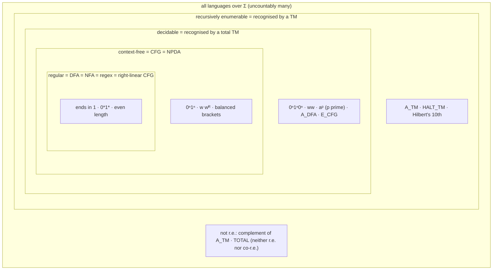
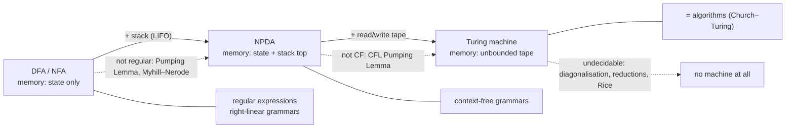

# Models of Computation — Course Summary

*Oxford CS Part A Models of Computation · lecture slides by Bernardo Cuenca Grau (based on material by Paul Hunter, Christian Coester, Luke Ong, Hanno Nickau, Jonathan Barrett, Tom Melham and Rahul Santhanam); tutorial sheets 1–5 (Christian Coester, MT 2022). Written to be read with **no prior knowledge**: every model is introduced by what it can and cannot do, with its diagram, its formal definition, the key theorems with proofs, and worked examples. Split into parts because GitHub stops rendering maths beyond a few hundred formulas per file.*

**Diagram conventions:** `start` arrow = start state; **double circle** = accepting state; edge label `0, 1` = "on 0 or on 1"; `ε` = empty string; PDA edge `a, Z → γ` = read `a`, pop `Z`, push `γ`.

| File | Lecture decks | Covers |
|---|---|---|
| **This page** | all | Big picture, the three machines and their language classes, how it all ties together, big takeaways, exam recipes |
| [Part 1 — Finite Automata](MoC-1-Finite-Automata.md) | MoC1, MoC2 | DFAs, languages, designing DFAs; regular operations; product construction; NFAs and ε-moves; subset construction (proof); union/concatenation/star constructions (proofs) |
| [Part 2 — Regular Expressions, Pumping, Myhill–Nerode](MoC-2-Regular-Expressions-Pumping-Myhill-Nerode.md) | MoC3, MoC3.5, MoC4 | regular expressions and $`L(E)`$; Kleene's theorem both ways (state elimination $`E^X_{q,q'}`$ worked); Kozen's axioms; Pumping Lemma (proof, template, examples); Myhill–Nerode (proof, minimal DFA, $`2^n`$ blow-up) |
| [Part 3 — Context-Free Grammars](MoC-3-Context-Free-Grammars.md) | MoC5 | CFGs, derivations, parse trees, leftmost derivations, ambiguity, right-linear = regular, Chomsky normal form, CFL Pumping Lemma, non-closure under complement |
| [Part 4 — Pushdown Automata](MoC-4-Pushdown-Automata.md) | MoC6 | NPDAs, configurations, acceptance by final state / empty stack, worked NPDAs ($`ww^R`$, brackets), CFG ⇔ NPDA (both directions), closure properties of CFLs |
| [Part 5 — Turing Machines](MoC-5-Turing-Machines.md) | MoC7, MoC7.5 | TM definition and configurations; r.e. vs decidable; worked TMs ($`a^nb^nc^n`$, $`ww`$, primes); multitape and non-deterministic TMs; decision problems as languages; Hilbert's 10th; Church–Turing thesis; the big table |
| [Part 6a — Decidability](MoC-6a-Decidability.md) | MoC8 | countability; decidable DFA/CFG problems; universal TM; $`A_{\text{TM}}`$ undecidable (diagonalisation); RE/co-RE; HALT, $`E_{\text{TM}}`$, $`EQ_{\text{TM}}`$, TOTAL |
| [Part 6b — Reductions, Rice, PCP](MoC-6b-Reductions-Rice-PCP.md) | MoC8.5 | diagonalisation vs Turing vs mapping reductions; Rice's theorem (proof, applications, non-applications); Post Correspondence Problem |
| [Part 7 — Complexity](MoC-7-Complexity.md) | MoC9 | running time, big-O, TIME, multitape cost, P, NDTM simulation, NP and verifiers, P vs NP, $`\le_p`$, NP-hard/complete, SAT and Cook–Levin |
| [Formula Sheet](MoC-8-Formula-Sheet.md) | all | every definition tuple, construction, theorem and proof technique on one page; closure/decidability tables; concepts not to confuse; top mistakes |

---

## 1. The big picture in one paragraph

The course asks **what computers can and cannot do**, and answers it by studying three increasingly powerful idealised machines together with the class of problems (languages) each one can solve. A **finite automaton** has no memory except its current state: it recognises exactly the **regular languages**, which are also exactly what **regular expressions** describe (Kleene). Adding a **stack** gives a **pushdown automaton**, which recognises exactly the **context-free languages** generated by **context-free grammars**. Adding an unbounded **read/write tape** gives a **Turing machine**, the formal definition of "algorithm" (**Church–Turing thesis**); its languages are the **recursively enumerable** ones, and those a TM can answer yes *or no* on every input are **decidable**. For each class there is a tool for proving a problem is *outside* it (Pumping Lemmas, Myhill–Nerode, diagonalisation, reductions, Rice's theorem), and the famous negative results — the **Halting Problem** is undecidable, **PCP** is undecidable — follow. Finally, among decidable problems, **complexity theory** separates the tractable (**P**) from those where only a solution's *check* is known to be efficient (**NP**), with **NP-complete** problems like **SAT** as the hardest representatives and **P vs NP** open.

## 2. Map of the course

| Deck | Part | Topic | Big idea in one line |
|---|---|---|---|
| MoC1 | 1 §1–3 | DFAs | A finite state graph; $`L(M)`$ = strings whose run ends in $`F`$; product construction $`Q_1\times Q_2`$ proves closure under union (and ∩, complement). |
| MoC2 | 1 §4 | NFAs | Choice + ε-moves, accept if *some* run accepts; **subset construction** shows NFAs = DFAs; union/concat/star constructions. |
| MoC3 | 2 §1–2 | Regular expressions | $`\epsilon,\emptyset,a,+,\cdot,{}^*`$; **Kleene**: regex = NFA = DFA; NFA→regex by $`E^X_{q,q'}`$ with separating states. |
| MoC3.5 | 2 §3 | Kozen's axioms | 11 axioms + 2 rules are sound and complete for regex equivalence; $`E\le F`$ iff $`E+F\equiv F`$. |
| MoC4 | 2 §4–5 | Pumping Lemma, Myhill–Nerode | Pigeonhole on states ⇒ long words pump (necessary only); $`\equiv_L`$ has finite index iff regular, index = minimal DFA size. |
| MoC5 | 3 | Context-free grammars | Generate by rewriting; parse trees ↔ leftmost derivations; ambiguity; right-linear = regular; CNF; CFL Pumping Lemma; not closed under complement. |
| MoC6 | 4 | Pushdown automata | NFA + stack, "guess and verify"; configurations $`(q,v,\gamma)`$; CFG ⇔ NPDA via one-state NPDAs with $`\langle pAq\rangle`$ symbols; closure table. |
| MoC7 | 5 §1–4 | Turing machines | 9-tuple, tape with $`\vdash`$ and $`\sqcup`$, configurations $`(u,q,v)`$; accept/reject/**loop**; r.e. vs decidable; multitape and NDTM variants are equivalent. |
| MoC7.5 | 5 §5 | What is an algorithm? | Decision problems = languages; Hilbert's 10th (r.e., undecidable); all formalisms coincide ⇒ **Church–Turing thesis** (a definition, not a theorem). |
| MoC8 | 6a | Decidability | Countably many TMs; DFA/CFG problems decidable; universal TM; $`A_{\text{TM}}`$ r.e. but undecidable (diagonalisation); decidable = RE ∩ co-RE; HALT, $`E_{\text{TM}}`$, $`EQ_{\text{TM}}`$ undecidable; TOTAL neither. |
| MoC8.5 | 6b | Reductions, Rice, PCP | Diagonalisation vs Turing vs **mapping** reductions ($`A\le_m B`$); **Rice**: every non-trivial property of $`L(M)`$ is undecidable; PCP undecidable via MPCP. |
| MoC9 | 7 | Complexity | Time = steps; $`k`$ tapes → 1 tape costs $`O(t^2)`$; **P**; NDTM simulation $`2^{O(t)}`$; **NP** = poly-time verifiers; $`\le_p`$; NP-complete; **SAT** (Cook–Levin); P vs NP open. |

## 3. How it all ties together

| Thread | Where it shows up |
|---|---|
| **Machine ⇔ description** (Kleene-style equivalences) | DFA = NFA (subset construction) = regex (Kleene) = right-linear CFG; NPDA = CFG; TM = NDTM = multitape TM = λ-calculus = … (Church–Turing) |
| **Non-determinism = guess and verify** | NFA concatenation (guess the split); NPDA for $`ww^R`$ (guess the middle) and CFG simulation (guess the rule); one-state NPDA (guess future states); NDTM/NP (guess the certificate) |
| **Simulation / product constructions** | product DFA (union, ∩); NFA ∩ NPDA for CFL ∩ regular; one tape simulating $`k`$ tapes (tracks + hats); universal TM (3 tracks); deterministic BFS of an NDTM tree |
| **Pigeonhole / finiteness of states** | Pumping Lemma ($`p=\lvert Q\rvert`$); Myhill–Nerode (i) ($`k+1`$ strings into $`k`$ states); why DFAs can't count |
| **"What must I remember?"** | DFA design (one state per remembered fact); Myhill–Nerode classes = what a continuation can detect; subset-construction states = set of possible NFA states; $`\langle pAq\rangle`$ = remembered guess |
| **Closure properties as a proof tool** | regular ∩/∪/complement/reverse/homomorphism; CFL ∪·* but **not** ∩/complement; decidable closed under everything incl. complement; r.e. not under complement; "if $`L`$ were regular then so would $`L\cap R`$ be" arguments (tutorial 3) |
| **Induction on structure** | regex → NFA (on $`E`$); NFA → regex (on $`\lvert X\rvert`$); Kozen soundness (on $`n`$); CNF derivation length $`2n-1`$ |
| **Diagonalisation** | uncountability of $`\mathcal{P}(\Sigma^*)`$; $`A_{\text{TM}}`$ undecidable ($`D`$ on $`\langle D\rangle`$) |
| **Reductions (the workhorse)** | HALT, $`E_{\text{TM}}`$, $`EQ_{\text{TM}}`$, TOTAL from $`A_{\text{TM}}`$/HALT; Rice via $`N_{M,x}`$; PCP via MPCP; NP-hardness via $`\le_p`$ from SAT. Direction: known-hard **to** new |
| **Complement / dual classes** | DFA complement = swap $`F`$ (not for NFAs/TMs that loop); decidable = RE ∩ co-RE; $`\overline{A_{\text{TM}}}`$ not r.e.; $`E_{\text{TM}}`$ co-RE; TOTAL neither |
| **Encodings $`\langle\cdot\rangle`$** | problems as languages; $`\langle M\rangle`$ makes TMs inputs to other TMs (universal TM, $`\langle M,\langle M\rangle\rangle`$); input size = encoding length (PRIME in digits) |
| **Polynomial robustness** | multitape/single-tape $`O(t^2)`$; "reasonable" models polynomially equivalent ⇒ P is model-independent; $`\le_p`$ compositional |

## 4. The big takeaways (if you remember nothing else)

1. **Three machines, three language classes**: finite automata ↔ regular; pushdown automata ↔ context-free; Turing machines ↔ r.e. (decidable if total). Each strictly contains the previous ($`0^n1^n`$ not regular; $`0^n1^n0^n`$, $`ww`$ not CF; $`A_{\text{TM}}`$ not decidable; $`\overline{A_{\text{TM}}}`$ not r.e.).
2. **Regular**: DFA = NFA = regex = right-linear grammar. Subset construction determinises; product construction intersects; the three ε-constructions prove Kleene.
3. **Prove non-regularity** with the Pumping Lemma (adversary game: *you* pick $`s`$ with $`\lvert s\rvert\ge p`$ and $`i`$) or, better, Myhill–Nerode (infinitely many pairwise distinguishable prefixes). Pumping is necessary, not sufficient; Myhill–Nerode is an iff.
4. **CFG** = rewriting rules; parse trees ↔ leftmost derivations; ambiguity = two trees for one word. **NPDA** = NFA + stack; non-determinism is essential; CFG ⇔ NPDA.
5. **CFLs** are closed under ∪, ·, *, ∩-with-regular, but **not** ∩ or complement; the CFL Pumping Lemma pumps two pieces together.
6. **TM**: accept / reject / **loop**. r.e. = some TM accepts exactly $`L`$; decidable = a *total* TM. Decidable ⇔ RE and co-RE.
7. **Church–Turing thesis**: algorithm = TM. It is a definition (supported by the equivalence of all proposed formalisms), which is what makes "no algorithm exists" a provable statement.
8. **$`A_{\text{TM}}`$ is r.e. but undecidable** (diagonalisation). From it, by reductions: HALT, $`E_{\text{TM}}`$, $`EQ_{\text{TM}}`$, TOTAL (neither RE nor co-RE), PCP. **Rice**: *any* non-trivial property of $`L(M)`$ is undecidable.
9. **Reductions go from the known-hard problem to the new one**: $`A\le_m B`$ with $`B`$ decidable ⇒ $`A`$ decidable. Mapping reductions need one computable $`f`$ and no answer-flipping.
10. **P** = polynomial time deterministic; **NP** = polynomial-time *verifiable* (= NDTM polynomial). **NP-complete** (in NP + every NP problem $`\le_p`$ it): SAT by Cook–Levin. $`\mathbf{P}=\mathbf{NP}`$ iff any NP-complete problem is in P; open.

## 5. How to attack a MoC question (exam recipes)

**"Give a DFA/NFA/regex/CFG/NPDA/TM for $`L`$."** Decide what information must be remembered (DFA), what can be guessed (NFA/NPDA), what is matched/nested (CFG: $`S\to aSb`$), what needs marking/sweeping (TM). Draw it, then **check** on 2–3 strings in $`L`$ and 2–3 not in $`L`$ (always test $`\epsilon`$). For DFAs ensure totality (sink state). State which description level you are giving (high-level / implementation-level / formal) and give the tuple if asked.

**"Show $`L`$ is regular / context-free."** Exhibit a machine, expression or grammar; or use closure properties (regular ∩ regular, CFL ∪ CFL, CFL ∩ regular, homomorphisms, reversal).

**"Show $`L`$ is not regular."** Pumping Lemma: "Suppose regular with pumping length $`p`$; take $`s=\dots`$ (depends on $`p`$, $`\lvert s\rvert\ge p$`); for any split $`xyz`$ with $`\lvert xy\rvert\le p`$, $`\lvert y\rvert>0`$, $`y`$ lies in the first block so $`y=0^b`$, $`b>0`$; take $`i=\dots`$; then $`xy^iz=\dots\notin L`$, contradiction." Or Myhill–Nerode: "the strings $`x_i`$ ($`i\ge0`$) are pairwise distinguishable because $`x_iz_{ij}\in L`$ but $`x_jz_{ij}\notin L`$, so the index is infinite." Or closure: "if $`L`$ were regular, $`L\cap R`$ (or $`\overline L`$, $`h(L)`$) would be, but it is $`\{0^n1^n\}`$."

**"Show $`L`$ is not context-free."** CFL Pumping Lemma with $`w=0^p1^p0^p`$-style words; use $`\lvert xyz\rvert\le p`$ to argue the two pumped pieces touch at most two blocks. Or closure: CFL ∩ regular is CF, so intersect with a regular language to land on a known non-CFL.

**"Is $`P`$ decidable?"** If yes: describe a decider at high level and say why it halts on every input (bounded search, marking algorithm, simulation for a bounded number of steps). If no: (a) Rice — is it a non-trivial property of $`L(M)`$? then done; (b) otherwise a reduction from $`A_{\text{TM}}`$ or HALT: "suppose decider $`R`$ for $`P`$; build $`S`$ deciding HALT: on $`\langle M,x\rangle`$ construct $`N_{M,x}`$ = 'on input $`y`$: run $`M`$ on $`x`$; if it halts, …'; run $`R`$ on $`\langle N_{M,x}\rangle`$; …; contradiction." State which direction the biconditional $`w\in A\iff f(w)\in B`$ goes, and check *both* directions.

**"Is $`P`$ r.e. / co-r.e.?"** r.e.: give a recogniser (simulate, dovetail over all inputs/steps, accept on success). Not r.e.: reduce $`\overline{A_{\text{TM}}}`$ or $`\overline{\mathit{HALT}}`$ to it (mapping reduction preserves non-RE-ness backwards). Neither: reduce $`\overline{\mathit{HALT}}`$ to both $`P`$ and $`\overline P`$ (TOTAL template).

**"Show $`B`$ is NP-complete."** (1) $`B\in\mathbf{NP}`$: name the certificate and the polynomial check. (2) Pick a known NP-complete $`A`$ (SAT, HAMPATH, …) and give a polynomial-time $`f`$ with $`w\in A\iff f(w)\in B`$; argue both directions and the running time.

**Proof hygiene.** Define every object you introduce (tuple components); quantifier order matters (Pumping Lemma, universal TM vs NDTM simulation); when a theorem is an "iff" prove both directions; when using a construction from the course name it ("by the subset construction", "by the product construction", "by Rice's theorem with $`P=\{\langle M\rangle : \dots\}`$, non-trivial because …, semantic because …").

## 6. Notation

| Symbol | Meaning |
|---|---|
| $`\Sigma`$, $`\Sigma^*`$, $`\epsilon`$ | alphabet; all finite strings over it; the empty string |
| $`\Gamma`$ | stack alphabet (PDA) / tape alphabet (TM), $`\Gamma\supseteq\Sigma`$ |
| $`\delta`$ | transition function: $`Q\times\Sigma\to Q`$ (DFA); $`Q\times(\Sigma\cup\{\epsilon\})\to\mathcal{P}(Q)`$ (NFA); $`Q\times(\Sigma\cup\{\epsilon\})\times\Gamma\to\mathcal{P}(Q\times\Gamma^*)`$ (NPDA); $`Q\times\Gamma\to Q\times\Gamma\times\{L,R\}`$ (TM) |
| $`q\xrightarrow{a}q'`$, $`q\xrightarrow{w}{}^*q'`$ | one transition; a run on $`w`$ (DFA) |
| $`q\overset{w}{\Longrightarrow}q'`$ | NFA reachability on $`w`$ allowing ε-moves |
| $`\mathcal{P}(Q)`$ | power set; subset-construction states |
| $`L(M)`$, $`L(E)`$, $`L(G)`$ | language recognised / denoted / generated |
| $`E\equiv F`$, $`E\le F`$ | regex equivalence; $`E+F\equiv F`$ (i.e. $`L(E)\subseteq L(F)`$) |
| $`E^X_{q,q'}`$ | regex for paths $`q\to q'`$ with intermediate states in $`X`$ |
| $`x\equiv_L y`$ | $`L`$-indistinguishable: $`\forall z.\ xz\in L\iff yz\in L`$ |
| $`\Rightarrow`$, $`\Rightarrow^*`$ | one derivation step; derivation (CFG) |
| $`(q,v,\gamma)`$, $`\bot`$ | NPDA configuration (state, unread input, stack top-first); bottom-of-stack symbol |
| $`(u,q,v)`$, $`\vdash`$, $`\sqcup`$, $`\dashv`$ | TM configuration (head on first symbol of $`v`$); left endmarker; blank; a right endmarker the TM writes itself |
| $`C\to C'`$, $`C\overset{*}{\to}C'`$ | yields in one step / in finitely many steps |
| $`\langle M\rangle`$, $`\langle M,w\rangle`$ | string encoding of a machine / of a pair |
| $`A_{\text{X}}`$, $`E_{\text{X}}`$, $`EQ_{\text{X}}`$ | acceptance, emptiness, equivalence problems for machines of type X |
| $`\mathit{HALT}_{\text{TM}}`$, TOTAL, PCP | halting problem; "halts on all inputs"; Post Correspondence Problem |
| $`A\le_m B`$, $`A\le_p B`$ | mapping (many-one) reduction; polynomial-time reduction |
| $`\mathrm{TIME}(t)`$, $`\mathrm{NTIME}(t)`$, P, NP | time classes; $`\bigcup_k\mathrm{TIME}(n^k)`$; $`\bigcup_k\mathrm{NTIME}(n^k)`$ |
