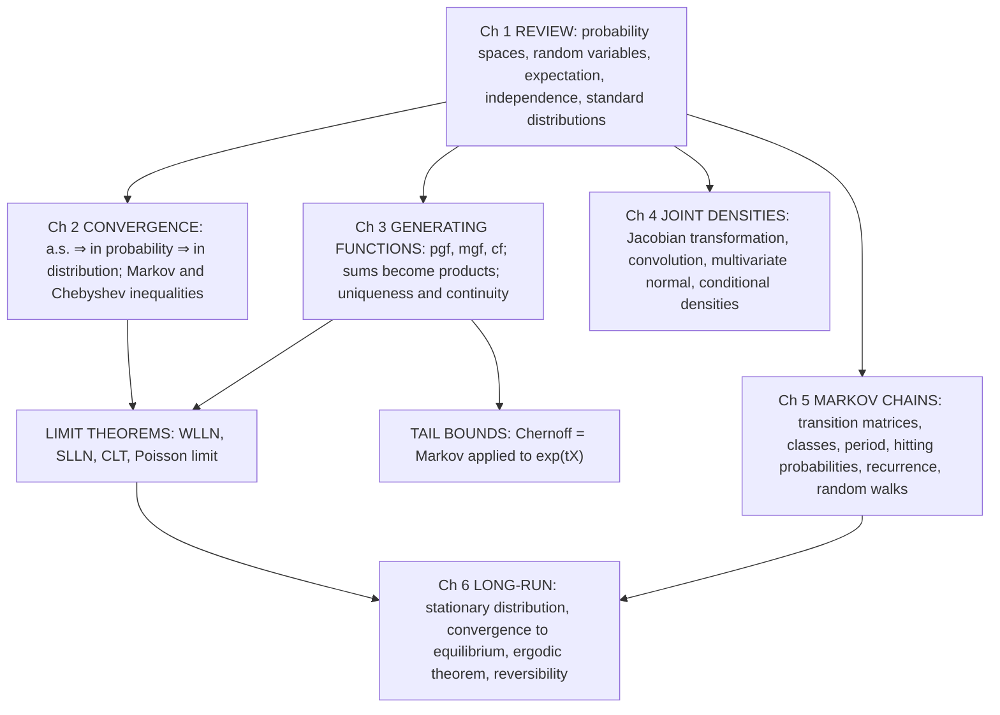

# A8 Probability (Part A) — Course Summary

*Oxford, Michaelmas Term 2025 · lecture notes by James Martin (version of 28 Nov 2025). This page is the overview; the details live in four linked files, because GitHub stops rendering math beyond a few hundred formulas per file.*

| File | Covers |
|---|---|
| **This page** | Big picture, how everything connects, proof techniques, what's examinable |
| [Part 1 — Foundations & Limit Theorems](A8-1-Foundations-and-Limit-Theorems.md) | Ch 1 review (spaces, RVs, expectation, independence, distributions) · Ch 2 modes of convergence, Markov/Chebyshev, WLLN, SLLN, CLT |
| [Part 2 — Generating Functions & Joint Densities](A8-2-Generating-Functions-and-Joint-Densities.md) | Ch 3 pgf/mgf/cf, CLT proof, Chernoff · Ch 4 transformation formula, multivariate normal, conditional densities, Borel paradox |
| [Part 3a — Markov Chains: Basics](A8-3a-Markov-Chains.md) | Ch 5 definitions, $`n`$-step probabilities, classes, periodicity, hitting probabilities, recurrence, random walks in $`\mathbb{Z}^d`$, mean hitting times |
| [Part 3b — Markov Chains: Long-Run Behaviour](A8-3b-Markov-Chains-Long-Run.md) | Ch 6 stationary distributions, convergence to equilibrium, ergodic theorem, proof ideas (coupling), time-reversal & detailed balance |
| [Formula Sheet](A8-4-Formula-Sheet.md) | Distribution tables, every key formula, concepts not to confuse, top mistakes |

---

## 1. The big picture

The course answers three questions:

1. **What happens when you add up lots of independent random variables?** (Ch 2–3)
   *Law of large numbers:* $`S_n/n \to \mu`$. *Central limit theorem:* $`S_n \approx n\mu + \sigma\sqrt n\,Z`$ with $`Z \sim N(0,1)`$. To even state these we need precise **modes of convergence**; to prove them we use **generating functions**, which turn sums into products.
2. **How do several continuous random variables behave together?** (Ch 4)
   Joint densities, **changing variables** (Jacobian), sums (convolution), the **multivariate normal**, and **conditioning** on a continuous variable (a limit, with a paradox).
3. **What if the variables are dependent, but only through the present?** (Ch 5–6)
   **Markov chains:** the future depends on the past only via the current state. We classify states (classes, period, recurrence), compute hitting probabilities/times by **first-step analysis**, and describe **long-run behaviour** (stationary distributions, convergence, ergodic theorem, reversibility).

## 2. How it all ties together

| Thread | Where it appears |
|---|---|
| **"Independence means multiply"** | $`\mathbb{P}(A \cap B) = \mathbb{P}(A)\mathbb{P}(B)`$ · $`\mathbb{E}XY = \mathbb{E}X\,\mathbb{E}Y`$ · variances of independent sums add · $`G_{X+Y} = G_XG_Y`$, $`M_{X+Y} = M_XM_Y`$ · joint density factorises · path probabilities of a Markov chain are products |
| **Markov's inequality** | Chebyshev ($`(X-\mu)^2`$) → WLLN · Chernoff ($`e^{tX}`$) → exponential tail bounds · mgf finite ⇒ exponential tails |
| **Continuity of probability** ($`A_n \uparrow`$) | a.s. ⇒ in probability · counterexample to the converse · minimality of hitting probabilities |
| **Taylor + $`(1 + a/n)^n \to e^a`$** | Poisson limit of the binomial · geometric → exponential · WLLN and CLT via mgfs |
| **Uniqueness + continuity theorems** | identify sums of normals/Gammas/Poissons · prove CLT/WLLN · cfs handle heavy tails (Cauchy) |
| **Change of variables** | Jacobian formula · multivariate normal from i.i.d. normals · polar coordinates · Borel's paradox (conditioning isn't invariant) |
| **"Write it as (function of $`X`$) + (independent noise)"** | bivariate-normal conditional · Markov criterion $`Y_{n+1} = f(Y_n, X_{n+1})`$ |
| **First-step analysis + minimal solution** | hitting probabilities · mean hitting times · gambler's ruin · mean return times |
| **Expected number of visits** | recurrence ⇔ $`\sum p^{(n)}_{ii} = \infty`$ · Pólya's random walks (Stirling) |
| **Laws of large numbers again** | the ergodic theorem *is* the SLLN applied to i.i.d. excursions, giving $`\pi_i = 1/m_i`$ |
| **Convergence in distribution again** | convergence to equilibrium $`\mathbb{P}(X_n = j) \to \pi_j`$ is convergence in distribution of $`X_n`$ to $`\pi`$ |

## 3. The big takeaways (if you remember nothing else)
1. **Three modes of convergence:** a.s. ⇒ in probability ⇒ in distribution; the reverse fails, except that convergence in distribution to a **constant** gives convergence in probability.
2. **WLLN** (in probability), **SLLN** (a.s.), **CLT** $`\frac{S_n - n\mu}{\sigma\sqrt n} \xrightarrow{d} N(0,1)`$: concentration at $`n\mu`$, fluctuations of order $`\sqrt n`$, normal shape.
3. **Markov ⇒ Chebyshev ⇒ WLLN;** Markov on $`e^{tX}`$ ⇒ Chernoff bounds (exponential decay).
4. **Generating functions:** sums ↔ products, random sums ↔ composition $`G_N(G_X)`$, moments ↔ derivatives, convergence of mgfs/cfs ↔ convergence in distribution. mgfs need exponential tails; cfs always exist.
5. **Transformation formula:** $`f_{U,V} = f_{X,Y}(x(u,v), y(u,v))\lvert J\rvert`$. Check one-to-one, find the new support, factorise + product support ⇒ independent.
6. **Multivariate normal** = linear image of i.i.d. normals, $`\Sigma = AA^T`$. Jointly normal: uncorrelated ⇔ independent; $`Y \mid X`$ is normal with variance $`(1-\rho^2)\sigma_2^2`$.
7. **Conditional density** $`f_{Y\mid X=x} = f_{X,Y}/f_X`$ is a limit; it depends on coordinates (Borel paradox).
8. **Markov chain** = $`(\lambda, P)`$: path probabilities multiply, $`P^{(n)} = P^n`$, $`X_n \sim \lambda P^n`$.
9. **Hitting probabilities / mean hitting times** = minimal non-negative solutions of the first-step equations.
10. **Recurrence** ⇔ $`\sum p^{(n)}_{ii} = \infty`$; class property; finite chains: recurrent ⇔ closed. SRW on $`\mathbb{Z}^d`$: recurrent iff $`d \le 2`$.
11. **Irreducible:** stationary $`\pi`$ exists ⇔ positive recurrent, with $`\pi_i = 1/m_i`$. **+ aperiodic:** $`p^{(n)}_{ij} \to \pi_j`$. **Ergodic theorem:** the fraction of time at $`i`$ → $`1/m_i`$.
12. **Detailed balance** $`\pi_ip_{ij} = \pi_jp_{ji}`$ ⇒ stationary & reversible: try it first.

## 4. Proof toolkit (techniques worth practising)

| Technique | Template | Used for |
|---|---|---|
| **Indicator domination** | $`X \ge z\mathbf{1}\{X \ge z\}`$, take expectations | Markov's inequality |
| **Apply Markov to a clever function** | $`g(X) = (X-\mu)^2`$ or $`e^{tX}`$; then optimise | Chebyshev, Chernoff, mgf ⇒ exponential tails |
| **Continuity of probability** | rewrite $`\bigcup A_n`$ as a disjoint union | Lemma 2.5, a.s. ⇒ P, minimality |
| **Sandwich cdfs** | $`\{X_n \le x\} \subseteq \{X \le x+\epsilon\} \cup \{\lvert X_n - X\rvert > \epsilon\}`$ | P ⇒ d |
| **Telescoping product** | $`\prod \frac{n-1}{n} = \frac{N-1}{N+K}`$ | P ⇏ a.s. |
| **Fourth-moment / summable expectation** | $`\mathbb{E}\sum Z_n < \infty \Rightarrow \sum Z_n < \infty`$ a.s. $`\Rightarrow Z_n \to 0`$ | SLLN (non-exam) |
| **mgf Taylor expansion** | $`M(h) = 1 + h\mu + \frac{h^2}{2}\mathbb{E}X^2 + o(h^2)`$, raise to $`n`$ | WLLN, CLT |
| **Completing the square** | $`tz - z^2/2 = t^2/2 - (z-t)^2/2`$ | normal mgf |
| **"It's a density, so it integrates to 1"** | recognise $`\int(\lambda - t)e^{-(\lambda-t)x}dx = 1`$ | mgf computations (state the domain!) |
| **Condition on $`N`$ (law of total expectation)** | $`\mathbb{E}z^{S} = \sum_n \mathbb{E}(z^S \mid N = n)\mathbb{P}(N = n)`$ | random sums |
| **Jacobian change of variables** | invert, $`\lvert J\rvert`$, support | transformations, MVN |
| **Normalising-constant trick** | conditional density ∝ joint density in $`y`$ | Ex. 4.6, Borel paradox |
| **Chain rule + Markov property** | $`\mathbb{P}(\text{path}) = \prod`$ conditionals | Thm 5.1, Chapman–Kolmogorov, time reversal |
| **Fresh-randomness representation** | $`Y_{n+1} = f(Y_n, X_{n+1})`$ | proving the Markov property |
| **First-step analysis** | condition on $`X_1`$ | hitting probabilities, mean times, return times |
| **Induction on the time horizon $`M`$** | $`x_i \ge \mathbb{P}_i(\text{hit by } M)`$ | minimality (Thm 5.10, 5.13) |
| **Expected number of visits** | $`\mathbb{E}_i V = \sum p^{(n)}_{ii}`$ vs geometric | recurrence criterion |
| **Stirling + sum test** | $`p^{(2m)}_{00} \asymp m^{-d/2}`$ | Pólya's theorem |
| **Projection / sub-walk** | rotate $`\mathbb{Z}^2`$ into two independent 1-d walks; project $`\mathbb{Z}^d`$ to $`\mathbb{Z}^3`$ | $`d = 2`$ recurrence, $`d \ge 4`$ transience |
| **Coupling** | run two chains until they meet | convergence to equilibrium (non-exam) |
| **Detailed balance / flow argument** | up- and down-crossings of an edge alternate | reversibility of trees, birth–death chains |

## 5. What's examinable
- **Examinable proofs/derivations** (inferred: everything not explicitly marked non-examinable): Lemma 2.5; Theorem 2.4 (all four parts); Markov; Chebyshev; WLLN (finite variance); Example 2.3; Poisson limit; random-sum pgf; Theorem 3.3; mgf/cf examples; WLLN & CLT via mgfs; Chernoff for SRW; Theorem 4.1 and its examples; bivariate normal conditional; Theorems 5.1, 5.2, 5.3, Proposition 5.8; class/period facts; Theorems 5.10, 5.11, 5.13; gambler's ruin; random walks in $`\mathbb{Z}^d`$; Theorems 6.12, 6.14 and examples.
- **Explicitly non-examinable:** the proof of the SLLN (§2.5.1); the **proofs** of Theorems 6.1, 6.2, 6.3 (§6.3). The *statements* of those theorems **are** examinable.
- **Stated without proof:** uniqueness/continuity theorems for mgfs and cfs (3.5, 3.6).

## 6. Exam checklist
- [ ] For convergence questions: identify the mode, and use a cdf argument (for $`d`$), Chebyshev/Markov (for $`P`$), or continuity of probability / summability (for a.s.).
- [ ] For limit theorems: check **i.i.d.**, **finite mean/variance**, and use the correct centring and scaling.
- [ ] For mgfs: state the **domain**; check finiteness near 0 before invoking uniqueness/continuity.
- [ ] For transformations: one-to-one? inverse? $`\lvert J\rvert`$? new **support**? marginals by integrating out?
- [ ] For conditional densities: write $`f_{X,Y}/f_X`$, treat $`f_X`$ as a constant, read off the shape.
- [ ] For Markov chains: draw the transition diagram, find the classes (closed? periods?), then use first-step equations with **minimal** solutions.
- [ ] For stationary distributions: try **detailed balance** first; otherwise solve $`\pi P = \pi`$ (left eigenvector) and **normalise**; use $`m_i = 1/\pi_i`$.
- [ ] Before claiming $`p^{(n)}_{ij} \to \pi_j`$: irreducible ✓ aperiodic ✓ positive recurrent ✓.

## 7. Notational conventions in the notes
$`\mathbb{P}_i, \mathbb{E}_i`$ = conditioned on $`X_0 = i`$ · $`\mathbf{1}_A`$ or $`I(A)`$ = indicator · $`\overset{d}{=}`$ = equal in distribution · $`\xrightarrow{P}, \xrightarrow{d}`$ = convergence in probability / distribution · $`p^{(n)}_{ij}`$ = $`n`$-step transition probability · $`h^A_i, k^A_i`$ = hitting probability / mean hitting time · $`m_i`$ = mean return time · $`V_i(n)`$ = number of visits to $`i`$ before time $`n`$ · $`\Phi`$ = standard normal cdf · Geometric($`p`$) may mean support $`\{1,2,\dots\}`$ or $`\{0,1,\dots\}`$: say which.
